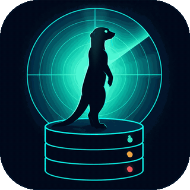
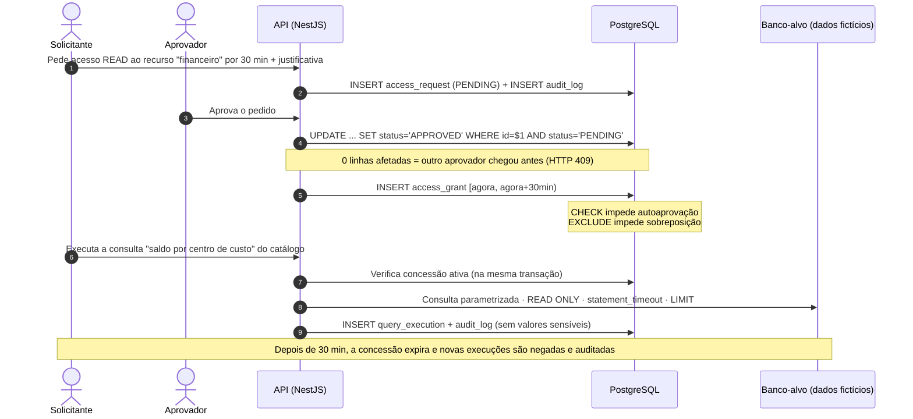
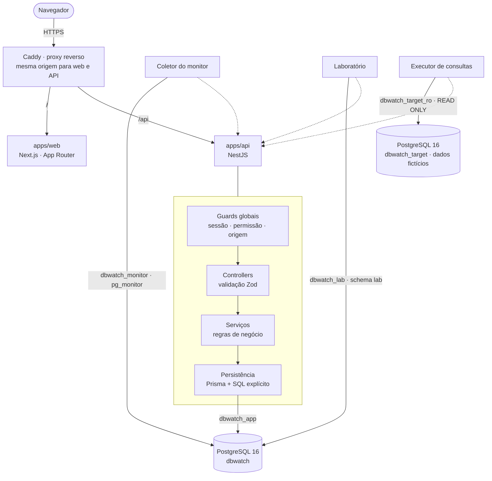
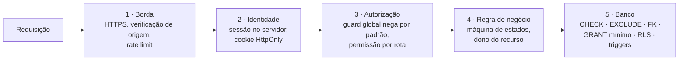

<div align="center">

<picture>
  <source media="(prefers-reduced-motion: reduce)" srcset="docs/assets/brand/dbwatch-icon-512.png">
  
</picture>

# DBWATCH

**Gerenciamento de acessos privilegiados e monitoramento de PostgreSQL, com cada ação registrada em uma trilha de auditoria protegida.**

[](docs/ROADMAP.md)
[](docs/DATA_MODEL.md)
[](docs/ARCHITECTURE.md)
[](docs/DESIGN.md)
[](docs/DECISIONS.md)
[](#-contexto-acadêmico)

[O que é](#-o-que-é-o-dbwatch) •
[Visão geral](#-visão-geral) •
[Arquitetura](#-arquitetura) •
[Segurança](#-segurança-o-backend-nunca-confia-no-front) •
[Monitor](#-database-monitor) •
[Laboratório](#-laboratório-de-concorrência) •
[Testes](#-testes) •
[Roadmap](#-roadmap) •
[Documentação](#-documentação)

</div>

---

> [!IMPORTANT]
> **Estado atual: fundação, papéis do banco e auditoria protegida prontos (PK-01 a PK-03), implementação em andamento.**
> Este README descreve o sistema **projetado**. A tabela [Status de implementação](#-status-de-implementação) mostra o que já existe e o que ainda é plano. Nada aqui afirma que uma funcionalidade funciona antes de ela estar implementada e testada.

## 💡 O que é o DBWATCH?

O **DBWATCH** é uma plataforma que **controla quem pode entrar nos bancos de dados de uma empresa** e **vigia o que acontece lá dentro**, guardando um histórico de tudo que não pode ser apagado nem alterado sem que se perceba.

Ele junta duas coisas que normalmente vivem separadas:

- **um PAM** (*Privileged Access Management*), que é o "porteiro" dos acessos privilegiados: ninguém tem a chave para sempre. Quem precisa pede, explica o motivo, outra pessoa aprova, e o acesso **expira sozinho**;
- **um monitor de PostgreSQL**, que é o "vigia": mostra em tempo real as sessões abertas, quem está travando quem (locks), quando o banco precisou abortar uma transação (deadlock) e quantas operações foram desfeitas (rollback).

Entre os dois fica a **auditoria**, o "livro de registro": cada pedido, aprovação, negação, consulta e falha vira um registro protegido, ligado aos eventos do banco por um identificador comum.

### Um exemplo concreto

> São 2h da manhã e o fechamento financeiro travou. O Diego, desenvolvedor de plantão, precisa olhar a tabela de lançamentos.
>
> 1. No DBWATCH, ele **pede acesso de leitura** ao banco "financeiro" por 30 minutos, com a justificativa "investigar o incidente INC‑42".
> 2. O Bruno, DBA líder, recebe o pedido e **aprova**. O Diego não conseguiria aprovar o próprio pedido: o banco de dados recusaria.
> 3. O Diego executa as consultas permitidas e, no monitor, os dois veem **uma transação travando as outras**.
> 4. Depois de 30 minutos, o acesso **some sozinho**.
> 5. Na semana seguinte, a Eva, da auditoria, filtra pelo incidente e vê **toda a história**: quem pediu, quem aprovou, o que foi consultado e quando. Ela ainda pode **provar** que ninguém mexeu nesse histórico.

### Para quem é

| Pessoa | O que ganha |
| --- | --- |
| Desenvolvedor ou analista | Acesso rápido e justificado quando precisa, sem depender de uma senha compartilhada |
| DBA ou líder técnico | Controle de quem entra, por quanto tempo, e visão dos locks e deadlocks |
| Auditor ou segurança | Resposta confiável para "quem fez o quê, quando e com autorização de quem" |
| Professores e estudantes | Conceitos de persistência (transações, isolamento, locks, deadlocks, constraints e índices) **acontecendo de verdade**, num produto real |

## 🔭 Visão geral

Acessos privilegiados a bancos de dados (de DBAs, desenvolvedores em incidentes e analistas) costumam ser permanentes, compartilhados e sem rastro. O DBWATCH ataca esse problema com três pilares que se conectam:

```mermaid
flowchart LR
    subgraph A["🔐 Pilar A: PAM"]
        A1[Usuários e papéis]
        A2[Solicitação de acesso]
        A3[Aprovação por outra pessoa]
        A4[Concessão temporária]
    end
    subgraph B["📡 Pilar B: Database Monitor"]
        B1[Sessões e transações]
        B2[Locks e bloqueios]
        B3[Deadlocks e rollbacks]
        B4[Eventos da aplicação]
    end
    subgraph C["🧾 Pilar C: Auditoria"]
        C1[Quem · o quê · quando]
        C2[Resultado e motivo]
        C3[Correlação entre eventos]
        C4[Proteção contra alteração]
    end
    A -- toda ação gera --> C
    B -- todo evento relevante gera --> C
    A -. "correlation_id" .- B
```



### Pilar A: PAM (Privileged Access Management)

Controla **quem pode acessar o quê, por quanto tempo e com aprovação de quem**.

- **Ninguém tem acesso permanente** a um recurso sensível. O acesso é pedido, justificado, aprovado e expira sozinho.
- **Quem pede não aprova.** A separação de funções é garantida por uma `CHECK constraint` no banco, não só por um `if` no código.
- **Concessões não se sobrepõem.** Uma `EXCLUDE constraint` com intervalos de tempo (`tstzrange`) impede duas concessões ativas do mesmo usuário para o mesmo recurso.
- **Nada de SQL livre.** Com uma concessão ativa, o usuário executa apenas **consultas parametrizadas de um catálogo aprovado**, em transação somente leitura, com tempo-limite e limite de linhas.
- **Tudo vai para a auditoria:** pedidos, aprovações, negações, revogações, expirações e tentativas negadas.

### Pilar B: Database Monitor

Observa o comportamento real do PostgreSQL e da aplicação, **sempre identificando a fonte de cada informação**:

| Fonte | Mecanismo | Exemplos |
| --- | --- | --- |
| `POSTGRES_OBSERVED` | Amostragem periódica das views nativas `pg_stat_activity`, `pg_locks` + `pg_blocking_pids()`, `pg_stat_database` e `pg_stat_user_tables`, por um papel com `pg_monitor` | Sessões ativas, quem bloqueia quem, contador de deadlocks, commits × rollbacks, seq scan × index scan |
| `APPLICATION` | Registro feito pela própria API ao final de cada transação relevante | Commit, rollback, SQLSTATE do erro (`40P01`, `40001`, `23505`…), duração |
| `LAB` | Cenários controlados do laboratório, sempre rotulados como experimento | Lock wait provocado, deadlock provocado, anomalias de isolamento |

> [!NOTE]
> O DBWATCH **não lê o log do servidor** do PostgreSQL no MVP. Portanto, detalhes de deadlock que só aparecem no log (como as queries envolvidas) não são exibidos. O que mostramos são o **contador nativo** de deadlocks e o **erro `40P01` recebido pela aplicação**. Essa limitação está documentada em [ARCHITECTURE.md](docs/ARCHITECTURE.md#42-limites-de-visibilidade).

### Pilar C: Auditoria

Conecta os dois pilares. Cada registro responde: **quem, o quê, quando, em qual recurso, com qual resultado e por quê**, além de um `correlation_id` que liga a requisição HTTP, a transação e os eventos do monitor.

A tabela de auditoria é protegida em **quatro camadas**:

1. **Permissões:** o papel da aplicação só tem `INSERT` e `SELECT`. `UPDATE`, `DELETE` e `TRUNCATE` são revogados.
2. **Triggers:** qualquer `UPDATE`, `DELETE` ou `TRUNCATE` dispara uma exceção, mesmo que alguém conceda a permissão por engano.
3. **Cadeia de hash:** cada linha guarda o SHA-256 da linha anterior, como numa blockchain simplificada. Alterar um registro antigo, mesmo como superusuário, quebra a cadeia, e um endpoint de verificação aponta exatamente onde.
4. **Leitura controlada:** só quem tem a permissão `audit:read` consulta a trilha, e a própria consulta também é auditada.

> [!WARNING]
> Um superusuário do PostgreSQL consegue desabilitar triggers. A cadeia de hash **não impede** essa alteração, mas a **detecta**. Ser honesto sobre esse limite faz parte do projeto.

## 🔄 Como funciona um acesso privilegiado



## 🏗️ Arquitetura



| Componente | Responsabilidade |
| --- | --- |
| **`apps/api`** (NestJS) | **O carro-chefe.** É a única fronteira de confiança: autenticação, autorização, regras do PAM, auditoria, coleta do monitor e laboratório. |
| **`apps/web`** (Next.js) | Interface. Não toma decisões de segurança. Esconder um botão é questão de usabilidade; quem bloqueia é a API. |
| **`packages/contracts`** | Schemas Zod e tipos compartilhados. O mesmo contrato valida a entrada na API e os formulários na web. |
| **PostgreSQL `dbwatch`** | Dados do produto em schemas separados: `iam`, `pam`, `audit`, `monitor` e `lab`. Também é a **última linha de defesa**, com constraints, triggers, grants e RLS. |
| **PostgreSQL `dbwatch_target`** | Banco-alvo com dados **fictícios**, que representa o "servidor sensível" protegido pelo PAM. |
| **Caddy** | Proxy reverso e HTTPS na VPS. Mantém web e API na mesma origem, o que permite cookies `SameSite=Strict`. |

Detalhes completos, fluxos e limites estão em **[docs/ARCHITECTURE.md](docs/ARCHITECTURE.md)**.

## 🧰 Stack

| Camada | Tecnologia | Por que esta, e não outra |
| --- | --- | --- |
| Banco | **PostgreSQL 16** | Tem tudo o que a disciplina pede, de verdade: MVCC, níveis de isolamento, detecção de deadlock, `pg_locks`, `EXCLUDE`, RLS, BRIN e `EXPLAIN ANALYZE`. |
| API | **NestJS + TypeScript** | Módulos, guards e pipes deixam explícita a separação entre controller, serviço e persistência. Guards globais permitem negar por padrão. |
| ORM | **Prisma** (versão estável fixada) | Migrations versionadas e tipagem forte no CRUD. |
| SQL explícito | **`pg`** (node-postgres) | Para o que um ORM esconde: conexões dedicadas no laboratório, `SELECT … FOR UPDATE`, leitura das views `pg_stat_*` e controle fino de transações. Sempre parametrizado. |
| Web | **Next.js (App Router) + TypeScript** | Rotas por pasta, layouts aninhados e fontes servidas localmente. |
| Estilo | **Tailwind CSS** + tokens próprios | Modo claro e escuro por tokens CSS, com contraste verificado. |
| Componentes | **Radix UI primitives** (só onde precisa) | Diálogos, menus e abas acessíveis por teclado e leitor de tela, sem um kit visual pronto. |
| Animação | **Motion** | Animações com significado: a varredura do radar, o fluxo de eventos e o grafo de locks. Respeita `prefers-reduced-motion`. |
| Validação | **Zod** | Um único schema para API e web. Objetos estritos bloqueiam *mass assignment*. |
| Senhas | **Argon2id** | Algoritmo recomendado pelo OWASP para hash de senhas. |
| Testes | **Vitest** · **Playwright** · **axe-core** | Unidade e integração contra PostgreSQL real · E2E no navegador · acessibilidade. |
| Ambiente | **Docker Compose** + **pnpm workspaces** | Um comando sobe tudo. Monorepo sem ferramenta extra de build. |

Cada escolha tem uma decisão registrada em **[docs/DECISIONS.md](docs/DECISIONS.md)**, com alternativas e trade-offs.

## 🛡️ Segurança: o backend nunca confia no front

Num PAM, a interface é só uma vitrine. **Toda decisão é tomada e verificada no servidor e, sempre que possível, garantida também pelo banco.** Usamos defesa em profundidade:



| Ameaça | Controle no DBWATCH |
| --- | --- |
| Senha vazada do banco de dados da aplicação | Argon2id com salt individual. A senha nunca é registrada em log. |
| Força bruta no login | Bloqueio progressivo persistido por conta, limite de tentativas por IP e mensagem de erro genérica. |
| Roubo ou fixação de sessão | Token aleatório de 256 bits. **Só o hash do token** fica no banco. Cookie `HttpOnly`, `Secure` e `SameSite=Strict`. Sessão rotacionada no login, com expiração por inatividade e expiração absoluta. Revogação imediata. |
| CSRF | `SameSite=Strict` e verificação do cabeçalho `Origin` em toda requisição que altera estado. |
| Escalada de privilégio ou IDOR | Guard global que **nega por padrão**, permissões por rota, verificação de dono no serviço e **Row Level Security** como rede de segurança no banco. |
| Autoaprovação | Regra no serviço **e** `CHECK (decided_by <> requester_id)` no banco. |
| Corrida entre dois aprovadores | `UPDATE … WHERE status = 'PENDING'` atômico, com `HTTP 409` para quem perder. Coberto por teste de concorrência. |
| SQL injection | Apenas consultas parametrizadas. Sem SQL dinâmico vindo do usuário. O catálogo de consultas é versionado em migrations, não editável pela API. |
| Adulteração da auditoria | Grants mínimos, triggers e cadeia de hash verificável. |
| Vazamento por erro | Filtro global de exceções devolve mensagens neutras e um `correlation_id`. Detalhes ficam só no log do servidor, sem segredos. |
| Segredos no repositório | Apenas `.env.example` é versionado. Credenciais diferentes para cada papel do banco. |

Modelo de ameaças completo (STRIDE), papéis do banco e política de segredos: **[docs/SECURITY.md](docs/SECURITY.md)**.

## 📡 Database Monitor

O monitor responde a perguntas que um DBA faz durante um incidente:

- **Quem está conectado e o que está fazendo?** Estado de cada sessão, idade da transação e evento de espera.
- **Quem está bloqueando quem?** A cadeia de bloqueio montada com `pg_blocking_pids()`, desenhada como um grafo animado.
- **O banco está saudável?** Taxa de commits × rollbacks, deadlocks no período, *cache hit ratio* e tabelas com muitos *seq scans*.
- **O que a aplicação viu?** Erros por SQLSTATE, transações mais lentas e rollbacks por operação.

Como funciona por baixo:

1. Um coletor na API lê as views `pg_stat_*` em intervalos regulares, com o papel `dbwatch_monitor` (membro do papel nativo `pg_monitor`).
2. Cada leitura vira uma **amostra** no schema `monitor`. As views do PostgreSQL mostram só o *agora* ou contadores acumulados; as amostras guardam a **história**.
3. As taxas são calculadas em SQL com funções de janela (`LAG()`) sobre os contadores acumulados.
4. O texto das queries **não é armazenado**, porque pode conter dados sensíveis em literais. Guardamos só o tipo do comando e metadados.
5. A API identifica cada transação com `application_name = 'dbwatch:<correlation_id>'`. Assim, uma sessão vista em `pg_stat_activity` pode ser ligada à requisição HTTP que a abriu.

## 🧪 Laboratório de concorrência

Experimentos **reais e reproduzíveis**, executados em um schema isolado (`lab`) com dados descartáveis e um papel de banco sem acesso ao resto do sistema. Cada execução é rotulada como `LAB`.

| Cenário | O que você vê acontecer | Conceito |
| --- | --- | --- |
| **Transferência com falha** | Uma transferência entre contas viola `CHECK (saldo >= 0)` no meio da transação, e o `ROLLBACK` desfaz até o débito que já tinha sido feito. | Atomicidade, COMMIT e ROLLBACK |
| **Espera por lock** | A sessão A atualiza uma linha. A sessão B tenta atualizar a mesma linha e fica esperando. O monitor desenha "A bloqueia B" ao vivo. A confirma e B segue. | Locks de linha, `pg_locks` |
| **Deadlock** | A trava a linha 1 e quer a 2. B trava a 2 e quer a 1. Depois de `deadlock_timeout`, o PostgreSQL **aborta uma das transações** com `40P01`, e o contador nativo de deadlocks sobe. | Detecção de deadlock |
| **Leitura não repetível** | A mesma consulta, duas vezes na mesma transação, devolve valores diferentes em `READ COMMITTED` e iguais em `REPEATABLE READ`. | Níveis de isolamento, MVCC |
| **Write skew** | Dois aprovadores saem de plantão ao mesmo tempo e não sobra nenhum. Em `SERIALIZABLE`, uma das transações falha com `40001`. | Anomalias de serialização |
| **Índices** | `EXPLAIN (ANALYZE, BUFFERS)` da mesma consulta sem índice, com B-tree e com BRIN, sobre centenas de milhares de linhas. | Planos de execução e custo |

> [!NOTE]
> Nenhum cenário deixa uma transação aberta sem limite. Todos usam `lock_timeout`, `statement_timeout` e `idle_in_transaction_session_timeout`, e só um experimento roda por vez, controlado por um *advisory lock*.

## 🎓 Objetivo acadêmico

Disciplina **Software para Persistência de Dados**. O DBWATCH foi desenhado para que **cada conceito tenha um lugar real no produto**, e não um exemplo isolado:

| Conceito | Onde aparece no DBWATCH |
| --- | --- |
| Modelagem relacional e normalização | `iam`: usuários, papéis e permissões em N:N normalizado, com tabelas associativas e chaves compostas |
| Chaves e integridade referencial | FKs com `ON DELETE RESTRICT` onde apagar quebraria a história (usuários são desativados, nunca apagados) |
| Constraints | `CHECK` de separação de funções, `EXCLUDE USING gist` contra sobreposição de concessões, `UNIQUE` parcial (um pedido pendente por recurso) |
| Transações, COMMIT e ROLLBACK | Aprovação e concessão na mesma transação. Auditoria de falhas gravada **fora** da transação que falhou, senão o rollback apagaria o registro da falha. |
| Isolamento | Laboratório de leitura não repetível e de write skew. A cadeia de hash exige `READ COMMITTED`, e o motivo está documentado. |
| Concorrência e locks | Aprovação concorrente com `UPDATE` condicional, *advisory locks*, `SELECT … FOR UPDATE` |
| Deadlocks | Cenário real no laboratório, contador nativo e tratamento do erro `40P01` com nova tentativa |
| Índices e análise de consultas | Índice de expressão (`lower(email)`), índices parciais, BRIN na auditoria e `EXPLAIN ANALYZE` antes e depois |
| Migrations | Evolução versionada do schema com Prisma Migrate, mais SQL próprio para triggers, grants e políticas |
| Segurança no banco | Papéis separados por função, `GRANT` mínimo e Row Level Security |
| Auditoria e histórico | Trilha append-only com cadeia de hash verificável |
| Testes de integridade | Testes que **tentam violar** cada constraint e esperam o SQLSTATE correto |

## 🧭 Metodologia de trabalho

Todo o desenvolvimento segue quatro níveis, nesta ordem:

| Nível | O que acontece | Onde fica registrado |
| --- | --- | --- |
| **1 · SPEC** | O que será construído e por quê: regras, fluxos, erros, segurança e critérios de aceite | [PRD.md](docs/PRD.md) |
| **2 · PACKS** | A entrega é dividida em pacotes pequenos, com escopo incluído e excluído, dependências e testes | [ROADMAP.md](docs/ROADMAP.md) |
| **3 · QA** | Depois de cada pack: testes, lint, tipos, migrations, revisão de segurança e regressão, com os resultados reais anotados | [TEST_PLAN.md](docs/TEST_PLAN.md) |
| **4 · RELEASE** | Documentação atualizada, changelog, migrations conferidas e notas de release | [CHANGELOG.md](CHANGELOG.md) |

Um pack só é dado como concluído quando os testes relevantes passam. Bloqueios são registrados, não escondidos.

### Primeira missão: descoberta e planejamento ✅

Antes de qualquer código, fizemos um diagnóstico do repositório (vazio) e do ambiente (Node 22, pnpm 10, Docker, PostgreSQL 16 e Chromium disponíveis). A partir dele definimos a arquitetura, o MVP, o modelo de dados, os riscos, o plano de testes e o roteiro da demonstração. O resultado são os documentos em [`docs/`](docs).

## ✅ Testes

O DBWATCH é testado de baixo para cima, sempre contra um **PostgreSQL real**, porque constraints, triggers, locks e isolamento não existem num mock.

```
                 ╱ E2E · Playwright ╲              fluxos críticos no navegador + acessibilidade (axe)
              ╱  Segurança e concorrência  ╲       matriz de autorização · corrida de aprovações · deadlock
          ╱     Integração (API + banco real)  ╲   endpoints, transações, rollback, auditoria
      ╱     Banco (constraints, triggers, RLS)     ╲ cada regra é testada tentando violá-la
  ╱              Unidade (regras de negócio)           ╲ máquina de estados, expiração, validação
```

Exemplos de testes que fazem parte do plano:

- Um aprovador tenta aprovar o próprio pedido → **403 na API** e, mesmo pulando a API, **`23514` (check_violation) no banco**.
- Dois aprovadores aprovam o mesmo pedido em paralelo → **exatamente um** recebe 200 e o outro recebe 409. Só **uma** concessão é criada.
- `UPDATE audit.audit_log` com o papel da aplicação → **permissão negada**. Com o dono da tabela → **exceção do trigger**. Adulteração como superusuário → o **verificador aponta a linha quebrada**.
- Para **cada rota × cada papel**, o status esperado (200, 401 ou 403) é verificado numa matriz gerada automaticamente.
- Payloads de SQL injection nos filtros da auditoria → tratados como texto e devolvidos sem erro de sintaxe SQL.

Estratégia completa, metas de cobertura e casos numerados: **[docs/TEST_PLAN.md](docs/TEST_PLAN.md)**.

## 📁 Estrutura do repositório

```text
dbwatch/
├── apps/
│   ├── api/                      # NestJS (o carro-chefe)
│   │   ├── src/
│   │   │   ├── common/           # filtro de erros, pipe Zod, correlation-id, guards globais
│   │   │   ├── database/         # PrismaService, pools pg por papel, helper de transação
│   │   │   ├── auth/             # login, sessões, hash, bloqueio por tentativas
│   │   │   ├── iam/              # usuários, papéis, permissões
│   │   │   ├── pam/              # recursos, solicitações, concessões, consultas controladas
│   │   │   ├── audit/            # gravação, consulta e verificação da cadeia de hash
│   │   │   ├── monitor/          # coletor pg_stat_*, eventos da aplicação, SSE
│   │   │   └── lab/              # cenários de concorrência (ativados por variável de ambiente)
│   │   ├── prisma/               # schema.prisma, migrations/, seed.ts
│   │   └── test/                 # unit/ · db/ · integration/ · security/ · concurrency/
│   └── web/                      # Next.js
│       ├── src/app/              # (auth)/login · (console)/dashboard, requests, approvals,
│       │                         #   grants, audit, monitor, lab, admin
│       ├── src/components/       # ui/ · charts/ · motion/
│       ├── src/lib/              # cliente da API, sessão, formatação
│       └── e2e/                  # Playwright
├── packages/
│   └── contracts/                # schemas Zod e tipos compartilhados
├── infra/
│   ├── postgres/                 # criação de papéis e bancos, parâmetros do servidor
│   ├── lab/                      # roteiros SQL dos experimentos (para rodar no psql)
│   └── deploy/                   # compose de produção e Caddyfile
├── docs/                         # PRD, arquitetura, dados, segurança, testes, demo…
├── docker-compose.yml
├── pnpm-workspace.yaml
└── package.json
```

> Já existem `apps/api`, `apps/web`, o Docker Compose e o CI (PK-01). Os módulos de domínio, `packages/contracts` e `infra/` chegam nos packs seguintes.

## 🚀 Como executar

**Pré-requisitos:** Node.js 22.13 ou mais novo, pnpm 10, Docker com Compose v2 e Git.

```bash
git clone https://github.com/Gabrieldiog/DBWATCH.git
cd DBWATCH
cp .env.example .env                   # troque as senhas; nunca use credenciais reais
pnpm install
docker compose up -d --wait            # PostgreSQL 16 (5432) e testes (5433), já com os papéis do banco
pnpm db:migrate                        # aplica as migrations com o papel dbwatch_migrator
pnpm db:target                         # banco-alvo com dados fictícios para as consultas controladas
pnpm db:seed                           # usuários de demonstração; as senhas aparecem só no terminal
pnpm dev                               # web em http://localhost:3000 · API em http://localhost:3000/api
```

Abra http://localhost:3000: a página mostra o estado **real** do PostgreSQL, medido pela API. A rota `GET /api/health` responde `200` com o banco no ar e `503` quando ele cai.

A documentação interativa da API fica em http://localhost:3000/api/docs (Swagger). Entre com um usuário do `pnpm db:seed` em `POST /api/auth/login` e o cookie de sessão passa a valer para as outras rotas.

| Comando | O que faz | Disponível |
| --- | --- | --- |
| `pnpm dev` | API (NestJS) e web (Next.js) com recarga automática | ✅ |
| `pnpm test` | Testes unitários, de banco (constraints, privilégios, auditoria) e de integração contra o PostgreSQL de testes | ✅ |
| `pnpm test:report` | Roda a suíte e gera o relatório exibido em http://localhost:3000/testes | ✅ |
| `pnpm lint` · `pnpm typecheck` | Qualidade estática | ✅ |
| `pnpm build` | Build de produção dos dois apps | ✅ |
| `pnpm db:migrate` · `pnpm db:status` | Aplica e confere as migrations | ✅ |
| `pnpm db:seed` | Usuários fictícios de demonstração, um por papel, com senhas aleatórias | ✅ |
| `pnpm test:e2e` | Fluxos no navegador com Playwright | PK-10 |
| `pnpm lab:<cenario>` | Experimentos do laboratório pelo terminal | PK-09 |

## 🗺️ Roadmap

Apresentação: **11 de novembro de 2026**. O plano completo, com dependências e a linha de corte do MVP, está em **[docs/ROADMAP.md](docs/ROADMAP.md)**.

| Fase | Packs | Entrega |
| --- | --- | --- |
| **P0 · Fundação** | PK-01, PK-02 | Monorepo, Docker, PostgreSQL com papéis separados, primeiras migrations, harness de testes |
| **P1 · Segurança e persistência** | PK-03 a PK-07 | Auditoria protegida, autenticação, RBAC, solicitações e aprovações, concessões temporárias e consultas controladas |
| **P2 · Monitoramento** | PK-08 a PK-12 | Coletor, laboratório, interface completa e dashboard com motion |
| **P3 · Refinamento** | PK-13 a PK-15 | QA final, deploy na VPS, release v1.0 e ensaio da apresentação |

## 📊 Status de implementação

| Item | Status |
| --- | --- |
| Diagnóstico, arquitetura e planejamento | ✅ Concluído |
| Identidade visual (logo, paleta, tipografia) | ✅ Concluído |
| Monorepo e ambiente local (PK-01) | ✅ Concluído |
| Banco, papéis e migrations (PK-02) | ✅ Concluído |
| Auditoria protegida (PK-03) | ✅ Concluído (rotas HTTP no PK-05) |
| Página de testes automatizados (`/testes`) | ✅ Concluído |
| Autenticação com sessão no servidor e Swagger (PK-04) | ✅ Concluído |
| Permissões e rotas da auditoria (PK-05) | ⏳ Próximo |
| Solicitações, aprovações e concessões (PK-06, PK-07) | 📋 Planejado |
| Monitor e laboratório (PK-08, PK-09) | 📋 Planejado |
| Interface web (PK-10 a PK-12) | 📋 Planejado |
| QA final, deploy e release (PK-13 a PK-15) | 📋 Planejado |

## 📚 Documentação

| Documento | Conteúdo |
| --- | --- |
| [PRD.md](docs/PRD.md) | Problema, personas, escopo do MVP, requisitos e especificação de cada funcionalidade |
| [ARCHITECTURE.md](docs/ARCHITECTURE.md) | Componentes, fluxos, transações, coleta do monitor e limites de visibilidade |
| [DATA_MODEL.md](docs/DATA_MODEL.md) | Entidades, diagrama ER, constraints, índices, triggers e papéis do banco |
| [SECURITY.md](docs/SECURITY.md) | Modelo de ameaças STRIDE, autenticação, autorização, segredos e limites conhecidos |
| [TEST_PLAN.md](docs/TEST_PLAN.md) | Estratégia, ferramentas, metas de cobertura e casos de teste numerados |
| [ROADMAP.md](docs/ROADMAP.md) | Packs, dependências, calendário e linha de corte do MVP |
| [DECISIONS.md](docs/DECISIONS.md) | Registro de decisões arquiteturais (ADRs) |
| [DESIGN.md](docs/DESIGN.md) | Identidade visual, tokens de cor dos modos claro e escuro, tipografia e motion |
| [DEMO.md](docs/DEMO.md) | Roteiro da apresentação no InovaTech, com plano B |
| [CHANGELOG.md](CHANGELOG.md) | Mudanças por versão |

## 👀 Por que um suricato?

Nos grupos de suricatos, sempre há um **sentinela**: ele fica em pé num ponto alto, vigiando, enquanto o resto do grupo trabalha. Quando vê perigo, dá o alarme. O DBWATCH tem esse papel diante do banco de dados: fica sobre ele, controla quem entra, observa o que acontece e registra tudo.

Os três LEDs do cilindro na logo são a linguagem visual de todo o produto:

| Cor | Significado no DBWATCH |
| :-: | --- |
| 🟢 Verde-sinal | Saudável: transação confirmada, acesso concedido |
| 🟠 Âmbar | Atenção: espera por lock, solicitação pendente, acesso perto de expirar |
| 🔴 Coral | Falha ou bloqueio: deadlock, rollback, acesso negado |

## 🎓 Contexto acadêmico

Projeto desenvolvido para a disciplina **Software para Persistência de Dados** e apresentado no **InovaTech 2026 da UniGoiás**.

O DBWATCH foi escrito do zero. Projetos open source de PAM e as documentações oficiais do PostgreSQL, do NestJS e do Next.js serviram de **referência de conceitos**. Nenhum código de terceiros foi reaproveitado como implementação pronta.

**Uso de dados:** o DBWATCH usa apenas dados fictícios. Todos os testes de concorrência rodam em ambiente isolado, com dados descartáveis.

---

<div align="center">
<sub>Feito por <a href="https://github.com/Gabrieldiog">@Gabrieldiog</a> · UniGoiás · 2026</sub>
</div>
