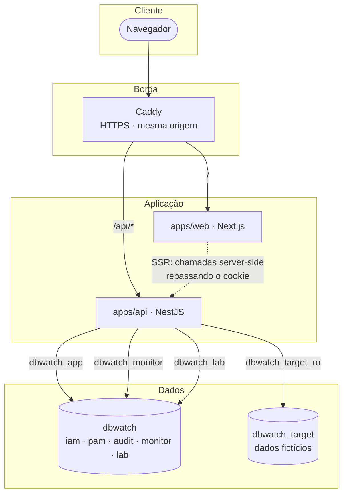
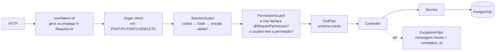
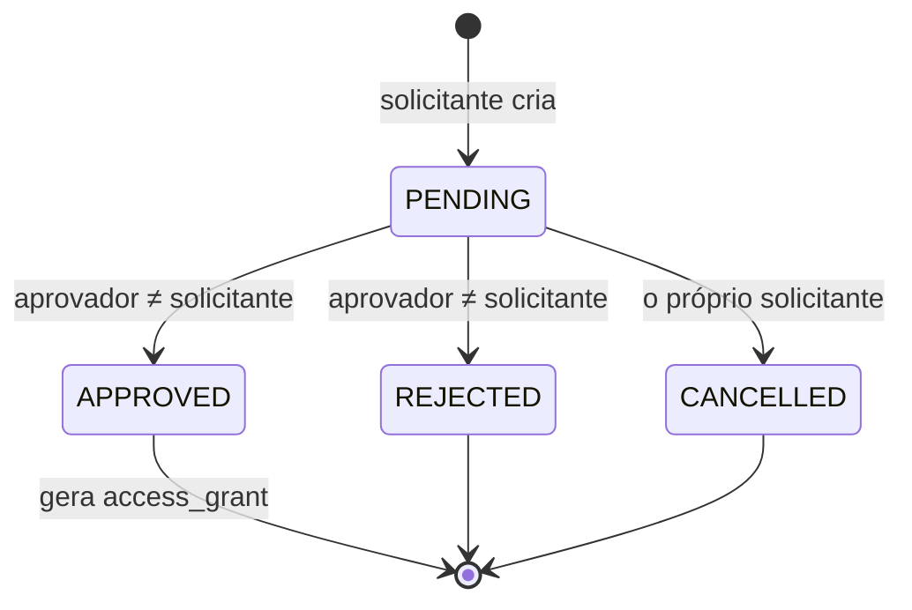
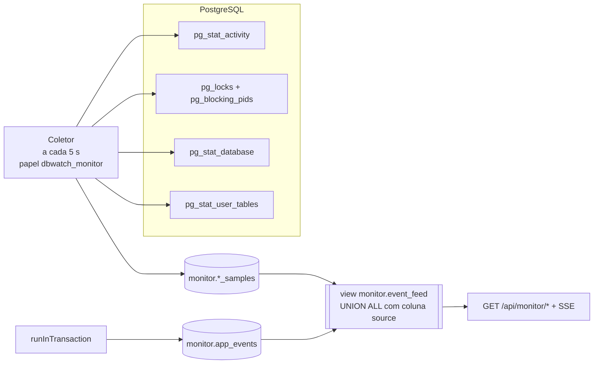
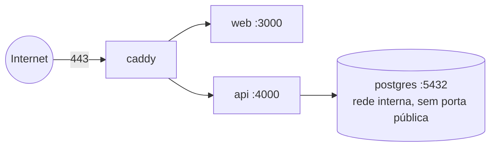

# Arquitetura do DBWATCH

> Status: **proposta para aprovação** (PK-00). Itens marcados como *hipótese* devem ser validados no PK-01.

## 1. Contexto e objetivos

O DBWATCH é um sistema acadêmico de **PAM** (Privileged Access Management) e **monitoramento de PostgreSQL**, com uma **trilha de auditoria protegida** que liga os dois. A arquitetura foi desenhada para:

1. **Ter o backend como fronteira de confiança única.** O front-end é apenas apresentação.
2. **Usar o banco como última linha de defesa.** Regras críticas são garantidas por constraints, triggers, grants e RLS, e não só pelo código.
3. **Mostrar comportamentos reais do PostgreSQL** (transações, isolamento, locks e deadlocks) de forma reproduzível.
4. **Separar com clareza** o que é observado no PostgreSQL, o que é registrado pela aplicação e o que é experimento de laboratório.
5. **Caber no prazo:** um MVP apresentável em 11/11/2026, desenvolvido por uma equipe pequena.

### Requisitos não funcionais

| Atributo | Meta do MVP |
| --- | --- |
| Escala | Dezenas de usuários simultâneos, dezenas a centenas de milhares de registros de auditoria |
| Latência | p95 < 300 ms nas rotas comuns da API, em ambiente local ou na VPS |
| Disponibilidade | Instância única (VPS de teste), sem alta disponibilidade. Reinício automático via Compose |
| Segurança | Ver [SECURITY.md](SECURITY.md). Nenhuma rota sem autorização explícita |
| Reprodutibilidade | `docker compose up` + migrations + seed recriam o ambiente inteiro |
| Observabilidade | Logs estruturados em JSON com `correlation_id`, sem segredos |

## 2. Visão de componentes



### Por que mesma origem?

Web e API ficam atrás do mesmo domínio (`/` e `/api`). Em desenvolvimento, o Next.js faz *rewrite* de `/api/*` para a API. Isso permite:

- cookie de sessão `SameSite=Strict`, que bloqueia CSRF entre sites por padrão;
- nenhuma configuração de CORS para manter;
- nenhum token exposto ao JavaScript (o cookie é `HttpOnly`).

## 3. Backend (apps/api), o carro-chefe

### 3.1 Módulos

| Módulo | Responsabilidade | Depende de |
| --- | --- | --- |
| `common` | Filtro global de exceções, pipe de validação Zod, middleware de `correlation_id`, logger estruturado, verificação de `Origin` | — |
| `database` | `PrismaService` (papel `dbwatch_app`), pools `pg` dedicados por papel e o helper `runInTransaction()` | `common` |
| `audit` | `AuditService.record()`, consulta paginada, verificação da cadeia de hash | `database` |
| `auth` | Login, logout, sessões, hash Argon2id, bloqueio por tentativas, `SessionGuard` | `database`, `audit` |
| `iam` | Usuários, papéis, permissões, `PermissionGuard` global (nega por padrão) | `auth`, `audit` |
| `pam` | Recursos, solicitações, aprovações, concessões, catálogo e execução de consultas | `iam`, `audit` |
| `monitor` | Coletor das views `pg_stat_*`, eventos da aplicação, endpoints de leitura, SSE | `database`, `iam` |
| `lab` | Cenários de concorrência, ativos só com `LAB_ENABLED=true` | `database`, `monitor`, `iam` |

### 3.2 Camadas dentro de cada módulo

```
Controller  →  recebe HTTP, valida com Zod, chama o serviço. Nenhuma regra de negócio aqui.
Service     →  regras de negócio e máquina de estados. Abre transações.
Repository  →  persistência: Prisma no CRUD e SQL parametrizado onde é preciso controle fino.
```

### 3.3 Pipeline de uma requisição



- **Nega por padrão:** uma rota sem `@RequirePermission(...)` ou `@Public()` responde 403. Um teste automatizado percorre todas as rotas registradas e falha se alguma não tiver declaração.
- **Rate limit** no login e nas rotas sensíveis.

### 3.4 Transações

O helper `runInTransaction(fn, { isolation, label })`:

1. Abre a transação com o nível de isolamento pedido (padrão `READ COMMITTED`).
2. Executa `SET LOCAL application_name = 'dbwatch:<correlation_id>'` para que a transação apareça identificada em `pg_stat_activity` (*hipótese a validar no PK-01: confirmar que a mudança aparece imediatamente na view*).
3. Executa a função.
4. Ao terminar, registra um evento da aplicação (`TX_COMMIT` ou `TX_ROLLBACK`, duração e SQLSTATE), **numa conexão separada**.
5. Em `40001` (serialization failure) ou `40P01` (deadlock), repete a transação até 3 vezes, com espera aleatória crescente, apenas em operações marcadas como idempotentes.

> **Ponto didático:** a auditoria de uma operação **que falhou** precisa ser gravada **fora** da transação que falhou. Se ficasse dentro, o `ROLLBACK` apagaria justamente o registro da falha. Já a auditoria de uma operação **bem-sucedida** fica **dentro** da mesma transação: ou tudo é confirmado, ou nada é.

### 3.5 Fluxo PAM e máquina de estados



Estado de uma concessão (`access_grant`), calculado no momento da consulta, e não por um job:

| Estado | Condição |
| --- | --- |
| `ACTIVE` | `revoked_at IS NULL AND now() >= starts_at AND now() < expires_at` |
| `EXPIRED` | `revoked_at IS NULL AND now() >= expires_at` |
| `REVOKED` | `revoked_at IS NOT NULL` |

> Calcular o estado a partir do tempo garante que a expiração é **sempre correta**, mesmo se o servidor ficar parado. Um job periódico apenas **registra na auditoria** as expirações (`grant.expired`), sem decidir nada.

### 3.6 Execução controlada de consultas

O PAM do MVP não entrega uma senha do banco ao usuário. Com uma concessão ativa, ele executa **consultas do catálogo**:

1. O catálogo (`pam.query_templates`) é criado **por migration/seed**. A API não tem rota para criar ou editar SQL.
2. Cada template declara seus parâmetros com um schema Zod, o nível de acesso exigido e o recurso.
3. A execução acontece no banco `dbwatch_target`, com o papel `dbwatch_target_ro`:
   `BEGIN READ ONLY; SET LOCAL statement_timeout = '3s'; <consulta parametrizada> LIMIT 500; COMMIT;`
4. A verificação da concessão e o registro da execução acontecem no banco `dbwatch`. A execução é auditada com os **nomes** dos parâmetros e o hash dos valores, nunca os valores em texto.

*Extensão possível depois do MVP:* credenciais efêmeras, com `CREATE ROLE ... VALID UNTIL` criada na aprovação e removida na expiração. Ficou fora do MVP porque exige o privilégio `CREATEROLE` para a API, o que aumenta a superfície de risco.

## 4. Monitor

### 4.1 Coleta



| Amostra | Origem | Campos principais |
| --- | --- | --- |
| `db_samples` | `pg_stat_database` | `xact_commit`, `xact_rollback`, `deadlocks`, `blks_hit`, `blks_read`, `conflicts`, `temp_files` (contadores acumulados) |
| `activity_samples` | `pg_stat_activity` | `pid`, papel, `application_name`, `state`, `wait_event_type`, `wait_event`, idade da transação, tipo do comando (sem texto da query) |
| `lock_samples` | `pg_locks` + `pg_blocking_pids()` | sessão bloqueada, sessão bloqueadora, tipo e modo do lock, relação, tempo de espera |
| `table_samples` | `pg_stat_user_tables` | `seq_scan`, `idx_scan`, `n_live_tup`, `n_dead_tup` |

Taxas por intervalo são calculadas em SQL:

```sql
SELECT sampled_at,
       xact_rollback - LAG(xact_rollback) OVER w AS rollbacks_no_intervalo,
       deadlocks     - LAG(deadlocks)     OVER w AS deadlocks_no_intervalo
FROM monitor.db_samples
WHERE datname = 'dbwatch'
WINDOW w AS (ORDER BY sampled_at)
ORDER BY sampled_at DESC
LIMIT 120;
```

Retenção: amostras com mais de 7 dias são removidas por um job da própria API (configurável).

### 4.2 Limites de visibilidade

Ser honesto sobre o que **não** vemos faz parte do projeto:

| Limite | Consequência | Mitigação |
| --- | --- | --- |
| A amostragem é periódica (5 s) | Locks que duram menos que o intervalo podem não aparecer | O laboratório mantém locks por alguns segundos, de forma controlada |
| O log do servidor não é lido | As queries envolvidas num deadlock não são exibidas | Mostramos o contador nativo e o erro `40P01` recebido pela aplicação |
| O texto das queries não é armazenado | Não dá para ver "qual SQL" uma sessão rodava | Decisão de segurança: literais podem conter dados sensíveis |
| `pg_stat_statements` é opcional | Sem ranking de queries lentas por padrão | Pode ser ativado no Compose (`shared_preload_libraries`). Fica fora do MVP |
| Contadores acumulados zeram quando o servidor reinicia | Um delta negativo aparece após o reinício | O SQL de taxas descarta deltas negativos |

## 5. Laboratório

- Ativado só com `LAB_ENABLED=true` e para usuários com a permissão `lab:run`.
- Usa **duas conexões `pg` dedicadas** (sessões A e B) com o papel `dbwatch_lab`, que só enxerga o schema `lab`.
- Um orquestrador executa os passos em ordem, com barreiras explícitas (por exemplo: "A atualiza a linha 1 → B tenta atualizar a linha 1 → aguarda o monitor registrar a espera → A confirma").
- Limites no papel: `lock_timeout = 5s`, `statement_timeout = 15s`, `idle_in_transaction_session_timeout = 20s`.
- Só um experimento por vez: `pg_try_advisory_lock(<id do lab>)`. Se outro estiver rodando, a API responde 409.
- Cada execução grava `lab.runs` (passos, tempos, SQLSTATE obtidos) e eventos com `source = 'LAB'`.
- Os mesmos cenários existem como **scripts SQL** em `infra/lab/`, para reproduzir no `psql` com dois terminais. É o caminho mais transparente para mostrar aos professores.

## 6. Front-end (apps/web)

- **App Router** com dois grupos de rotas: `(auth)` (login) e `(console)` (área autenticada, com layout lateral).
- **Server Components** buscam dados repassando o cookie para a API. **Client Components** cuidam do que é interativo e animado.
- **Tempo real:** SSE (`EventSource`) para o fluxo de eventos do monitor e os passos do laboratório. Nas demais telas, recarga sob demanda.
- **Estados obrigatórios** em toda tela: carregando, vazio, erro (com `correlation_id` para suporte) e sem permissão.
- **Visual:** ver [DESIGN.md](DESIGN.md) (tokens, modo claro e escuro, tipografia e motion).

## 7. Implantação

### Local

`docker-compose.yml` sobe o `postgres` (16, com os scripts de `infra/postgres/init`). A API e a web rodam com `pnpm dev`. Um serviço `postgres-test` com `tmpfs` atende os testes de integração.

### VPS de teste (PK-14, depende de autorização)



- O PostgreSQL **não expõe porta** na internet.
- Segredos ficam num `.env` no servidor, com permissão `600`, fora do Git.
- Backup diário com `pg_dump` antes de cada atualização.
- Informações pendentes: sistema operacional, memória da VPS, domínio (para HTTPS automático) e forma de acesso.

## 8. O que revisitar se o sistema crescer

- Particionar `audit.audit_log` e as amostras do monitor por mês (`PARTITION BY RANGE`).
- Ancorar periodicamente o último hash da auditoria fora do banco (por exemplo, num armazenamento WORM).
- Tirar o coletor da API e transformá-lo num processo próprio.
- Usar `pg_stat_statements` e leitura do log do servidor para diagnosticar deadlocks com detalhe.
- Credenciais efêmeras reais no banco-alvo, com um broker isolado.
