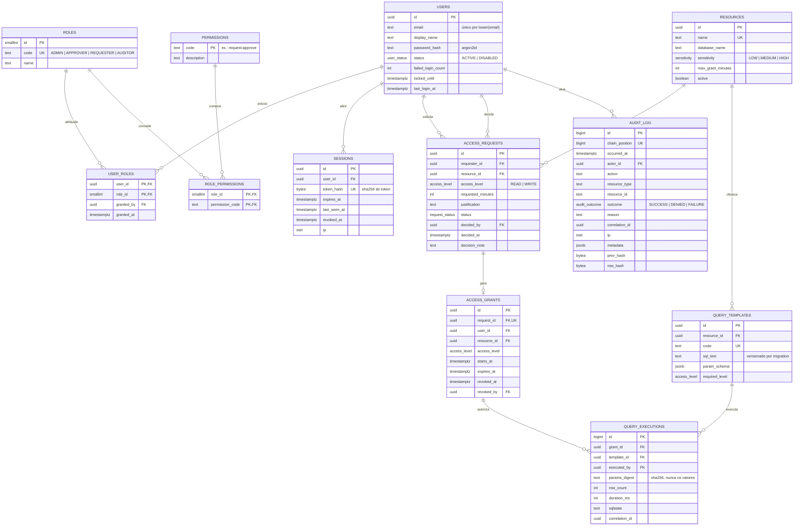
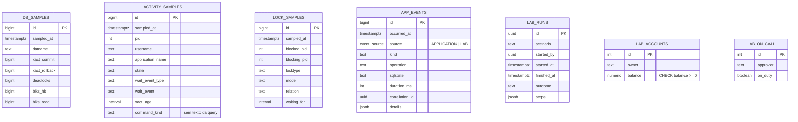

# Modelo de dados

> Status: **proposta para aprovação** (PK-00). Os nomes são finais. Tipos e detalhes podem ser ajustados nas migrations dos packs PK-02 a PK-09, sempre com registro neste documento.
>
> **Validado em 22/10/2026** num PostgreSQL 16.15 descartável (Docker): o SQL das seções 3.1 a 3.7 foi executado, e cada regra foi violada de propósito para conferir o erro. Resultados: e-mail duplicado → `23505`; segundo pedido pendente → `23505`; autoaprovação → `23514`; concessão sobreposta → `23P01`; período invertido → `23514`; `UPDATE` e `TRUNCATE` na auditoria → exceção do trigger; `DELETE` como `dbwatch_app` → `permission denied`; inserção em `REPEATABLE READ` → recusada; adulteração como superusuário → o verificador aponta exatamente a linha alterada, mesmo com a sessão em outro fuso horário. A corrida da seção 3.5 também foi reproduzida com duas sessões: o segundo aprovador esperou cerca de 2 s pelo lock e recebeu `UPDATE 0`. Esses roteiros viram testes automatizados nos packs PK-02 e PK-03.

## 1. Organização

Um banco `dbwatch` com **schemas por domínio** e um banco separado `dbwatch_target` com dados fictícios.

| Schema | Conteúdo | Pack |
| --- | --- | --- |
| `iam` | Usuários, papéis, permissões, sessões | PK-02, PK-04, PK-05 |
| `pam` | Recursos, solicitações, concessões, catálogo e execuções de consultas | PK-06, PK-07 |
| `audit` | Trilha de auditoria append-only com cadeia de hash | PK-03 |
| `monitor` | Amostras das views `pg_stat_*` e eventos da aplicação | PK-08 |
| `lab` | Tabelas descartáveis dos experimentos de concorrência | PK-09 |

**Convenções**

- Chaves primárias: `uuid DEFAULT gen_random_uuid()` em entidades de negócio. `bigint GENERATED ALWAYS AS IDENTITY` em tabelas de volume alto e append-only (auditoria, amostras).
- Datas sempre em `timestamptz`.
- Estados como tipos `ENUM` do PostgreSQL, gerados pelo Prisma.
- `created_at` e `updated_at` em todas as entidades mutáveis.
- **Nada é apagado** em `iam` e `pam`: usuários são desativados, solicitações mudam de estado e concessões são revogadas. Isso preserva a história e as FKs da auditoria.

## 2. Diagrama entidade-relacionamento



Monitor e laboratório (sem FKs para o domínio, porque são telemetria e experimento):



## 3. Integridade: as regras que o banco garante

Cada regra abaixo tem **um teste que tenta violá-la** (ver [TEST_PLAN.md](TEST_PLAN.md)).

### 3.1 E-mail único sem diferenciar maiúsculas (índice de expressão)

```sql
CREATE UNIQUE INDEX users_email_lower_uk ON iam.users (lower(email));
```

`Ana@x.com` e `ana@x.com` são a mesma conta. O índice garante isso e também acelera o login (`WHERE lower(email) = lower($1)`).

### 3.2 Separação de funções (CHECK)

```sql
ALTER TABLE pam.access_requests
  ADD CONSTRAINT access_requests_sod_ck
  CHECK (decided_by IS NULL OR decided_by <> requester_id);

ALTER TABLE pam.access_requests
  ADD CONSTRAINT access_requests_decision_ck
  CHECK ((status IN ('APPROVED', 'REJECTED')) = (decided_by IS NOT NULL AND decided_at IS NOT NULL));

ALTER TABLE pam.access_requests
  ADD CONSTRAINT access_requests_justification_ck
  CHECK (char_length(justification) BETWEEN 20 AND 500);
```

Mesmo que um bug na API deixe passar uma autoaprovação, o banco recusa com `23514 check_violation`.

### 3.3 Um pedido pendente por usuário e recurso (UNIQUE parcial)

```sql
CREATE UNIQUE INDEX access_requests_one_pending_uk
  ON pam.access_requests (requester_id, resource_id)
  WHERE status = 'PENDING';
```

### 3.4 Concessões que não se sobrepõem (EXCLUDE)

```sql
CREATE EXTENSION IF NOT EXISTS btree_gist;

ALTER TABLE pam.access_grants
  ADD CONSTRAINT access_grants_period_ck CHECK (expires_at > starts_at),
  ADD CONSTRAINT access_grants_no_overlap
  EXCLUDE USING gist (
    user_id     WITH =,
    resource_id WITH =,
    tstzrange(starts_at, expires_at, '[)') WITH &&
  ) WHERE (revoked_at IS NULL);
```

A `EXCLUDE` generaliza a `UNIQUE`: em vez de "não pode haver dois iguais", diz "não pode haver dois cujos intervalos se cruzam". A extensão `btree_gist` permite misturar igualdade (`=`) e sobreposição (`&&`) no mesmo índice GiST. Violação: `23P01 exclusion_violation`.

### 3.5 Aprovação concorrente (UPDATE condicional)

```sql
UPDATE pam.access_requests
   SET status = 'APPROVED', decided_by = $1, decided_at = now(), updated_at = now()
 WHERE id = $2 AND status = 'PENDING'
RETURNING id;
```

Dois aprovadores ao mesmo tempo: o primeiro trava a linha e muda o estado. O segundo **espera o lock**, relê a linha (em `READ COMMITTED` o PostgreSQL reavalia o `WHERE` na versão nova), vê `APPROVED` e afeta **0 linhas**. A API transforma isso em `409 Conflict`. Nenhum lock explícito é necessário, e o laboratório mostra esse comportamento acontecendo.

### 3.6 Auditoria append-only (grants + triggers)

```sql
REVOKE ALL ON audit.audit_log FROM PUBLIC;
GRANT INSERT, SELECT ON audit.audit_log TO dbwatch_app;

CREATE FUNCTION audit.forbid_mutation() RETURNS trigger
LANGUAGE plpgsql AS $$
BEGIN
  RAISE EXCEPTION 'audit.audit_log é append-only: % não é permitido', TG_OP
    USING ERRCODE = 'insufficient_privilege';
END $$;

CREATE TRIGGER audit_log_no_update_delete
  BEFORE UPDATE OR DELETE ON audit.audit_log
  FOR EACH ROW EXECUTE FUNCTION audit.forbid_mutation();

CREATE TRIGGER audit_log_no_truncate
  BEFORE TRUNCATE ON audit.audit_log
  FOR EACH STATEMENT EXECUTE FUNCTION audit.forbid_mutation();
```

### 3.7 Cadeia de hash

```sql
CREATE FUNCTION audit.chain_row() RETURNS trigger
LANGUAGE plpgsql AS $$
DECLARE
  last_hash bytea;
  last_pos  bigint;
BEGIN
  IF current_setting('transaction_isolation') <> 'read committed' THEN
    RAISE EXCEPTION 'auditoria exige READ COMMITTED';
  END IF;

  -- serializa a inserção na cadeia; liberado no fim da transação
  PERFORM pg_advisory_xact_lock(hashtext('audit.audit_log.chain'));

  SELECT row_hash, chain_position INTO last_hash, last_pos
    FROM audit.audit_log ORDER BY chain_position DESC LIMIT 1;

  NEW.chain_position := coalesce(last_pos, 0) + 1;
  NEW.prev_hash      := last_hash;
  NEW.row_hash       := sha256(convert_to(concat_ws('|',
      encode(coalesce(last_hash, '\x'::bytea), 'hex'),
      NEW.chain_position, extract(epoch FROM NEW.occurred_at), NEW.actor_id, NEW.action,
      NEW.resource_type, NEW.resource_id, NEW.outcome, NEW.reason,
      NEW.correlation_id, NEW.metadata::text), 'UTF8'));
  RETURN NEW;
END $$;

CREATE TRIGGER audit_log_chain
  BEFORE INSERT ON audit.audit_log
  FOR EACH ROW EXECUTE FUNCTION audit.chain_row();
```

**Por que `chain_position` e não `id`?** O `id` é reservado da sequência **antes** do trigger. Duas transações concorrentes podem pegar `id = 10` e `id = 11` e confirmar em ordem inversa. A posição na cadeia é atribuída **depois** do advisory lock, então reflete a ordem real de inserção.

**Por que exigir `READ COMMITTED`?** Em `REPEATABLE READ`, o `SELECT` do trigger usaria o snapshot do início da transação e não veria a linha que outra transação acabou de confirmar. Duas linhas apontariam para o mesmo "anterior" e a cadeia se bifurcaria. Esse é um ótimo exemplo prático de isolamento.

**Custo:** o advisory lock serializa as inserções na auditoria. Para o volume do MVP isso é irrelevante, e a decisão está registrada em [DECISIONS.md](DECISIONS.md).

**Por que `extract(epoch …)`?** Converter `timestamptz` direto para texto depende do `TimeZone` da sessão. O mesmo registro geraria hashes diferentes em sessões com fusos diferentes. O *epoch* é independente de fuso.

**Verificação:** `GET /api/audit/verify` percorre a cadeia por `chain_position`, recalcula cada hash e devolve a primeira posição divergente, se houver.

### 3.8 Row Level Security (rede de segurança contra IDOR)

```sql
ALTER TABLE pam.access_requests ENABLE ROW LEVEL SECURITY;

CREATE POLICY requests_visibility ON pam.access_requests
  FOR SELECT TO dbwatch_app
  USING (
    requester_id = current_setting('app.user_id', true)::uuid
    OR current_setting('app.can_review', true) = 'on'
  );
```

A API executa `SELECT set_config('app.user_id', $1, true)` e `set_config('app.can_review', ...)` no início de cada transação (o terceiro argumento `true` limita o valor à transação). Se um bug esquecer o filtro `WHERE requester_id = ...`, o banco ainda devolve apenas as linhas permitidas.

> **Implementado no PK-06c**, com políticas de SELECT, INSERT (`WITH CHECK`: ninguém cria pedido em nome de outro) e UPDATE. Toda transação da API declara o usuário (`setActor`); um teste prova que, sem o filtro da API, a RLS sozinha ainda barra o acesso.

## 4. Índices

| Índice | Tipo | Consulta atendida | Por quê |
| --- | --- | --- | --- |
| `users (lower(email))` UNIQUE | B-tree de expressão | Login | Unicidade sem diferenciar maiúsculas |
| `sessions (token_hash)` UNIQUE | B-tree | Validação da sessão em toda requisição | Busca por igualdade, muito frequente |
| `sessions (user_id) WHERE revoked_at IS NULL` | B-tree parcial | "Encerrar todas as sessões do usuário" | Indexa só as sessões vivas |
| `access_requests (created_at) WHERE status = 'PENDING'` | B-tree parcial | Fila de aprovação | A fila é pequena; o índice também |
| `access_grants` EXCLUDE | GiST | Sobreposição de períodos | Garante a regra e acelera "concessão ativa?" |
| `audit_log (occurred_at)` | **BRIN** | Filtro por período | A tabela é append-only e o tempo cresce junto com a posição física. O BRIN fica minúsculo |
| `audit_log (actor_id, occurred_at DESC)` | B-tree composto | "O que o usuário X fez" | Ordem das colunas = filtro de igualdade + ordenação |
| `audit_log (correlation_id)` | B-tree | Rastrear uma requisição | Busca por igualdade |
| `monitor.*_samples (sampled_at)` | BRIN | Séries temporais | Mesmo raciocínio da auditoria |

O laboratório de índices compara `EXPLAIN (ANALYZE, BUFFERS)` sem índice, com B-tree e com BRIN, mostrando tamanho do índice, páginas lidas e tempo.

## 5. Papéis do banco (menor privilégio)

| Papel | Login? | Usado por | Pode | Não pode |
| --- | --- | --- | --- | --- |
| `postgres` | sim | Apenas o bootstrap do container | Tudo | Nunca é usado pela aplicação |
| `dbwatch_migrator` | sim | `prisma migrate deploy` | É dono dos schemas e objetos | Não é usado em tempo de execução |
| `dbwatch_app` | sim | API (Prisma) | DML em `iam` e `pam`; `INSERT` e `SELECT` em `audit`; `INSERT` em `monitor.app_events` | `UPDATE`, `DELETE` e `TRUNCATE` em `audit`; DDL; acesso a `lab` |
| `dbwatch_monitor` | sim | Coletor | Membro de `pg_monitor`; `INSERT` e `SELECT` em `monitor.*`; `SELECT` em `audit` para o dashboard | DML em `iam` e `pam` |
| `dbwatch_lab` | sim | Laboratório | Tudo dentro do schema `lab` | Qualquer outro schema. Tem timeouts curtos definidos com `ALTER ROLE` |
| `dbwatch_target_ro` | sim | Executor de consultas | `SELECT` no banco-alvo; `default_transaction_read_only = on` | Qualquer escrita |

Cada papel tem a **própria senha**, definida no `.env`. A API recebe uma URL de conexão por papel.

### Privilégios efetivos no schema `iam` (PK-02)

| Tabela | `dbwatch_app` | Motivo |
| --- | --- | --- |
| `users` | `SELECT`, `INSERT`, `UPDATE` | Usuários são desativados, nunca apagados |
| `user_roles` | `SELECT`, `INSERT`, `DELETE` | Atribuir e remover papéis |
| `roles`, `permissions`, `role_permissions` | `SELECT` | Catálogo muda só por migration |

Além disso, `user_roles_no_self_grant_ck` impede que alguém atribua um papel a si mesmo, e os demais papéis (`dbwatch_monitor`, `dbwatch_lab`, `dbwatch_target_ro`) não têm acesso ao `iam`.

## 6. Migrations

- **Prisma Migrate** gera e versiona as migrations em `apps/api/prisma/migrations/`.
- O que o `schema.prisma` não expressa (`CHECK`, `EXCLUDE`, índices parciais e de expressão, triggers, RLS e grants) entra como **SQL escrito à mão dentro da migration**, revisado no code review.
- Migrations são **imutáveis** depois de enviadas ao `main`: correção é uma nova migration.
- Os papéis do banco são de nível de cluster e são criados por `infra/postgres/init/` com as senhas do ambiente. As migrations cuidam dos `GRANT`.
- **Teste de migrations** no CI: banco vazio → `migrate deploy` → `migrate diff` deve retornar vazio (o schema bate com o modelo).

**Validado no PK-02:** o Prisma 7.10.1 suporta múltiplos schemas (`schemas = ["iam"]` + `@@schema`). Na versão 7, a URL do banco fica em `prisma.config.ts`, apontando para o papel `dbwatch_migrator`. O `migrate diff` ignora as CHECKs e o índice de expressão escritos à mão, então o T-MIG-01 não dá falso alarme.

## 7. Dados de demonstração (seed)

- Usuários fictícios: `ana.admin`, `bruno.aprovador`, `carla.aprovadora`, `diego.solicitante`, `eva.auditora`.
- Senhas geradas no seed e exibidas **apenas no terminal local**, nunca versionadas.
- Banco-alvo `dbwatch_target` com tabelas fictícias (por exemplo, `financeiro.lancamentos` com ~50 mil linhas geradas por `generate_series`).
- Laboratório: contas com saldo, escala de plantão e uma tabela de eventos com ~500 mil linhas para o experimento de índices.
