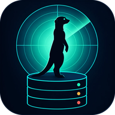

# Design e identidade visual

> Status: **proposta para aprovação** (PK-00). Implementação no PK-10.

## 1. Conceito: o livro de ronda do sentinela



A logo mostra um **suricato em pose de sentinela**, visto só como silhueta contra a luz de um radar, em pé sobre um banco de dados. O sentinela vigia e **anota o que viu**: a interface é o livro dessa ronda.

> **Revisão do PK-10 (25/10/2026):** a primeira paleta (fundo azul quase preto com um acento verde-neon) foi descartada. É um dos visuais mais batidos em painéis técnicos e não diferenciava o produto. A nova direção é sóbria, com modo claro como padrão e personalidade na tipografia e nos dados reais, não em brilhos.

Princípios:

1. **Registro, não painel de nave espacial.** Listas em linhas, como num livro de ocorrências, em vez de cartões com sombra. Cada linha tem o fato e a prova (por exemplo, "9 de 9 testes").
2. **Cor só onde há estado.** Verde para o que está garantido, âmbar para espera, coral para falha. O resto é tinta e papel.
3. **Movimento só quando algo real acontece.** O único elemento animado da visão geral é o pulso do indicador do banco, disparado a cada leitura real da API.

## 2. Cores

Tokens definidos uma única vez com `light-dark()` do CSS. Os contrastes foram **calculados** e passam no **WCAG AA** (≥ 4,5:1) nos dois temas.

### Modo claro (padrão): papel de sálvia

| Token | Hex | Uso | Contraste sobre `bg` / `surface` |
| --- | --- | --- | --- |
| `--bg` | `#EEF1EC` | Fundo, papel com leve tom de sálvia (frio, sem creme) | — |
| `--surface` | `#F8FAF7` | Controle selecionado, áreas destacadas | — |
| `--line` | `#B9C4BA` | Linhas do registro (decorativas) | 1,6 |
| `--ink` | `#14201B` | Texto principal | 14,7 / 16,0 |
| `--muted` | `#4F5E57` | Texto secundário | 6,0 / 6,5 |
| `--accent` | `#0D6B5E` | Links, foco, aba atual | 5,6 / 6,1 |
| `--ok` | `#1F7A4D` | Garantido, no ar, passou | 4,7 / 5,1 |
| `--warn` | `#8A5700` | Pendente, espera por lock | 5,4 / 5,8 |
| `--fail` | `#B3302E` | Falha, fora do ar, negado | 5,5 / 5,9 |

### Modo escuro: turno da noite

Grafite esverdeado, sem azul profundo e sem neon.

| Token | Hex | Contraste sobre `bg` / `surface` |
| --- | --- | --- |
| `--bg` | `#151A18` | — |
| `--surface` | `#1C2320` | — |
| `--line` | `#3A4741` | 1,8 (decorativa) |
| `--ink` | `#E6ECE8` | 14,7 / 13,4 |
| `--muted` | `#9DAEA6` | 7,6 / 6,9 |
| `--accent` | `#5CC2AE` | 8,2 / 7,5 |
| `--ok` | `#6CCB93` | 8,9 / 8,1 |
| `--warn` | `#E2B05A` | 8,9 / 8,1 |
| `--fail` | `#F08A80` | 7,3 / 6,6 |

### Semântica de estados

| Estado no domínio | Token | Marca (nunca só a cor) |
| --- | --- | --- |
| Garantido, no ar, teste aprovado, concessão ativa | `--ok` | ✓ ou ● |
| Pendente, espera por lock, concessão perto de expirar | `--warn` | ◐ |
| Falha, fora do ar, negado, rollback, deadlock | `--fail` | ✕ |
| Expirado, revogado, sem dados | `--muted` | – |

**A cor nunca é a única pista:** todo estado também tem marca e texto, para quem tem daltonismo e para o projetor, que distorce cores.

### Tema

- Três opções: **Sistema** (padrão, segue `prefers-color-scheme`), **Claro** e **Escuro**. A escolha fica salva no navegador.
- Um script mínimo no `<head>` aplica o tema salvo antes da primeira pintura, evitando o "piscar" de tema errado (verificado com o JavaScript do React bloqueado).
- Sem Tailwind por enquanto: as poucas telas cabem em CSS puro com tokens (ver ADR-016).

## 3. Tipografia

| Papel | Fonte | Por quê |
| --- | --- | --- |
| Títulos, números de indicadores | **Sora** (600 e 700) | Geométrica e aberta, conversa com os círculos do radar. Números grandes muito legíveis à distância |
| Texto, formulários, tabelas | **IBM Plex Sans** (400, 500, 600) | Desenhada para interfaces técnicas; distingue bem `I`, `l` e `1`; ótima no projetor |
| SQL, IDs, hashes, SQLSTATE | **IBM Plex Mono** (400, 500) | Mesma família do texto, então o código não "destoa"; algarismos tabulares |

Todas são **servidas localmente** via `next/font` (sem requisições a terceiros em tempo de execução) e têm licença OFL.

### Escala (razão 1,25, base 16 px)

| Token | Tamanho / altura de linha | Uso |
| --- | --- | --- |
| `display` | 49 / 56 · Sora 700 | Número principal de um indicador |
| `h1` | 39 / 46 · Sora 700 | Título da página |
| `h2` | 31 / 38 · Sora 600 | Seção |
| `h3` | 25 / 32 · Sora 600 | Card e painel |
| `body-lg` | 20 / 30 · Plex Sans | Destaques e textos explicativos do laboratório |
| `body` | 16 / 26 · Plex Sans | Padrão |
| `small` | 13 / 20 · Plex Sans 500 | Metadados e legendas (nunca abaixo de 13 px) |
| `code` | 14 / 22 · Plex Mono | SQL e identificadores |

- Linhas de texto com até ~75 caracteres.
- Rótulos em *sentence case* (nada de CAIXA ALTA em rótulos).
- Números de tabelas e indicadores com algarismos tabulares (`font-variant-numeric: tabular-nums`), para que os valores não "dancem" ao atualizar.

## 4. Motion

**Regra principal: o movimento só acontece quando algo real aconteceu.** Nenhuma animação simula atividade. Se a coleta parou, o radar para e a tela diz isso. É a versão visual do princípio "não fingir monitoramento".

### Momentos assinatura

| Momento | O que se move | Significado |
| --- | --- | --- |
| **Login** | A silhueta do sentinela com a varredura do radar girando atrás | O sistema está vigiando. É a única animação contínua "decorativa", e para depois do login |
| **Fluxo de eventos** | Cada evento novo entra em 160 ms, com a borda na cor da fonte (`scan` = PostgreSQL, `signal`/`coral` = aplicação, `amber` = LAB) | Algo acabou de acontecer, e de onde veio |
| **Grafo de bloqueio** | Arestas "A → B" com tracejado fluindo enquanto B espera; num deadlock, o ciclo acende em coral e a aresta da vítima se rompe | Quem bloqueia quem; o PostgreSQL escolhendo uma vítima |
| **Linha do tempo do lab** | As sessões A e B em duas colunas; cada passo aparece **quando o evento real chega** pelo SSE | A ordem real dos acontecimentos, sem roteiro falso |
| **Contagem regressiva da concessão** | Um anel que diminui e fica âmbar nos últimos 20% | O acesso é temporário |
| **Verificação da auditoria** | Uma varredura percorre a cadeia; um elo quebrado fica em coral e a tela rola até ele | Onde a integridade falhou |

### Parâmetros

| Tipo | Duração | Curva |
| --- | --- | --- |
| Retorno de interação (hover, press, foco) | 120 a 160 ms | `cubic-bezier(0.2, 0.8, 0.2, 1)` |
| Mudança de estado (abrir painel, nova linha) | 200 a 320 ms | mesma curva, ou mola suave do Motion |
| Coreografias (grafo, linha do tempo) | 400 a 700 ms | mola com amortecimento alto (sem "quicar") |
| Varredura do radar | 6 a 8 s por volta | linear |

- `prefers-reduced-motion: reduce` desliga as varreduras e os tracejados e troca as entradas por mudanças instantâneas de opacidade. A informação continua toda lá.
- Nada de entrada animada em cada card da página nem efeitos de hover em tudo. Uma coreografia bem feita vale mais que vinte efeitos espalhados.

## 5. Layout

```text
┌──────────────┬───────────────────────────────────────────────────────┐
│  ◉ DBWATCH   │  Título da página                       [tema] [Ana ▾]│
│              ├───────────────────────────────────────────────────────┤
│  Visão geral │                                                       │
│  Pedidos     │   Conteúdo principal                                  │
│  Aprovações  │   (largura máxima de 1280 px, alinhado à esquerda)    │
│  Meus acessos│                                                       │
│  Auditoria   │                                                       │
│  Monitor     │                                                       │
│  Laboratório │                                                       │
│  ─────────── │                                                       │
│  Admin       │                                                       │
└──────────────┴───────────────────────────────────────────────────────┘
```

- A navegação lateral mostra só os itens que o usuário pode acessar (a API revalida tudo).
- Alinhamento à esquerda e grade de 8 px. Raios diferentes por hierarquia: 6 px em controles, 12 px em painéis e círculos para os elementos do radar.
- Funciona em 1280×720 (projetor) sem rolagem horizontal e se reorganiza até 375 px.

## 6. Componentes e estados obrigatórios

Toda tela tem quatro estados, cada um com um texto específico e uma ação:

| Estado | Exemplo de texto |
| --- | --- |
| Carregando | Esqueleto com a forma do conteúdo (sem spinner genérico em tela cheia) |
| Vazio | "Nenhum pedido pendente. Novos pedidos aparecem aqui assim que forem enviados." |
| Erro | "Não foi possível carregar a auditoria. Tente de novo. Código para suporte: `c0ffee12`." |
| Sem permissão | "Esta área é da auditoria. Peça o papel Auditor a um administrador." |

Botões dizem exatamente o que fazem ("Aprovar acesso", "Revogar acesso"), e a confirmação repete o mesmo verbo ("Acesso aprovado").

## 7. Uso da logo

| Arquivo | Uso |
| --- | --- |
| `assets/brand/dbwatch-logo.png` (1254 px, com margem) | Arte original e material de apresentação |
| `assets/brand/dbwatch-icon.png` (1024 px, cantos transparentes) | Base para os demais tamanhos |
| `assets/brand/dbwatch-icon-animado.gif` (320 px, 60 quadros, 3,6 s em loop, 2,2 MB) | Cabeçalho do README; quem usa `prefers-reduced-motion` vê a versão estática |
| `assets/brand/suri.gif` (1254 px, 120 quadros, 17 MB) | Animação original, usada como fonte; não deve ser referenciada direto em páginas |
| `assets/brand/dbwatch-icon-512.png` | README e slides |
| `assets/brand/dbwatch-icon-192.png` | PWA e ícone de atalho |
| `assets/brand/dbwatch-icon-64.png`, `-32.png` | Favicon e cabeçalho da aplicação |

- Não recolorir, não distorcer e não aplicar sombra ou contorno.
- Tamanho mínimo: 24 px. Abaixo disso, o suricato deixa de ser reconhecível.
- Por ter fundo próprio, a logo funciona nos dois temas.

## 8. Acessibilidade

- Contraste AA garantido pelos tokens acima e conferido com o axe no CI.
- Foco sempre visível (anel de 2 px em `--scan`, com 2 px de afastamento).
- Gráficos com tabela alternativa ("ver como tabela") e `aria-label` com o resumo.
- Atualizações ao vivo anunciadas com `aria-live="polite"` e limitadas, para não inundar o leitor de tela.
- Alvos de toque de pelo menos 40×40 px.
