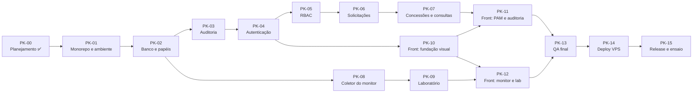

# Roadmap e backlog de packs

> Hoje: **22/10/2026**. Apresentação: **11/11/2026**. São **20 dias**.
> O calendário é uma **hipótese**: depende do tempo disponível para revisar e aprovar cada pack. Ele é revisado ao fim de cada pack.

## 1. Mapa de dependências

## 2. Calendário proposto

> **Revisão de 24/10:** o backend vem primeiro e o front fica para depois, quando todas as regras já estiverem garantidas e testadas na API. O redesenho do front parte de referências visuais escolhidas pelo Gabriel.

| Datas | Packs | Marco |
| --- | --- | --- |
| 22 a 24/10 | PK-00 a PK-04 | Planejamento, ambiente, banco, auditoria e login ✅ |
| 25/10 | PK-05a, PK-05b | Permissões por rota, rotas da auditoria e administração de usuários |
| 25/10 | PK-05c | Sessões ativas e encerrar sessões |
| 25/10 | PK-05d | ACL de login por IP e horário |
| 25/10 | PK-06a | Recursos, pedidos de acesso e fila do aprovador |
| 27/10 | PK-06b | Aprovar e rejeitar com concorrência segura |
| 27/10 | PK-06c | 2 níveis para HIGH e RLS |
| 27/10 | PK-07a | Meus acessos, revogação e job de expiração |
| 28/10 a 02/11 | PK-07b, PK-07c | **Marco 1:** consultas controladas e break-glass; PAM completo pela API (Swagger) |
| 29/10 | PK-08a | Monitor coletando: sessões, locks e taxas |
| 30/10 | PK-08b | Eventos da aplicação, alertas e SSE |
| 31/10 | PK-09a | Laboratório: transferência, espera de lock e deadlock |
| 01 a 05/11 | PK-09b | Níveis de isolamento e scripts para o `psql` |
| 05 a 08/11 | PK-10 a PK-12 | **Marco 2:** console com menu lateral, cards e gráficos legíveis |
| 09/11 | PK-13, PK-14 | QA final e deploy na VPS · **congelamento de código** |
| 10/11 | PK-15 | Ensaio completo × 3, release v1.0.0, vídeo de backup |
| **11/11** | — | **Apresentação no InovaTech** |
| Se sobrar tempo | PK-16 | Landing page com motion |

## 3. Linha de corte do MVP

Se o **Marco 1 atrasar além de 02/11**, cortamos nesta ordem, sem tocar no núcleo acadêmico:

| Prioridade | Itens |
| --- | --- |
| **Must** (não sai) | PK-01 a PK-06, concessões do PK-07, PK-08, PK-09, PK-10, PK-12, ensaio |
| **Should** | Consultas controladas (PK-07b), RLS (PK-06), telas de administração completas (PK-11), deploy na VPS (o plano B é rodar local) |
| **Could** | Cenário de índices no lab, `pg_stat_statements`, exportar a auditoria em CSV, animações extras |
| **Won't** (MVP) | MFA, credenciais efêmeras, particionamento, SSO |

> O laboratório e a auditoria são **Must** porque são o coração da disciplina de persistência. Uma tela bonita a mais nunca vale mais que um deadlock real demonstrado.

## 4. Backlog de packs

Cada pack segue o ciclo **SPEC → implementação → QA → registro**. Um pack só é concluído quando os critérios abaixo são atendidos, com os comandos e resultados anotados no PR.

### PK-00 · Descoberta e planejamento ✅

- **Entregue:** diagnóstico, documentos de `docs/`, identidade visual, validação real do DDL principal num PostgreSQL 16.

### PK-01 · Monorepo e ambiente local ✅

> **Registro de QA (23/10/2026):** `pnpm lint` e `pnpm typecheck` sem erros; `pnpm test` com 8/8 testes passando contra PostgreSQL 16 real; `pnpm build` dos dois apps ok; fluxo navegador → Next → `/api` → Nest → PostgreSQL verificado com o banco no ar (200) e parado (503), com reconexão automática. Teste de mutação: vazar a mensagem do erro no filtro faz o teste correspondente falhar. Decisões do spike em [ADR-018](DECISIONS.md#adr-018--somente-versões-estáveis). `packages/contracts` foi adiado para o PK-04, quando surge o primeiro DTO compartilhado.

- **Objetivo:** qualquer pessoa clona o repositório e roda tudo com poucos comandos.
- **Inclui:** `pnpm-workspace`; `apps/api` (NestJS) e `apps/web` (Next.js) mínimos; `packages/contracts`; TypeScript `strict`; ESLint e Prettier; Vitest; `docker-compose.yml` com PostgreSQL 16 e parâmetros do lab; `.env.example`; `GET /api/health` que consulta o banco; filtro global de erros; `correlation_id`; logger JSON; GitHub Actions (lint, typecheck, test).
- **Spikes (hipóteses a validar):** versões compatíveis entre NestJS, TypeScript e Prisma (fixar versões **estáveis**, sem RC); suporte do Prisma a múltiplos schemas; `SET LOCAL application_name` visível em `pg_stat_activity`.
- **Exclui:** qualquer regra de negócio.
- **Banco:** nenhuma tabela, só a conexão.
- **Testes:** smoke de `/api/health`; teste do filtro de erros.
- **Pronto quando:** `pnpm install && docker compose up -d && pnpm dev` funciona do zero; CI verde.

### PK-02 · Banco base, papéis e harness de testes ✅

> **Registro de QA (23/10/2026):** 17/17 testes contra PostgreSQL 16 real (9 novos de banco: unicidade por `lower(email)`, CHECKs, FK `RESTRICT`, autoatribuição de papel barrada, catálogo de permissões, privilégios negados por papel com `42501`, banco-alvo somente leitura com `25006` e T-MIG-01 sem diferença entre banco e `schema.prisma`). Simulação do CI num PostgreSQL limpo: papéis + migration do zero + suíte verde. Teste de mutação: um `GRANT DELETE` indevido para `dbwatch_app` faz a suíte falhar. O seed de usuários foi para o PK-04 (precisa do hash Argon2id). O banco de testes não é recriado a cada execução: os testes geram dados únicos e as migrations são reaplicadas de forma idempotente.

- **Objetivo:** fundação de persistência com menor privilégio desde o início.
- **Inclui:** `infra/postgres/init` (papéis e bancos); schemas; Prisma schema de `iam` (users, roles, permissions, role_permissions, user_roles); primeira migration; seed; harness `pnpm test:db` contra PostgreSQL real com banco recriado por execução.
- **Banco:** `iam.*`, papéis `dbwatch_migrator`, `dbwatch_app`, `dbwatch_monitor`, `dbwatch_lab`, `dbwatch_target_ro`.
- **Testes:** T-DB-01, T-DB-02, T-DB-12 (grants por papel), T-MIG-01.
- **Pronto quando:** as migrations aplicam do zero e `migrate diff` retorna vazio; testes de banco verdes.

### PK-03 · Auditoria persistente ✅

> **Registro de QA (24/10/2026):** 42/42 testes (38 da API, 4 da web): 6 unitários do mapeamento de falhas, 8 de banco (append-only até para o dono da tabela, privilégios por papel, adulteração e remoção de linha detectadas como superusuário em outro fuso, recusa fora de `READ COMMITTED`, 20 inserções concorrentes formando cadeia contínua) e 7 de integração da transação auditada. Testes de mutação: gravar a falha dentro da transação faz 3 testes falharem; um teste quebrado de propósito aparece em vermelho na página `/testes`. O spike do Prisma 7 mostrou que o `DETAIL` do PostgreSQL traz a linha inteira (inclusive hash de senha), por isso a auditoria guarda só SQLSTATE e constraint. **Mudança de escopo:** `GET /api/audit` e `GET /api/audit/verify` foram para o PK-05, porque expor a auditoria antes do guard de permissões violaria o "nega por padrão". Entrou a página `/testes`, que mostra o relatório real da suíte.

- **Inclui:** `audit.audit_log`; triggers append-only e de cadeia; `AuditService` (dentro da transação no sucesso, fora dela na falha); `GET /api/audit` paginado por cursor; `GET /api/audit/verify`.
- **Testes:** T-DB-07 a T-DB-11, T-INT-08, T-INT-09.
- **Pronto quando:** a adulteração simulada é detectada num teste automatizado.

### PK-04 · Autenticação ✅

> **Registro de QA (24/10/2026):** 64/64 testes (60 da API, 4 da web), 22 deles novos: 5 unitários (token, hash, cookie, schema de login e rate limit), 3 de banco em `iam.sessions` (hash de 32 bytes, `DELETE` negado à API, período válido) e 14 de integração cobrindo T-AUTH-01 a T-AUTH-08, T-SEC-04 e T-SEC-07, além do seed e do Swagger. Simulação do CI num PostgreSQL recriado do zero: verde. Testes de mutação: remover o custo do Argon2 para e-mail inexistente, o limite de ociosidade, a checagem de usuário ativo, o ator no contexto da auditoria, o incremento atômico do contador ou o `HttpOnly` do cookie faz um teste falhar em cada caso. Teste manual com a API rodando: login, `/me`, logout e Swagger conferidos com `curl`; nenhuma senha no log.

- **Inclui:** Argon2id; `iam.sessions`; login, logout e `GET /api/auth/me`; bloqueio; rate limit; `SessionGuard`; verificação de `Origin`; cabeçalhos de segurança; Swagger em `/api/docs`; `reason` em cada login negado; `pnpm db:seed` com os usuários de demonstração.
- **Testes:** T-AUTH-01 a T-AUTH-08, T-SEC-04, T-SEC-07.

### PK-05 · Autorização (RBAC)

Dividido em três packs para caber no limite de 400 linhas cada.

#### PK-05a · Permissões por rota e rotas da auditoria ✅

> **Registro de QA (25/10/2026):** 74/74 testes (70 da API, 4 da web), 10 novos, num PostgreSQL de testes recriado do zero: T-SEC-01 (todas as rotas declaram acesso), T-SEC-02 (matriz de 4 rotas × 6 perfis), T-SEC-06 (injeção nos filtros), catálogo de permissões igual ao do banco, rota esquecida negada em execução, negação auditada, papel novo valendo na requisição seguinte, paginação por cursor sem repetir linhas, filtros e verificação da cadeia. Testes de mutação: liberar rota sem decorator, ignorar a permissão, cursor com `<=`, filtro ignorado e schema sem `.strict()` fazem um teste falhar em cada caso. Teste manual com os usuários do seed: a auditora lê e verifica a trilha; a admin recebe 403.

- **Inclui:** guard global que exige `@Public()`, `@Authenticated()` ou `@RequirePermission(...)` em toda rota e nega o resto; permissões carregadas com a sessão a cada requisição; negações auditadas como `authz.denied`; `GET /api/audit` (filtros e paginação por cursor) e `GET /api/audit/verify`.
- **Testes:** T-SEC-01, T-SEC-02, T-SEC-06.

#### PK-05b · Administração de usuários ✅

> **Registro de QA (25/10/2026):** 79/79 testes (75 da API, 4 da web), num PostgreSQL de testes recriado do zero e de novo num banco já usado. Novos: T-IAM-01 a T-IAM-05. O T-IAM-04 abre duas transações reais que removem o papel ADMIN uma da outra: com o trigger, a segunda espera o lock e é barrada (`DW001`). Testes de mutação: **sem o advisory lock, as duas passam e o banco fica sem ADMIN**; desativar sem revogar sessões, não traduzir o `DW001`, não gravar quem deu o papel e aceitar senha curta fazem um teste falhar em cada caso. Teste manual com a admin do seed: criar, dar papel, desativar e tentar remover o próprio papel de única ADMIN (422).

- **Inclui:** criar e desativar usuários (desativar revoga as sessões na mesma transação); atribuir e remover papéis; proteção do último ADMIN com lock; diff antes/depois na auditoria.
- **Testes:** T-IAM-01 a T-IAM-05.

#### PK-05c · Sessões ativas ✅

> **Registro de QA (25/10/2026):** 83/83 testes (79 da API, 4 da web), num PostgreSQL de testes recriado do zero. Novos: listar e encerrar a própria sessão, sessão ociosa fora da lista, sessão de outra pessoa respondendo 404 (sem revelar que existe) e admin derrubando todas as sessões de um usuário com a contagem na auditoria. Testes de mutação: sem o filtro de dono, lista com sessão ociosa, `current` errado e auditoria sem contagem fazem um teste falhar em cada caso. Teste manual: o mesmo usuário em dois navegadores encerra o outro, que passa a receber 401.

- **Inclui:** `GET /api/auth/sessions` e `DELETE /api/auth/sessions/:id` (as próprias), `GET` e `DELETE /api/users/:id/sessions` (admin). A regra de "sessão ativa" é a mesma do login, definida num único lugar.

#### PK-05d · ACL de login ✅

> **Registro de QA (25/10/2026):** 88/88 testes (84 da API, 4 da web), num PostgreSQL de testes recriado do zero e de novo num banco já usado. Novos: decisão por prioridade, faixa, dia da semana e janela em horário de Brasília; CHECKs recusando faixa com bits de host, janela invertida e regra que nega todos sempre; login de IP negado (403 só com a senha certa, auditado); CRUD pela API com o antes e o depois na auditoria; normalização de IPv4 mapeado em IPv6. Testes de mutação: fuso em UTC, prioridade invertida, operador de faixa trocado, login ignorando a ACL, IP sem normalizar e erro sem tradução fazem testes falharem. Teste manual: a admin bloqueia o solicitante na rede local, o login dele recebe 403, e volta a funcionar quando a regra é removida.

- **Inclui:** `iam.login_acl` com índice GiST (`inet_ops`); função `iam.login_acl_decision` no banco; `GET`, `POST` e `DELETE /api/login-acl`; checagem no login depois da senha certa.
- **Decisão:** o Prisma 7 não suporta `cidr`; a coluna é `inet` com uma CHECK `ip_range = network(ip_range)`, que dá a mesma garantia.

### PK-06 · Recursos, solicitações e aprovações

Dividido em três packs para caber no limite de 400 linhas cada.

#### PK-06a · Recursos e pedidos ✅

> **Registro de QA (25/10/2026):** 93/93 testes (89 da API, 4 da web), num PostgreSQL de testes recriado do zero e de novo num banco já usado. Novos: T-PAM-01, T-PAM-02, T-SEC-05, um pendente por pessoa e recurso, fila sem os próprios pedidos e o banco barrando autoaprovação, decisão sem autor e `DELETE`. Testes de mutação: sem o trigger de limites, sem o UNIQUE parcial, sem a CHECK de separação de funções, fila mostrando os próprios pedidos e schema aceitando `status` fazem testes falharem. Teste manual com o seed: o solicitante pede "Clientes", o pedido repetido recebe 409, 90 min num recurso de 60 recebe 422, e o aprovador vê o pedido na fila.

- **Inclui:** schema `pam` com `resources` e `access_requests`; CHECKs (justificativa, duração, separação de funções, decisão com autor); UNIQUE parcial de pendentes; índice parcial da fila; trigger que barra recurso inativo e duração acima do máximo (SQLSTATEs `DW002` e `DW003`); `GET /api/resources`, `POST /api/requests`, `GET /api/requests/mine`, `GET /api/requests/queue`; três recursos fictícios no seed.

#### PK-06b · Aprovar e rejeitar ✅

> **Registro de QA (27/10/2026):** 98/98 testes (94 da API, 4 da web), num PostgreSQL de testes recriado do zero e de novo num banco já usado. Novos: T-PAM-03 a T-PAM-06, T-CONC-01 (10 aprovadores ao mesmo tempo: 1 aprova, 9 recebem 409, uma concessão) e um deadlock real provocado por duas transações em ordem cruzada, refeito automaticamente (3 tentativas, 2 sucessos, nenhuma falha na auditoria). Testes de mutação: UPDATE sem a condição de status, sem retry, sem a checagem de autoaprovação, sem tratar 0 linhas, cancelamento por qualquer um e o banco sem a `EXCLUDE` fazem testes falharem. Sem a condição de status, o T-CONC-01 sozinho continua verde porque o `UNIQUE (request_id)` das concessões barra a segunda concessão: é a defesa em camadas, e o T-PAM-05 pega a mutação. Teste manual com o seed: o aprovador aprova, o segundo aprovador recebe 409 e a concessão aparece com o prazo.

- **Inclui:** `pam.access_grants` com `EXCLUDE` (btree_gist) contra concessões sobrepostas; `POST /api/requests/:id/approve` (UPDATE condicional + concessão na mesma transação), `reject` (motivo obrigatório) e `cancel` (só o dono); retry automático em `40P01` e `40001` dentro da transação auditada.
- **Testes:** T-PAM-03 a T-PAM-06, T-CONC-01.

#### PK-06c · Aprovação em 2 níveis e RLS ✅

> **Registro de QA (27/10/2026):** 102/102 testes (98 da API, 4 da web), num PostgreSQL de testes recriado do zero e de novo num banco já usado; os 94 testes anteriores continuaram verdes com a RLS ligada. Novos: dois aprovadores diferentes para HIGH (a concessão só sai na segunda), o banco recusando HIGH com um aprovador só (`DW004`) ou com a mesma pessoa duas vezes (CHECK), T-SEC-03 (pedido alheio responde 404) e a RLS testada direto no SQL (sem identidade, outra pessoa, dono, revisor, UPDATE alheio com 0 linhas e INSERT em nome de outro com `42501`). Testes de mutação: HIGH com um aprovador, mesmo aprovador duas vezes e leituras sem declarar o usuário fazem testes falharem. **Sem o filtro do dono na API, o T-SEC-03 continua verde porque a RLS barra sozinha; sem o filtro e com a RLS desligada, ele falha.** Teste manual no recurso Financeiro: primeira aprovação deixa pendente (1 de 2), o mesmo aprovador recebe 403, o segundo aprova e a concessão sai; a admin recebe 404 ao abrir o pedido.

- **Inclui:** `first_approved_by` e `first_approved_at`; trigger que exige dois aprovadores em recursos HIGH; RLS em `pam.access_requests` (SELECT, INSERT e UPDATE) com o usuário declarado por `set_config` em cada transação; `GET /api/requests/:id`.
- **Testes:** T-SEC-03.

### PK-07 · Concessões e consultas controladas

#### PK-07a · Meus acessos, revogação e expiração ✅

> **Registro de QA (27/10/2026):** 106/106 testes (102 da API, 4 da web), num PostgreSQL de testes recriado do zero e de novo num banco já usado. Novos: estado calculado pelo relógio do banco (ACTIVE, EXPIRED, REVOKED) com segundos restantes e aviso de 5 min; revogação com motivo (409 para já revogada ou vencida, 404 para inexistente, 403 sem permissão); job que audita cada expiração uma vez só e ignora vivas e revogadas; RLS nas concessões. Testes de mutação: estado ignorando revogação, revogar concessão vencida, job auditando de novo ou auditando revogada, aviso tardio e `can_revoke` não declarado fazem testes falharem. Teste manual com o job a cada 2 s: concessão aprovada aparece ACTIVE com aviso; envelhecida no banco, o job grava `pam.grant_expired` e ela passa a EXPIRED.

- **Inclui:** `GET /api/grants/mine`, `GET /api/grants/active`, `POST /api/grants/:id/revoke`; colunas de revogação (autor e motivo obrigatórios por CHECK) e `expiry_audited_at`; job com intervalo `GRANT_SWEEP_SECONDS`; RLS em `pam.access_grants`.

#### PK-07b · Consultas controladas ✅

> **Registro de QA (27/10/2026):** 110/110 testes (106 da API, 4 da web), num PostgreSQL de testes recriado do zero (o setup dos testes também cria o banco-alvo) e de novo num banco já usado. Novos: execução com concessão ativa (catálogo sem SQL exposto, limite de linhas, e-mail mascarado, execução registrada), T-PAM-07 e T-PAM-08 (sem concessão, expirada e revogada: 403 auditado com o motivo), T-PAM-09 (`pg_sleep` acima do tempo-limite: o banco cancela com `57014`, resposta 504, falha registrada) e T-SEC-06 nos parâmetros. Testes de mutação: sem tempo-limite, sem limite de linhas, ignorando revogação, usando a concessão mais antiga e aceitando parâmetro extra fazem testes falharem. Tirar o `READ ONLY` da transação não muda nada, porque o papel `dbwatch_target_ro` já nasce somente leitura e o catálogo só tem SELECT: são duas camadas. Teste manual: antes da concessão, 403; depois da aprovação, 50 linhas com e-mail mascarado em 10 ms. Orçamento: 427 linhas, aprovado acima de 400.

- **Inclui:** `infra/target/schema.sql` (dados fictícios gerados com `generate_series`) e `pnpm db:target`; `pam.query_templates` (catálogo só por migration, 4 consultas, uma delas LAB) e `pam.query_executions`; `GET /api/queries` e `POST /api/queries/:code/execute` com papel somente leitura, transação `READ ONLY`, `statement_timeout` por template e parâmetros posicionais.
- **Templates de nível WRITE e o T-PAM-10:** fora do PK-07c por decisão do Gabriel (exigem um papel novo no PostgreSQL); ficam para "se sobrar tempo".

#### PK-07c · Break-glass ✅

> **Registro de QA (29/10/2026):** 114/114 testes (110 da API, 4 da web), num PostgreSQL de testes recriado do zero e de novo num banco já usado. Novos: ADMIN abre acesso imediato (até em recurso HIGH) e consulta na hora, auditado como alerta; segundo break-glass no mesmo recurso esbarra na `EXCLUDE`; limites de 15 min e 40 caracteres; o banco recusando sem permissão (`DW006`), pedido comum já aprovado (`DW005`) e prazo acima do limite (CHECK); revisão posterior por outra pessoa, uma vez só. Testes de mutação: sem o trigger de pedido novo, sem a CHECK, com a política RLS antiga nas concessões, revisão dupla e sem a marca de alerta fazem testes falharem. Teste manual com o seed: o solicitante recebe 403; a admin abre e consulta o faturamento; o aprovador vê na fila e revisa; a auditora vê os dois registros.

- **Inclui:** permissão `breakglass:use` (só ADMIN); `POST /api/break-glass`, `GET /api/break-glass/pending`, `POST /api/break-glass/:id/review`; colunas `break_glass` e de revisão; a única exceção à separação de funções, limitada por CHECK; trigger que obriga pedido comum a nascer pendente; política RLS que deixa o próprio usuário criar a concessão só no break-glass.

- **PK-07b (Should):** `dbwatch_target` com dados fictícios; `pam.query_templates`; executor somente leitura; `pam.query_executions`.
- **Testes:** T-PAM-07 a T-PAM-10, T-DB-05, T-SEC-06.

### PK-08 · Coletor do monitor

#### PK-08a · Coletor e leitura ✅

> **Registro de QA (29/10/2026):** 119/119 testes (115 da API, 4 da web), num PostgreSQL de testes recriado do zero, de novo num banco já usado e os do monitor mais 3 vezes seguidas (sem oscilação). Novos: T-MON-01 (lock wait real com duas conexões: par bloqueado/bloqueador correto), T-MON-02 (deadlock real: delta ≥ 1 na série), T-MON-04 (query com "segredo-123" rodando durante a amostra: nada gravado além do comando `SELECT`), T-MON-05 (`pg_stat_reset()`: nenhuma taxa negativa), retenção de 7 dias e permissões (o papel do monitor não lê `iam`). Testes de mutação: gravar o texto da query (o banco recusa pela CHECK da coluna `command`), delta sem tratar reinício, sem retenção e bloqueador errado fazem testes falharem. Teste manual com o coletor a cada 1 s: duas sessões `psql` disputando a mesma linha aparecem como "sessao-B espera sessao-A" (`transactionid`, `ShareLock`).

- **Inclui:** schema `monitor` (fora do `schema.prisma`) com `db_samples`, `activity_samples` e `lock_samples`, índices BRIN e grants só para `dbwatch_monitor`; coletor transacional a cada `MONITOR_SAMPLE_SECONDS`; `GET /api/monitor/overview`, `/locks` e `/series` (taxas com `LAG()`).

#### PK-08b · Eventos, alertas e SSE ✅

> **Registro de QA (30/10/2026):** 124/124 testes (120 da API, 4 da web), num PostgreSQL de testes recriado do zero, de novo num banco já usado e os do monitor mais 5 vezes (sem oscilação). Novos: T-MON-03 (rollback por e-mail duplicado vira evento com operação, `23505` e o mesmo `correlation_id` da resposta), alertas de lock longo e de transação parada sem repetição, deadlock novo como alerta high, break-glass como alerta high e SSE recebido pela rede de verdade (403 sem `monitor:read`). Testes de mutação: alerta repetido, rollback sem evento, sem alerta de deadlock e o banco sem o trigger de `NOTIFY` fazem testes falharem; a de deadlock só falhou depois de corrigir o teste, que aceitava um alerta de execução anterior. Teste manual ao vivo: a auditora ouvindo o SSE recebe o break-glass e um lock de 6 s ("sessao-B esperou 5965 ms") uma vez só.

- **Inclui:** `monitor.app_events` (rollbacks da API e alertas) com trigger `pg_notify`; alertas do coletor na mesma transação da amostra (`MONITOR_LOCK_ALERT_MS`, `MONITOR_IDLE_ALERT_MS`); `GET /api/monitor/events` e `GET /api/monitor/stream` (SSE alimentado por `LISTEN dbwatch_events`).

- **Inclui:** amostras de `pg_stat_activity`, `pg_locks`, `pg_stat_database` e `pg_stat_user_tables`; `monitor.app_events` via `runInTransaction`; view `event_feed`; endpoints de leitura; SSE; retenção; alertas (lock acima de 5 s, transação parada, deadlock novo).
- **Testes:** T-MON-01 a T-MON-05.

### PK-09 · Laboratório de concorrência

#### PK-09a · Orquestrador e três cenários ✅

> **Registro de QA (31/10/2026):** 128/128 testes (124 da API, 4 da web), num PostgreSQL de testes recriado do zero, de novo num banco já usado e os do lab mais 3 vezes (sem oscilação). Novos: T-LAB-01 (transferência barrada por `23514`, saldos intactos, execução gravada), T-LAB-02 (B espera ≥ 1,5 s e nenhuma atualização se perde), T-LAB-03 (exatamente um `40P01`, o outro confirma) e T-LAB-06 (o papel do lab não lê `iam`, `audit`, `monitor` nem `pam`; timeouts de 5 s, 15 s e 20 s no papel; segundo experimento simultâneo recebe 409; 403 sem `lab:run`; 404 com o lab desligado). Testes de mutação: sem o advisory lock, sem a barreira de lock, sem o reset das contas e o banco sem a CHECK de saldo fazem testes falharem. Teste manual: a admin roda o deadlock e a espera de lock pela API, e o monitor, sem ligação nenhuma com o lab, manda o alerta de deadlock ao vivo para a auditora.

- **Inclui:** schema `lab` (`accounts` com CHECK de saldo e `runs`), papel `dbwatch_lab` isolado; orquestrador com duas conexões dedicadas (`dbwatch-lab:A` e `dbwatch-lab:B`), barreira por `pg_stat_activity`, um experimento por vez (`pg_try_advisory_lock`); `GET /api/lab/scenarios`, `POST /api/lab/:scenario/run`, `GET /api/lab/runs`; `LAB_ENABLED`.

#### PK-09b · Níveis de isolamento e scripts

- **Inclui:** schema `lab`; orquestrador de duas sessões; seis cenários; `lab.runs`; scripts SQL equivalentes em `infra/lab/`.
- **Testes:** T-LAB-01 a T-LAB-06.

### PK-10 · Front: fundação visual

- **Inclui:** tokens de [DESIGN.md](DESIGN.md); fontes locais; modo claro e escuro com troca persistida; layout do console; componentes base (botão, campo, tabela, badge de estado, diálogo, toast); tela de login com a animação do radar; tratamento global de erro e de sessão expirada.
- **Testes:** T-E2E-01 (login), T-A11Y-01 (login e shell).

### PK-11 · Front: PAM e auditoria

- **Inclui:** pedir acesso; meus pedidos; fila de aprovação; meus acessos com contagem regressiva; execução de consultas; explorador da auditoria com verificação de integridade; administração de usuários.
- **Testes:** T-E2E-02 a T-E2E-04.

### PK-12 · Front: monitor e laboratório

- **Inclui:** dashboard (indicadores, séries, sessões); grafo de bloqueio animado; fluxo de eventos ao vivo; laboratório com a linha do tempo A/B.
- **Testes:** T-E2E-05, T-E2E-06.

### PK-13 · QA final

- **Inclui:** suíte completa; navegação exploratória num navegador real com gravação; auditoria de acessibilidade; revisão de segurança do diff completo; teste de carga leve na aprovação concorrente; correções.

### PK-14 · Deploy na VPS *(exige autorização explícita)*

- **Inclui:** compose de produção; Caddy com HTTPS; PostgreSQL sem porta pública; `.env` no servidor; backup com `pg_dump`; checklist de deploy e de rollback.
- **Bloqueado por:** questão Q-1 do [PRD](PRD.md#7-questões-em-aberto).

### PK-15 · Release v1.0.0 e ensaio

- **Inclui:** CHANGELOG; notas de release; README final com capturas de tela; três ensaios do [DEMO.md](DEMO.md); vídeo de backup.

### PK-16 · Landing page *(se sobrar tempo)*

- **Inclui:** página pública de apresentação do projeto, com motion.

> **Referência estudada:** o JumpServer (PAM de código aberto, GPL v3) foi lido só como fonte de **ideias**; nenhum código foi copiado. As ideias aproveitadas aparecem nos packs acima. Ver [ADR-022](DECISIONS.md#adr-022--jumpserver-só-como-referência-de-ideias).

## 5. Status

| Pack | Status | Data |
| --- | --- | --- |
| PK-00 | ✅ Concluído | 22/10/2026 |
| PK-01 | ✅ Concluído | 23/10/2026 |
| PK-02 | ✅ Concluído | 23/10/2026 |
| PK-03 | ✅ Concluído | 24/10/2026 |
| PK-04 | ✅ Concluído | 24/10/2026 |
| PK-05a | ✅ Concluído | 25/10/2026 |
| PK-05b | ✅ Concluído | 25/10/2026 |
| PK-05c | ✅ Concluído | 25/10/2026 |
| PK-05d | ✅ Concluído | 25/10/2026 |
| PK-06a | ✅ Concluído | 25/10/2026 |
| PK-06b | ✅ Concluído | 27/10/2026 |
| PK-06c | ✅ Concluído | 27/10/2026 |
| PK-07a | ✅ Concluído | 27/10/2026 |
| PK-07b | ✅ Concluído | 27/10/2026 |
| PK-07c | ✅ Concluído | 29/10/2026 |
| PK-08a | ✅ Concluído | 29/10/2026 |
| PK-08b | ✅ Concluído | 30/10/2026 |
| PK-09a | ✅ Concluído | 31/10/2026 |
| PK-09b | ⏳ Próximo | — |
| PK-08 a PK-16 | 📋 Planejado | — |
