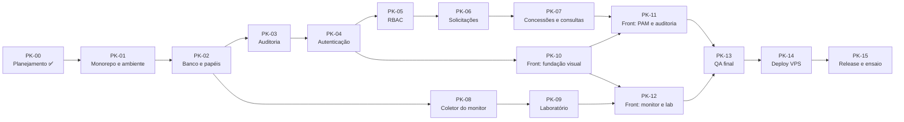

# Roadmap e backlog de packs

> Hoje: **22/10/2026**. Apresentação: **11/11/2026**. São **20 dias**.
> O calendário é uma **hipótese**: depende do tempo disponível para revisar e aprovar cada pack. Ele é revisado ao fim de cada pack.

## 1. Mapa de dependências

## 2. Calendário proposto

> **Revisão de 24/10:** o backend vem primeiro e o front fica para depois, quando todas as regras já estiverem garantidas e testadas na API. O redesenho do front parte de referências visuais escolhidas pelo Gabriel.

| Datas | Packs | Marco |
| --- | --- | --- |
| 22 a 24/10 | PK-00 a PK-04 | Planejamento, ambiente, banco, auditoria e login ✅ |
| 25/10 | PK-05a, PK-05b | Permissões por rota, rotas da auditoria e administração de usuários |
| 25/10 | PK-05c | Sessões ativas e encerrar sessões |
| 25/10 | PK-05d | ACL de login por IP e horário |
| 25/10 | PK-06a | Recursos, pedidos de acesso e fila do aprovador |
| 27/10 | PK-06b | Aprovar e rejeitar com concorrência segura |
| 27/10 | PK-06c | 2 níveis para HIGH e RLS |
| 27/10 | PK-07a | Meus acessos, revogação e job de expiração |
| 28/10 a 02/11 | PK-07b, PK-07c | **Marco 1:** consultas controladas e break-glass; PAM completo pela API (Swagger) |
| 29/10 | PK-08a | Monitor coletando: sessões, locks e taxas |
| 30/10 | PK-08b | Eventos da aplicação, alertas e SSE |
| 31/10 | PK-09a | Laboratório: transferência, espera de lock e deadlock |
| 01/11 | PK-09b | Níveis de isolamento e scripts para o `psql` |
| 05 a 08/11 | PK-10 a PK-12 | **Marco 2:** console com menu lateral, cards e gráficos legíveis |
| 09/11 | PK-13, PK-14 | QA final e deploy na VPS · **congelamento de código** |
| 10/11 | PK-15 | Ensaio completo × 3, release v1.0.0, vídeo de backup |
| **11/11** | — | **Apresentação no InovaTech** |
| Se sobrar tempo | PK-16 | Landing page com motion |

## 3. Linha de corte do MVP

Se o **Marco 1 atrasar além de 02/11**, cortamos nesta ordem, sem tocar no núcleo acadêmico:

| Prioridade | Itens |
| --- | --- |
| **Must** (não sai) | PK-01 a PK-06, concessões do PK-07, PK-08, PK-09, PK-10, PK-12, ensaio |
| **Should** | Consultas controladas (PK-07b), RLS (PK-06), telas de administração completas (PK-11), deploy na VPS (o plano B é rodar local) |
| **Could** | Cenário de índices no lab, `pg_stat_statements`, exportar a auditoria em CSV, animações extras |
| **Won't** (MVP) | MFA, credenciais efêmeras, particionamento, SSO |

> O laboratório e a auditoria são **Must** porque são o coração da disciplina de persistência. Uma tela bonita a mais nunca vale mais que um deadlock real demonstrado.

## 4. Backlog de packs

Cada pack segue o ciclo **SPEC → implementação → QA → registro**. Um pack só é concluído quando os critérios abaixo são atendidos, com os comandos e resultados anotados no PR.

### PK-00 · Descoberta e planejamento ✅

- **Entregue:** diagnóstico, documentos de `docs/`, identidade visual, validação real do DDL principal num PostgreSQL 16.

### PK-01 · Monorepo e ambiente local ✅

> **Registro de QA (23/10/2026):** `pnpm lint` e `pnpm typecheck` sem erros; `pnpm test` com 8/8 testes passando contra PostgreSQL 16 real; `pnpm build` dos dois apps ok; fluxo navegador → Next → `/api` → Nest → PostgreSQL verificado com o banco no ar (200) e parado (503), com reconexão automática. Teste de mutação: vazar a mensagem do erro no filtro faz o teste correspondente falhar. Decisões do spike em [ADR-018](DECISIONS.md#adr-018--somente-versões-estáveis). `packages/contracts` foi adiado para o PK-04, quando surge o primeiro DTO compartilhado.

- **Objetivo:** qualquer pessoa clona o repositório e roda tudo com poucos comandos.
- **Inclui:** `pnpm-workspace`; `apps/api` (NestJS) e `apps/web` (Next.js) mínimos; `packages/contracts`; TypeScript `strict`; ESLint e Prettier; Vitest; `docker-compose.yml` com PostgreSQL 16 e parâmetros do lab; `.env.example`; `GET /api/health` que consulta o banco; filtro global de erros; `correlation_id`; logger JSON; GitHub Actions (lint, typecheck, test).
- **Spikes (hipóteses a validar):** versões compatíveis entre NestJS, TypeScript e Prisma (fixar versões **estáveis**, sem RC); suporte do Prisma a múltiplos schemas; `SET LOCAL application_name` visível em `pg_stat_activity`.
- **Exclui:** qualquer regra de negócio.
- **Banco:** nenhuma tabela, só a conexão.
- **Testes:** smoke de `/api/health`; teste do filtro de erros.
- **Pronto quando:** `pnpm install && docker compose up -d && pnpm dev` funciona do zero; CI verde.

### PK-02 · Banco base, papéis e harness de testes ✅

> **Registro de QA (23/10/2026):** 17/17 testes contra PostgreSQL 16 real (9 novos de banco: unicidade por `lower(email)`, CHECKs, FK `RESTRICT`, autoatribuição de papel barrada, catálogo de permissões, privilégios negados por papel com `42501`, banco-alvo somente leitura com `25006` e T-MIG-01 sem diferença entre banco e `schema.prisma`). Simulação do CI num PostgreSQL limpo: papéis + migration do zero + suíte verde. Teste de mutação: um `GRANT DELETE` indevido para `dbwatch_app` faz a suíte falhar. O seed de usuários foi para o PK-04 (precisa do hash Argon2id). O banco de testes não é recriado a cada execução: os testes geram dados únicos e as migrations são reaplicadas de forma idempotente.

- **Objetivo:** fundação de persistência com menor privilégio desde o início.
- **Inclui:** `infra/postgres/init` (papéis e bancos); schemas; Prisma schema de `iam` (users, roles, permissions, role_permissions, user_roles); primeira migration; seed; harness `pnpm test:db` contra PostgreSQL real com banco recriado por execução.
- **Banco:** `iam.*`, papéis `dbwatch_migrator`, `dbwatch_app`, `dbwatch_monitor`, `dbwatch_lab`, `dbwatch_target_ro`.
- **Testes:** T-DB-01, T-DB-02, T-DB-12 (grants por papel), T-MIG-01.
- **Pronto quando:** as migrations aplicam do zero e `migrate diff` retorna vazio; testes de banco verdes.

### PK-03 · Auditoria persistente ✅

> **Registro de QA (24/10/2026):** 42/42 testes (38 da API, 4 da web): 6 unitários do mapeamento de falhas, 8 de banco (append-only até para o dono da tabela, privilégios por papel, adulteração e remoção de linha detectadas como superusuário em outro fuso, recusa fora de `READ COMMITTED`, 20 inserções concorrentes formando cadeia contínua) e 7 de integração da transação auditada. Testes de mutação: gravar a falha dentro da transação faz 3 testes falharem; um teste quebrado de propósito aparece em vermelho na página `/testes`. O spike do Prisma 7 mostrou que o `DETAIL` do PostgreSQL traz a linha inteira (inclusive hash de senha), por isso a auditoria guarda só SQLSTATE e constraint. **Mudança de escopo:** `GET /api/audit` e `GET /api/audit/verify` foram para o PK-05, porque expor a auditoria antes do guard de permissões violaria o "nega por padrão". Entrou a página `/testes`, que mostra o relatório real da suíte.

- **Inclui:** `audit.audit_log`; triggers append-only e de cadeia; `AuditService` (dentro da transação no sucesso, fora dela na falha); `GET /api/audit` paginado por cursor; `GET /api/audit/verify`.
- **Testes:** T-DB-07 a T-DB-11, T-INT-08, T-INT-09.
- **Pronto quando:** a adulteração simulada é detectada num teste automatizado.

### PK-04 · Autenticação ✅

> **Registro de QA (24/10/2026):** 64/64 testes (60 da API, 4 da web), 22 deles novos: 5 unitários (token, hash, cookie, schema de login e rate limit), 3 de banco em `iam.sessions` (hash de 32 bytes, `DELETE` negado à API, período válido) e 14 de integração cobrindo T-AUTH-01 a T-AUTH-08, T-SEC-04 e T-SEC-07, além do seed e do Swagger. Simulação do CI num PostgreSQL recriado do zero: verde. Testes de mutação: remover o custo do Argon2 para e-mail inexistente, o limite de ociosidade, a checagem de usuário ativo, o ator no contexto da auditoria, o incremento atômico do contador ou o `HttpOnly` do cookie faz um teste falhar em cada caso. Teste manual com a API rodando: login, `/me`, logout e Swagger conferidos com `curl`; nenhuma senha no log.

- **Inclui:** Argon2id; `iam.sessions`; login, logout e `GET /api/auth/me`; bloqueio; rate limit; `SessionGuard`; verificação de `Origin`; cabeçalhos de segurança; Swagger em `/api/docs`; `reason` em cada login negado; `pnpm db:seed` com os usuários de demonstração.
- **Testes:** T-AUTH-01 a T-AUTH-08, T-SEC-04, T-SEC-07.

### PK-05 · Autorização (RBAC)

Dividido em três packs para caber no limite de 400 linhas cada.

#### PK-05a · Permissões por rota e rotas da auditoria ✅

> **Registro de QA (25/10/2026):** 74/74 testes (70 da API, 4 da web), 10 novos, num PostgreSQL de testes recriado do zero: T-SEC-01 (todas as rotas declaram acesso), T-SEC-02 (matriz de 4 rotas × 6 perfis), T-SEC-06 (injeção nos filtros), catálogo de permissões igual ao do banco, rota esquecida negada em execução, negação auditada, papel novo valendo na requisição seguinte, paginação por cursor sem repetir linhas, filtros e verificação da cadeia. Testes de mutação: liberar rota sem decorator, ignorar a permissão, cursor com `<=`, filtro ignorado e schema sem `.strict()` fazem um teste falhar em cada caso. Teste manual com os usuários do seed: a auditora lê e verifica a trilha; a admin recebe 403.

- **Inclui:** guard global que exige `@Public()`, `@Authenticated()` ou `@RequirePermission(...)` em toda rota e nega o resto; permissões carregadas com a sessão a cada requisição; negações auditadas como `authz.denied`; `GET /api/audit` (filtros e paginação por cursor) e `GET /api/audit/verify`.
- **Testes:** T-SEC-01, T-SEC-02, T-SEC-06.

#### PK-05b · Administração de usuários ✅

> **Registro de QA (25/10/2026):** 79/79 testes (75 da API, 4 da web), num PostgreSQL de testes recriado do zero e de novo num banco já usado. Novos: T-IAM-01 a T-IAM-05. O T-IAM-04 abre duas transações reais que removem o papel ADMIN uma da outra: com o trigger, a segunda espera o lock e é barrada (`DW001`). Testes de mutação: **sem o advisory lock, as duas passam e o banco fica sem ADMIN**; desativar sem revogar sessões, não traduzir o `DW001`, não gravar quem deu o papel e aceitar senha curta fazem um teste falhar em cada caso. Teste manual com a admin do seed: criar, dar papel, desativar e tentar remover o próprio papel de única ADMIN (422).

- **Inclui:** criar e desativar usuários (desativar revoga as sessões na mesma transação); atribuir e remover papéis; proteção do último ADMIN com lock; diff antes/depois na auditoria.
- **Testes:** T-IAM-01 a T-IAM-05.

#### PK-05c · Sessões ativas ✅

> **Registro de QA (25/10/2026):** 83/83 testes (79 da API, 4 da web), num PostgreSQL de testes recriado do zero. Novos: listar e encerrar a própria sessão, sessão ociosa fora da lista, sessão de outra pessoa respondendo 404 (sem revelar que existe) e admin derrubando todas as sessões de um usuário com a contagem na auditoria. Testes de mutação: sem o filtro de dono, lista com sessão ociosa, `current` errado e auditoria sem contagem fazem um teste falhar em cada caso. Teste manual: o mesmo usuário em dois navegadores encerra o outro, que passa a receber 401.

- **Inclui:** `GET /api/auth/sessions` e `DELETE /api/auth/sessions/:id` (as próprias), `GET` e `DELETE /api/users/:id/sessions` (admin). A regra de "sessão ativa" é a mesma do login, definida num único lugar.

#### PK-05d · ACL de login ✅

> **Registro de QA (25/10/2026):** 88/88 testes (84 da API, 4 da web), num PostgreSQL de testes recriado do zero e de novo num banco já usado. Novos: decisão por prioridade, faixa, dia da semana e janela em horário de Brasília; CHECKs recusando faixa com bits de host, janela invertida e regra que nega todos sempre; login de IP negado (403 só com a senha certa, auditado); CRUD pela API com o antes e o depois na auditoria; normalização de IPv4 mapeado em IPv6. Testes de mutação: fuso em UTC, prioridade invertida, operador de faixa trocado, login ignorando a ACL, IP sem normalizar e erro sem tradução fazem testes falharem. Teste manual: a admin bloqueia o solicitante na rede local, o login dele recebe 403, e volta a funcionar quando a regra é removida.

- **Inclui:** `iam.login_acl` com índice GiST (`inet_ops`); função `iam.login_acl_decision` no banco; `GET`, `POST` e `DELETE /api/login-acl`; checagem no login depois da senha certa.
- **Decisão:** o Prisma 7 não suporta `cidr`; a coluna é `inet` com uma CHECK `ip_range = network(ip_range)`, que dá a mesma garantia.

### PK-06 · Recursos, solicitações e aprovações

Dividido em três packs para caber no limite de 400 linhas cada.

#### PK-06a · Recursos e pedidos ✅

> **Registro de QA (25/10/2026):** 93/93 testes (89 da API, 4 da web), num PostgreSQL de testes recriado do zero e de novo num banco já usado. Novos: T-PAM-01, T-PAM-02, T-SEC-05, um pendente por pessoa e recurso, fila sem os próprios pedidos e o banco barrando autoaprovação, decisão sem autor e `DELETE`. Testes de mutação: sem o trigger de limites, sem o UNIQUE parcial, sem a CHECK de separação de funções, fila mostrando os próprios pedidos e schema aceitando `status` fazem testes falharem. Teste manual com o seed: o solicitante pede "Clientes", o pedido repetido recebe 409, 90 min num recurso de 60 recebe 422, e o aprovador vê o pedido na fila.

- **Inclui:** schema `pam` com `resources` e `access_requests`; CHECKs (justificativa, duração, separação de funções, decisão com autor); UNIQUE parcial de pendentes; índice parcial da fila; trigger que barra recurso inativo e duração acima do máximo (SQLSTATEs `DW002` e `DW003`); `GET /api/resources`, `POST /api/requests`, `GET /api/requests/mine`, `GET /api/requests/queue`; três recursos fictícios no seed.

#### PK-06b · Aprovar e rejeitar ✅

> **Registro de QA (27/10/2026):** 98/98 testes (94 da API, 4 da web), num PostgreSQL de testes recriado do zero e de novo num banco já usado. Novos: T-PAM-03 a T-PAM-06, T-CONC-01 (10 aprovadores ao mesmo tempo: 1 aprova, 9 recebem 409, uma concessão) e um deadlock real provocado por duas transações em ordem cruzada, refeito automaticamente (3 tentativas, 2 sucessos, nenhuma falha na auditoria). Testes de mutação: UPDATE sem a condição de status, sem retry, sem a checagem de autoaprovação, sem tratar 0 linhas, cancelamento por qualquer um e o banco sem a `EXCLUDE` fazem testes falharem. Sem a condição de status, o T-CONC-01 sozinho continua verde porque o `UNIQUE (request_id)` das concessões barra a segunda concessão: é a defesa em camadas, e o T-PAM-05 pega a mutação. Teste manual com o seed: o aprovador aprova, o segundo aprovador recebe 409 e a concessão aparece com o prazo.

- **Inclui:** `pam.access_grants` com `EXCLUDE` (btree_gist) contra concessões sobrepostas; `POST /api/requests/:id/approve` (UPDATE condicional + concessão na mesma transação), `reject` (motivo obrigatório) e `cancel` (só o dono); retry automático em `40P01` e `40001` dentro da transação auditada.
- **Testes:** T-PAM-03 a T-PAM-06, T-CONC-01.

#### PK-06c · Aprovação em 2 níveis e RLS ✅

> **Registro de QA (27/10/2026):** 102/102 testes (98 da API, 4 da web), num PostgreSQL de testes recriado do zero e de novo num banco já usado; os 94 testes anteriores continuaram verdes com a RLS ligada. Novos: dois aprovadores diferentes para HIGH (a concessão só sai na segunda), o banco recusando HIGH com um aprovador só (`DW004`) ou com a mesma pessoa duas vezes (CHECK), T-SEC-03 (pedido alheio responde 404) e a RLS testada direto no SQL (sem identidade, outra pessoa, dono, revisor, UPDATE alheio com 0 linhas e INSERT em nome de outro com `42501`). Testes de mutação: HIGH com um aprovador, mesmo aprovador duas vezes e leituras sem declarar o usuário fazem testes falharem. **Sem o filtro do dono na API, o T-SEC-03 continua verde porque a RLS barra sozinha; sem o filtro e com a RLS desligada, ele falha.** Teste manual no recurso Financeiro: primeira aprovação deixa pendente (1 de 2), o mesmo aprovador recebe 403, o segundo aprova e a concessão sai; a admin recebe 404 ao abrir o pedido.

- **Inclui:** `first_approved_by` e `first_approved_at`; trigger que exige dois aprovadores em recursos HIGH; RLS em `pam.access_requests` (SELECT, INSERT e UPDATE) com o usuário declarado por `set_config` em cada transação; `GET /api/requests/:id`.
- **Testes:** T-SEC-03.

### PK-07 · Concessões e consultas controladas

#### PK-07a · Meus acessos, revogação e expiração ✅

> **Registro de QA (27/10/2026):** 106/106 testes (102 da API, 4 da web), num PostgreSQL de testes recriado do zero e de novo num banco já usado. Novos: estado calculado pelo relógio do banco (ACTIVE, EXPIRED, REVOKED) com segundos restantes e aviso de 5 min; revogação com motivo (409 para já revogada ou vencida, 404 para inexistente, 403 sem permissão); job que audita cada expiração uma vez só e ignora vivas e revogadas; RLS nas concessões. Testes de mutação: estado ignorando revogação, revogar concessão vencida, job auditando de novo ou auditando revogada, aviso tardio e `can_revoke` não declarado fazem testes falharem. Teste manual com o job a cada 2 s: concessão aprovada aparece ACTIVE com aviso; envelhecida no banco, o job grava `pam.grant_expired` e ela passa a EXPIRED.

- **Inclui:** `GET /api/grants/mine`, `GET /api/grants/active`, `POST /api/grants/:id/revoke`; colunas de revogação (autor e motivo obrigatórios por CHECK) e `expiry_audited_at`; job com intervalo `GRANT_SWEEP_SECONDS`; RLS em `pam.access_grants`.

#### PK-07b · Consultas controladas ✅

> **Registro de QA (27/10/2026):** 110/110 testes (106 da API, 4 da web), num PostgreSQL de testes recriado do zero (o setup dos testes também cria o banco-alvo) e de novo num banco já usado. Novos: execução com concessão ativa (catálogo sem SQL exposto, limite de linhas, e-mail mascarado, execução registrada), T-PAM-07 e T-PAM-08 (sem concessão, expirada e revogada: 403 auditado com o motivo), T-PAM-09 (`pg_sleep` acima do tempo-limite: o banco cancela com `57014`, resposta 504, falha registrada) e T-SEC-06 nos parâmetros. Testes de mutação: sem tempo-limite, sem limite de linhas, ignorando revogação, usando a concessão mais antiga e aceitando parâmetro extra fazem testes falharem. Tirar o `READ ONLY` da transação não muda nada, porque o papel `dbwatch_target_ro` já nasce somente leitura e o catálogo só tem SELECT: são duas camadas. Teste manual: antes da concessão, 403; depois da aprovação, 50 linhas com e-mail mascarado em 10 ms. Orçamento: 427 linhas, aprovado acima de 400.

- **Inclui:** `infra/target/schema.sql` (dados fictícios gerados com `generate_series`) e `pnpm db:target`; `pam.query_templates` (catálogo só por migration, 4 consultas, uma delas LAB) e `pam.query_executions`; `GET /api/queries` e `POST /api/queries/:code/execute` com papel somente leitura, transação `READ ONLY`, `statement_timeout` por template e parâmetros posicionais.
- **Templates de nível WRITE e o T-PAM-10:** fora do PK-07c por decisão do Gabriel (exigem um papel novo no PostgreSQL); ficam para "se sobrar tempo".

#### PK-07c · Break-glass ✅

> **Registro de QA (29/10/2026):** 114/114 testes (110 da API, 4 da web), num PostgreSQL de testes recriado do zero e de novo num banco já usado. Novos: ADMIN abre acesso imediato (até em recurso HIGH) e consulta na hora, auditado como alerta; segundo break-glass no mesmo recurso esbarra na `EXCLUDE`; limites de 15 min e 40 caracteres; o banco recusando sem permissão (`DW006`), pedido comum já aprovado (`DW005`) e prazo acima do limite (CHECK); revisão posterior por outra pessoa, uma vez só. Testes de mutação: sem o trigger de pedido novo, sem a CHECK, com a política RLS antiga nas concessões, revisão dupla e sem a marca de alerta fazem testes falharem. Teste manual com o seed: o solicitante recebe 403; a admin abre e consulta o faturamento; o aprovador vê na fila e revisa; a auditora vê os dois registros.

- **Inclui:** permissão `breakglass:use` (só ADMIN); `POST /api/break-glass`, `GET /api/break-glass/pending`, `POST /api/break-glass/:id/review`; colunas `break_glass` e de revisão; a única exceção à separação de funções, limitada por CHECK; trigger que obriga pedido comum a nascer pendente; política RLS que deixa o próprio usuário criar a concessão só no break-glass.

- **PK-07b (Should):** `dbwatch_target` com dados fictícios; `pam.query_templates`; executor somente leitura; `pam.query_executions`.
- **Testes:** T-PAM-07 a T-PAM-10, T-DB-05, T-SEC-06.

### PK-08 · Coletor do monitor

#### PK-08a · Coletor e leitura ✅

> **Registro de QA (29/10/2026):** 119/119 testes (115 da API, 4 da web), num PostgreSQL de testes recriado do zero, de novo num banco já usado e os do monitor mais 3 vezes seguidas (sem oscilação). Novos: T-MON-01 (lock wait real com duas conexões: par bloqueado/bloqueador correto), T-MON-02 (deadlock real: delta ≥ 1 na série), T-MON-04 (query com "segredo-123" rodando durante a amostra: nada gravado além do comando `SELECT`), T-MON-05 (`pg_stat_reset()`: nenhuma taxa negativa), retenção de 7 dias e permissões (o papel do monitor não lê `iam`). Testes de mutação: gravar o texto da query (o banco recusa pela CHECK da coluna `command`), delta sem tratar reinício, sem retenção e bloqueador errado fazem testes falharem. Teste manual com o coletor a cada 1 s: duas sessões `psql` disputando a mesma linha aparecem como "sessao-B espera sessao-A" (`transactionid`, `ShareLock`).

- **Inclui:** schema `monitor` (fora do `schema.prisma`) com `db_samples`, `activity_samples` e `lock_samples`, índices BRIN e grants só para `dbwatch_monitor`; coletor transacional a cada `MONITOR_SAMPLE_SECONDS`; `GET /api/monitor/overview`, `/locks` e `/series` (taxas com `LAG()`).

#### PK-08b · Eventos, alertas e SSE ✅

> **Registro de QA (30/10/2026):** 124/124 testes (120 da API, 4 da web), num PostgreSQL de testes recriado do zero, de novo num banco já usado e os do monitor mais 5 vezes (sem oscilação). Novos: T-MON-03 (rollback por e-mail duplicado vira evento com operação, `23505` e o mesmo `correlation_id` da resposta), alertas de lock longo e de transação parada sem repetição, deadlock novo como alerta high, break-glass como alerta high e SSE recebido pela rede de verdade (403 sem `monitor:read`). Testes de mutação: alerta repetido, rollback sem evento, sem alerta de deadlock e o banco sem o trigger de `NOTIFY` fazem testes falharem; a de deadlock só falhou depois de corrigir o teste, que aceitava um alerta de execução anterior. Teste manual ao vivo: a auditora ouvindo o SSE recebe o break-glass e um lock de 6 s ("sessao-B esperou 5965 ms") uma vez só.

- **Inclui:** `monitor.app_events` (rollbacks da API e alertas) com trigger `pg_notify`; alertas do coletor na mesma transação da amostra (`MONITOR_LOCK_ALERT_MS`, `MONITOR_IDLE_ALERT_MS`); `GET /api/monitor/events` e `GET /api/monitor/stream` (SSE alimentado por `LISTEN dbwatch_events`).

- **Inclui:** amostras de `pg_stat_activity`, `pg_locks`, `pg_stat_database` e `pg_stat_user_tables`; `monitor.app_events` via `runInTransaction`; view `event_feed`; endpoints de leitura; SSE; retenção; alertas (lock acima de 5 s, transação parada, deadlock novo).
- **Testes:** T-MON-01 a T-MON-05.

### PK-09 · Laboratório de concorrência

#### PK-09a · Orquestrador e três cenários ✅

> **Registro de QA (31/10/2026):** 128/128 testes (124 da API, 4 da web), num PostgreSQL de testes recriado do zero, de novo num banco já usado e os do lab mais 3 vezes (sem oscilação). Novos: T-LAB-01 (transferência barrada por `23514`, saldos intactos, execução gravada), T-LAB-02 (B espera ≥ 1,5 s e nenhuma atualização se perde), T-LAB-03 (exatamente um `40P01`, o outro confirma) e T-LAB-06 (o papel do lab não lê `iam`, `audit`, `monitor` nem `pam`; timeouts de 5 s, 15 s e 20 s no papel; segundo experimento simultâneo recebe 409; 403 sem `lab:run`; 404 com o lab desligado). Testes de mutação: sem o advisory lock, sem a barreira de lock, sem o reset das contas e o banco sem a CHECK de saldo fazem testes falharem. Teste manual: a admin roda o deadlock e a espera de lock pela API, e o monitor, sem ligação nenhuma com o lab, manda o alerta de deadlock ao vivo para a auditora.

- **Inclui:** schema `lab` (`accounts` com CHECK de saldo e `runs`), papel `dbwatch_lab` isolado; orquestrador com duas conexões dedicadas (`dbwatch-lab:A` e `dbwatch-lab:B`), barreira por `pg_stat_activity`, um experimento por vez (`pg_try_advisory_lock`); `GET /api/lab/scenarios`, `POST /api/lab/:scenario/run`, `GET /api/lab/runs`; `LAB_ENABLED`.

#### PK-09b · Níveis de isolamento e scripts ✅

> **Registro de QA (01/11/2026):** 135/135 testes (131 da API, 4 da web), num PostgreSQL de testes recriado do zero, de novo num banco já usado e os do lab mais 3 vezes (sem oscilação). Novos: T-LAB-04 (leituras 100 → 70 em READ COMMITTED e 100 → 100 em REPEATABLE READ, com os valores gravados na linha do tempo), T-LAB-05 (0 de plantão em READ COMMITTED; em SERIALIZABLE um `40001` e 1 de plantão) e os 5 scripts de `infra/lab/` executados bloco a bloco com duas conexões reais. Testes de mutação: write skew com REPEATABLE READ no lugar de SERIALIZABLE (a regra também quebra: snapshot isolation não impede write skew), REPEATABLE READ trocado, script 05 sem SERIALIZABLE e script 02 sem marcar a espera fazem testes falharem.

- **Inclui:** `lab.on_call`; cenários `leitura-nao-repetivel` e `write-skew` (cada um roda as duas variantes); linhas lidas por cada SELECT na linha do tempo; `infra/lab/` com 5 scripts para dois terminais do `psql` e um README.

- **Inclui:** schema `lab`; orquestrador de duas sessões; seis cenários; `lab.runs`; scripts SQL equivalentes em `infra/lab/`.
- **Testes:** T-LAB-01 a T-LAB-06.

### PK-10 · Front: fundação visual

- **Direção escolhida em 01/11/2026:** "Radar" (azul-petróleo, com o radar de sessões como peça principal). Ver [DESIGN.md](DESIGN.md).
- **Dividido** para caber no orçamento de 400 linhas por pack.

#### PK-10a · Cores, fontes e tema ✅

> **Registro de QA (01/11/2026):** lint, typecheck, 7/7 testes da web e build. Num navegador real (Chromium, 1280×720) com API e PostgreSQL de verdade: tema do sistema claro e escuro, tema salvo vencendo o do sistema já na primeira pintura (fundo lido no `DOMContentLoaded`, antes da hidratação), troca pelo botão persistindo entre páginas e as três fontes carregadas dos arquivos locais, sem erro no console. Testes de mutação: o script de tema aceitando qualquer valor salvo e o `parseTheme` aceitando qualquer texto fazem testes falharem.

- **Inclui:** tokens da direção Radar nos dois temas; Sora, IBM Plex Sans e IBM Plex Mono como arquivos locais (licença OFL junto); tema claro, escuro ou do sistema, salvo no navegador e aplicado antes da primeira pintura; páginas atuais usando os tokens.

#### PK-10b · Tela de login com o radar ✅

> **Registro de QA (01/11/2026):** lint, typecheck, 11/11 testes da web e build. Num navegador real (Chromium) contra a API e o PostgreSQL de verdade: senha errada mostra "Credenciais inválidas" e fica na tela; senha certa só pelo teclado (Enter) volta para a página pedida, com cookie `HttpOnly` e `SameSite=Strict` invisível ao JavaScript; `?next=//evil.example` cai na visão geral; 5 erros seguidos mostram o bloqueio (423) com o texto da API; rede fora e erro 500 com detalhe interno mostram mensagens do front, sem vazar o detalhe; a varredura gira e para com `prefers-reduced-motion`; sem rolagem horizontal em 1280 e 375 px. Testes de mutação: aceitar `//` no destino e repassar a mensagem de erro 500 fazem testes falharem.

- **Inclui:** tela de entrada com a varredura do radar (desligada com `prefers-reduced-motion`); formulário com as mensagens da API; volta para a página pedida só se for um caminho interno.

#### PK-10c · Console com menu por permissão ✅

> **Registro de QA (01/11/2026):** lint, typecheck, 17/17 testes da web e build. Num navegador real (Chromium) contra a API e o PostgreSQL de verdade, 28 de 29 checagens passaram: sem sessão, `/painel?aba=x` vai para o login com o `next` completo; o menu de cada papel demo bate com as permissões (solicitante sem aprovações, auditora sem pedidos, admin sem aprovações nem auditoria, pela segregação de funções); as permissões na tela são as mesmas do `/api/auth/me`; sair leva ao login, apaga o cookie e o cookie antigo reaproveitado recebe 401; com `last_seen_at` empurrado um dia para trás no banco, a próxima tela volta ao login com `motivo=expirou`; sair sem rede avisa e mantém a pessoa logada; cabeçalho `x-dbwatch-path` forjado é sobrescrito pelo proxy; axe sem violação séria ou crítica nos dois temas; Tab chega ao menu com foco visível; sem rolagem horizontal em 1280 e 375 px. A checagem que falhou: o console mostra 404 do pré-carregamento das telas do menu que ainda não existem (some quando elas chegarem no PK-11 e no PK-12). Testes de mutação: trocar "qualquer permissão" por "todas" no menu e não marcar a sessão expirada fazem testes falharem.

- **Inclui:** console com menu lateral filtrado pelas permissões que vêm da API; checagem da sessão no servidor antes de desenhar qualquer tela (layout e página); botão de sair que revoga a sessão no banco; visão geral provisória com papel e permissões.

#### PK-10d · Sessão expirada, erros e testes de navegador ✅

> **Registro de QA (01/11/2026):** lint, typecheck, 18/18 testes da web e build; `pnpm test:e2e` com 11/11 no Chromium contra a API e o PostgreSQL de verdade. Ensaio do CI: 131/131 testes da API no banco de testes e, em seguida, os 11 E2E no mesmo banco (sessões conferidas no `dbwatch_test`, nenhuma no banco de desenvolvimento). Testes de mutação: esconder o aviso no login, fingir o sair sem chamar a API (o cookie antigo continuou valendo: 200 em vez de 401) e baixar o contraste do texto secundário no tema claro fazem os testes falharem. Tela de erro conferida derrubando a API: aparece "Algo deu errado" sem detalhe técnico, e "Tentar de novo" volta ao painel quando a API sobe.

- **Inclui:** aviso no login quando a sessão terminou ou a pessoa saiu; telas de erro e de página não encontrada; Playwright e axe no repositório e no CI (`pnpm test:e2e`).
- **Testes:** T-E2E-01 (login, logout, sessão encerrada em outro lugar), T-A11Y-01 na parte publicada (login, console e página não encontrada, nos dois temas).

### PK-11 · Front: PAM e auditoria

- **Inclui:** componentes base (tabela, badge de estado, diálogo, toast), cada um criado junto da primeira tela que o usa; pedir acesso; meus pedidos; fila de aprovação; meus acessos com contagem regressiva; execução de consultas; explorador da auditoria com verificação de integridade; administração de usuários.
- **Testes:** T-E2E-02 a T-E2E-04.
- **Divisão:** o rascunho do PK-11a passou do orçamento de 400 linhas, então o pack foi dividido em partes menores.

#### PK-11a · Base das telas e meus pedidos ✅

> **Registro de QA (01/11/2026):** lint, typecheck, 22/22 testes da web e build; `pnpm test:e2e` com 17/17 no Chromium contra a API e o PostgreSQL de verdade. Testes de mutação: tirar o `router.refresh()` depois de cancelar (a linha continua "Pendente"), tirar a checagem de permissão da página (a auditora recebe a tela de erro em vez de 404) e tirar o layout de celular da tabela (a célula de estado vai a 423 px numa tela de 375) fazem os testes falharem. Capturas em 1280 e 375 px nos dois temas, sem rolagem horizontal.

- **Inclui:** leitura no servidor com o cookie de quem pediu a tela (`apiGet`), tela fora do papel respondendo 404 (`requirePermission`), envio pelo navegador com a mensagem da própria API (`send`), badge de estado, tabela que vira blocos no celular, botão de ação; tela "Pedir acesso" com a lista dos meus pedidos e o botão de cancelar.
- **Testes:** parte do T-E2E-02 (acompanhar e cancelar um pedido, pedido cancelado em outra aba), 404 para quem não pode pedir, T-A11Y-01 na tela nova.

#### PK-11b · Formulário de pedido e aprovações ✅

> **Registro de QA (01/11/2026):** lint, typecheck, 22/22 testes da web, 131/131 da API e build; `pnpm test:e2e` com 22/22 no Chromium contra a API e o PostgreSQL de verdade, duas vezes seguidas (os testes limpam o que sobra da execução anterior). Testes de mutação: liberar o botão "Aprovar" para quem já deu a primeira aprovação, mandar o motivo da rejeição no campo errado (a API recusa com 400 e o diálogo não fecha), não atualizar a lista depois de enviar o formulário e tirar `firstApprovedById` da fila (teste da API) fazem os testes falharem. Tirar o `close()` do diálogo não foi pego: depois de rejeitar, o cartão sai da fila e leva o diálogo junto; o `close()` passa a valer quando o item continua na tela (revogação, no PK-11c). Capturas em 1280 e 375 px nos dois temas, sem rolagem horizontal; o `<select>` com a opção mais longa alargava a página no celular e foi corrigido.

- **Inclui:** formulário de pedido (recurso, nível, duração limitada pelo recurso, justificativa); fila do aprovador com aprovar e rejeitar com motivo num diálogo; recurso HIGH mostrando a etapa "1 de 2".
- **Testes:** T-E2E-02 até a aprovação, incluindo rejeição e os dois aprovadores do recurso HIGH.

#### PK-11c · Meus acessos e revogação ✅

> **Registro de QA (02/11/2026):** lint, typecheck, 24/24 testes da web e build; `pnpm test:e2e` com 27/27 no Chromium contra a API e o PostgreSQL de verdade, duas vezes seguidas. Testes de mutação: congelar a contagem (o relógio fica parado em 15:00) e mostrar a área de revogação para o solicitante (a API recusa com 403 e a tela quebra) fazem os testes falharem. Conferência manual da expiração ao vivo: com o prazo de uma concessão encurtado para 6 segundos direto no banco, a linha passou de "Ativo 00:06" para "Expirado" sem recarregar a página, e a consulta do catálogo logo depois respondeu 403 "Sua concessão expirou". Capturas em 1280 e 375 px, sem rolagem horizontal.

- **Inclui:** tela "Meus acessos" com estado e contagem regressiva (âmbar nos últimos 5 minutos); para quem tem `grant:revoke`, a lista de acessos ativos de todos com revogação por motivo.
- **Testes:** fim do T-E2E-02 (acesso aprovado ativo com o tempo correndo), revogação com motivo vista pelo dono, 404 para a auditora, T-A11Y-01 na tela nova.
- **Divisão:** as consultas saíram deste pack antes de escrever, pela estimativa de linhas.

#### PK-11d · Consultas do catálogo ✅

> **Registro de QA (02/11/2026):** lint, typecheck, 24/24 testes da web e build; `pnpm test:e2e` com 33/33 no Chromium contra a API e o PostgreSQL de verdade, duas vezes seguidas. Testes de mutação: não repassar o código da execução (`x-request-id`) e mandar o parâmetro numérico como texto (a API recusa com 400 em vez de deixar o banco cancelar por tempo) fazem os testes falharem. Capturas em 1280 e 375 px nos dois temas com resultado na tela, sem rolagem horizontal; o e-mail dos clientes chega mascarado pela própria consulta.

- **Inclui:** execução de consultas do catálogo com os parâmetros de cada uma e o resultado em tabela, com os avisos de tempo-limite e de concessão vencida.
- **Testes:** T-E2E-03.

#### PK-11e · Explorador da auditoria ✅

> **Registro de QA (02/11/2026):** lint, typecheck, 28/28 testes da web e build; `pnpm test:e2e` com 39/39 no Chromium contra a API e o PostgreSQL de verdade, duas vezes seguidas. Testes de mutação: ignorar os filtros na chamada à API (a busca pelo código traz a trilha inteira e a paginação volta ao começo) e desligar a validação da tela (o filtro inválido vira um 400 e a página quebra) fazem os testes falharem. Os testes acharam um bug: registros antigos sem `correlation_id` derrubavam a tela. Capturas em 1280 e 375 px nos dois temas, sem rolagem horizontal; UUIDs na coluna de detalhes empurravam a coluna do código para fora e passaram a quebrar linha.

- **Inclui:** tela "Auditoria" com filtro por código da execução (`correlation_id`), ação e resultado; o código de cada linha filtra o fluxo inteiro; paginação por cursor na posição da cadeia; botão "Verificar integridade" para quem tem `audit:verify`.
- **Testes:** T-E2E-04 (a auditora acha pelo código a consulta feita pelo solicitante e confere a cadeia), filtro inválido, página seguinte sem pular nem repetir linhas, 404 para o solicitante, T-A11Y-01 na tela nova.
- **Divisão:** a administração de usuários saiu deste pack antes de escrever, pela estimativa de linhas.

#### PK-11f · Administração de usuários ✅

> **Registro de QA (03/11/2026):** lint, typecheck, 28/28 testes da web e build; `pnpm test:e2e` com 44/44 no Chromium contra a API e o PostgreSQL de verdade, duas vezes seguidas. Testes de mutação: mandar a troca de status como POST em vez de PATCH (a tela não muda para "Desativado") e, na API, desativar sem revogar as sessões fazem os testes falharem. A segunda mutação passou na primeira versão do teste, porque a API também recusa sessão de conta desativada; o teste passou a conferir direto que a lista de sessões ativas ficou vazia. Capturas em 1280 e 375 px nos dois temas, sem rolagem horizontal.

- **Inclui:** lista de usuários com papéis e status; criar usuário; ativar e desativar (desativar encerra as sessões); atribuir e remover papéis; encerrar as sessões de alguém.
- **Testes:** fluxo do admin no navegador, incluindo as negações do banco (ninguém atribui papel a si mesmo, o último ADMIN não sai).

### PK-12 · Front: monitor e laboratório

- **Inclui:** dashboard (indicadores, séries, sessões); grafo de bloqueio animado; fluxo de eventos ao vivo; laboratório com a linha do tempo A/B.
- **Testes:** T-E2E-05, T-E2E-06.
- **Divisão:** estimado acima de 400 linhas antes de escrever, então o pack foi dividido em três partes: indicadores e séries (12a), grafo de bloqueio e eventos ao vivo (12b), laboratório (12c). A API do lab devolve todos os passos de uma vez, com o tempo real de cada um; a linha do tempo desenha esses tempos medidos, sem reproduzir os passos como se estivessem acontecendo agora.

#### PK-12a · Monitor: indicadores e séries ✅

> **Registro de QA (03/11/2026):** lint, typecheck, 33/33 testes da web e build; `pnpm test:e2e` com 48/48 no Chromium contra a API e o PostgreSQL de verdade, duas vezes seguidas. O E2E provoca um rollback real (o admin tenta dar papel a si mesmo e a CHECK do banco recusa) e espera o gráfico de rollbacks mostrar o intervalo novo sem recarregar a página. Testes de mutação: tirar a atualização automática (o gráfico não recebe o rollback e o teste falha esperando) e transformar o contador reiniciado (`null`) em zero fazem os testes falharem. Com a API recém-ligada, a tela mostrou de verdade o aviso de coleta parada até a primeira amostra nova. Capturas em 1280 e 375 px nos dois temas, sem rolagem horizontal. O CI do E2E passou a ligar o monitor (`MONITOR_DATABASE_URL`).

- **Inclui:** tela "Monitor" com as sessões por estado, esperas por lock, pares bloqueados e cache hit da última amostra; aviso quando a coleta para; gráficos de commits e de rollbacks a cada 5 s nos últimos 30 minutos, cada um com resumo para leitor de tela e tabela alternativa; a tela relê a amostra sozinha a cada 5 s.
- **Testes:** parte do T-E2E-05 (rollback provocado chega ao gráfico), 404 para quem não tem `monitor:read`, T-A11Y-01 na tela nova.

#### PK-12b · Monitor: grafo de bloqueio e eventos ao vivo ✅

> **Registro de QA (03/11/2026):** lint, typecheck, 35/35 testes da web, 131/131 da API e build; `pnpm test:e2e` com 49/49 no Chromium contra a API e o PostgreSQL de verdade, duas vezes seguidas. Antes de escrever, o SSE foi conferido passando pelo rewrite do Next (o rollback provocado chegou ao navegador em cerca de 50 ms). **Bug encontrado e corrigido na API:** `GET /api/monitor/locks` devolvia a última amostra que *teve* lock, então um bloqueio que já tinha acabado continuava aparecendo; agora a rota lê a amostra mais nova, e o T-MON-01 confere que o par some depois do COMMIT (o teste falhou antes da correção). O E2E segura um advisory lock de verdade com duas sessões `psql` (sem tocar em dado nenhum), espera o grafo desenhar "quem segura → quem espera" e o alerta de espera longa chegar pelo SSE com o pid daquela sessão. Teste de mutação: trocar os ouvintes dos eventos com nome pelo `onmessage` padrão. Na primeira versão a mutação passou, porque a lista inicial já trazia eventos iguais de rodadas anteriores; as asserções passaram a usar o código da execução devolvido pela API e o pid real da sessão, e aí a mutação é pega. Axe sem violação séria com o grafo na tela, nos dois temas; capturas em 1280 e 375 px sem rolagem horizontal.

- **Inclui:** grafo "quem bloqueia quem" da última amostra, com tracejado correndo só enquanto há espera e tabela com tipo, modo e tempo de cada lock; lista de eventos ao vivo pelo SSE (rollbacks da API, espera longa, transação parada, deadlock e break-glass), com link para a trilha de auditoria quando a pessoa pode ler a auditoria.
- **Testes:** T-E2E-05 completo (lock real no grafo, alerta e rollback chegando pelo SSE), T-MON-01 reforçado na API.

#### PK-12c · Laboratório com a linha do tempo A/B ✅

> **Registro de QA (04/11/2026):** lint, typecheck, 37/37 testes da web, 131/131 da API e build; `pnpm test:e2e` com 54/54 no Chromium contra a API e o PostgreSQL de verdade, duas vezes seguidas. O cenário "espera de lock" passou a segurar o lock por 6 s (antes 1,5 s), mais que o intervalo de 5 s do coletor, para o grafo do monitor pegar o bloqueio durante a apresentação. Como o papel `dbwatch_lab` desiste de lock em 5 s, a sessão B roda `SET lock_timeout = '10s'` só para si, e esse passo aparece na linha do tempo; o limite do papel continua valendo para todo o resto. O E2E roda o cenário pela tela e, ao mesmo tempo, vê o grafo do monitor desenhar `dbwatch-lab:A → dbwatch-lab:B` em outra aba. Testes de mutação: tirar o `SET lock_timeout` (o banco cancela a espera de B e o cenário dá FAILED) e não atualizar o histórico depois de rodar fazem os testes falharem. Com `LAB_ENABLED=false`, a tela mostra o aviso de laboratório desligado em vez da tela de erro. Axe sem violação séria com a linha do tempo aberta, nos dois temas; capturas em 1280 e 375 px sem rolagem horizontal. O CI do E2E passou a ligar o laboratório.

- **Inclui:** tela "Laboratório" com os cinco cenários, cada um com o rótulo LAB e o botão de rodar; linha do tempo com as sessões A e B em colunas, o tempo e o resultado de cada passo, o significado do SQLSTATE e o que cada SELECT leu; histórico das últimas execuções.
- **Testes:** T-E2E-06 (deadlock e espera de lock pela tela, com o grafo do monitor ao vivo), 404 para quem não tem `lab:run`, T-A11Y-01 na tela nova.

### PK-13 · QA final

- **Inclui:** suíte completa; navegação exploratória num navegador real com gravação; auditoria de acessibilidade; revisão de segurança do diff completo; teste de carga leve na aprovação concorrente; correções.
- **Divisão:** a primeira checagem do QA achou o CI vermelho desde o PK-11d, então a correção saiu antes, num pack próprio (13a). O restante do QA segue no 13b.

#### PK-13a · CI verde de novo ✅

> **Registro de QA (04/11/2026):** o CI do GitHub estava vermelho desde o PK-11d, com duas causas. (1) O passo do E2E não recebia a `TARGET_DATABASE_URL`: a API respondia 503 nas consultas e quatro testes falhavam (consultas e auditoria). Localmente isso não aparecia, porque o `.env` preenchia o que faltava. (2) O E2E rodava no mesmo banco em que os testes da API já tinham criado outros ADMINs; assim, "tirar o último ADMIN" funcionava de verdade e o teste falhava. **Correção:** o E2E passou a rodar num banco recém-migrado, só com os usuários demo (como o da apresentação), antes dos testes da API; o passo ganhou a URL do banco-alvo; o teste do último ADMIN ganhou uma pré-condição explícita, que falha dizendo o motivo em vez de tirar o papel da Ana. **Ensaio fiel do CI:** banco de testes recriado do zero, `.env` fora do caminho e só as variáveis do CI (`env -i`), na mesma ordem do `ci.yml`: migrations e banco-alvo, 54/54 E2E, 37/37 da web e 131/131 da API.

- **Lição registrada:** depois de cada push, conferir o resultado do CI no GitHub, não só a suíte local.

#### PK-13b · QA final: navegação gravada, carga, acessibilidade e segurança ✅

> **Registro de QA (04/11/2026):** CI do PK-13a verde no GitHub (PR e main). **Navegação exploratória gravada** (72 s, Chromium 1280×720) contra um banco limpo, seguindo o DEMO.md: Diego pede o Financeiro, Bruno e Carla aprovam (1 de 2, 2 de 2), Diego vê a contagem e roda o faturamento, Eva segue o código na auditoria e verifica a cadeia (íntegra), um superusuário desliga o trigger e altera um registro, Eva verifica de novo (o registro exato é apontado), Ana roda os quatro experimentos do lab e abre o monitor; depois cada papel abre todas as telas do seu menu. Nenhum erro de console, nenhuma exceção e nenhuma resposta HTTP de erro em todo o percurso. **Carga leve** (`infra/carga/aprovacao-concorrente.mjs`): 30/30 corridas com Bruno e Carla aprovando o mesmo pedido ao mesmo tempo deram um 200, um 409 e uma concessão só; aprovar em p50 de 15 ms e p95 de 21 ms; 200 leituras da fila, 20 em paralelo, p95 de 95 ms e 0 erros. **Acessibilidade:** foco visível em todos os elementos focáveis de nove telas, nenhuma animação com movimento reduzido; faltava o atalho para pular o menu (9 a 13 Tabs até o conteúdo), que entrou com teste. **Segurança:** SQL só parametrizado (os dois `$queryRawUnsafe` montam o texto só com constantes); `next` do login só aceita caminho relativo; toda rota declara permissão e a sem declaração é negada e auditada; cookies `HttpOnly`, `SameSite=Strict` e `Secure` em produção. Achados corrigidos: as telas do Next não mandavam cabeçalho contra iframe (clickjacking), e o `multer` 2.4.0 tinha falha alta de DoS (não alcançável, porque nenhuma rota faz upload; fixado em 2.5.0). O `pnpm audit` que o SECURITY.md citava não rodava no CI e passou a rodar. Testes de mutação: tirar o alvo do atalho de teclado faz o teste falhar; o teste novo dos cabeçalhos falhou contra o build anterior. Lint, typecheck, 37/37 da web, 131/131 da API e 56/56 E2E, duas vezes no banco de desenvolvimento e uma no ensaio fiel do CI.

- **Inclui:** cabeçalhos de segurança nas telas; atalho "Pular para o conteúdo"; `pnpm audit` no CI; `multer` corrigido; script da corrida de aprovação para a demonstração e para carga leve; DEMO.md corrigido (o código da execução liga o que uma requisição gravou, não o fluxo inteiro).

### PK-14 · Deploy na VPS ✅

> **Registro de QA (04/11/2026):** Dockerfiles multi-stage (usuário `node`) e `docker-compose.prod.yml` testados no Docker local (arm64): migrations, banco-alvo e seed rodaram pelo alvo `tools`; os três contêineres ficaram saudáveis, só o web publica porta, e o consumo ficou em ~45 MB (web), ~137 MB (API) e ~95 MB (banco). No navegador, via `http://localhost:8089`: login da Ana (admin), Monitor com amostras reais e o experimento do deadlock do Laboratório com o erro 40P01. `backup.sh` gerou o dump e a restauração foi testada de duas formas: num banco ao lado (5 usuários nos dois) e no lugar (drop, restore, grants), com migrations sem pendência e API saudável depois. Lint, typecheck, 37/37 da web e 132/132 da API (num PostgreSQL de testes descartável). **Deploy na VPS (04/11/2026):** imagens construídas em amd64 e enviadas com `docker save | docker load`; `http://IP:8088` responde o login, `/api/health` ok, painel sem sessão redireciona e senha errada dá 401; PostgreSQL sem porta no host; limites de memória e CPU nos contêineres; backup rodado à mão (dump legível) e cron das 03:30 instalado sem alterar os existentes; o outro sistema da VPS respondeu igual antes e depois (site 200, processos pm2 sem reinício). **Não testado por mim na VPS:** login de usuário demo, Monitor e Laboratório pelo navegador (foram testados no Docker local); o E2E do Playwright contra a imagem de produção.

- **Inclui:** `apps/api/Dockerfile`, `apps/web/Dockerfile`, `docker-compose.prod.yml`, `.env.prod.example`, `infra/deploy/backup.sh` e [DEPLOY.md](DEPLOY.md) (deploy, atualização, rollback e restauração); `TRUST_PROXY` na API, para enxergar o IP real do cliente atrás do web.
- **Mudança de escopo:** sem domínio, o acesso é `http://IP:porta` e não há Caddy nem HTTPS; o cookie vai sem `Secure` e a API avisa no log. Com domínio, é só trocar `APP_ORIGIN`.

### PK-15 · Release v1.0.0 e ensaio ✅

> **Registro de QA (07/11/2026):** o ensaio virou um roteiro automatizado (`pnpm --filter @dbwatch/web ensaio`, config própria do Playwright, fora da suíte de testes) que percorre a parte do DEMO.md que acontece na tela e grava o vídeo. Três ensaios completos passaram (os dois últimos num banco de desenvolvimento recriado do zero, como o da apresentação), com 97 a 98 s de tela; os tempos por bloco estão no DEMO.md. Erros pegos pelos ensaios, todos no próprio roteiro: depois do Sair, o login seguinte começava antes do navegador chegar à tela de entrada, e a tela de entrada sem destino mandava para o painel; a simulação ficava fora do quadro do vídeo, então o roteiro passou a rolar até o grafo. O vídeo de backup (1 min 43 s, 1280×720) foi entregue ao Gabriel e não fica no repositório. Capturas do README tiradas de um banco recém-criado. Lint, typecheck, 43/43 da web, 137/137 da API e 69/69 E2E. Ensaios com narração humana, no projetor da sala, ficam com o Gabriel.

- **Inclui:** CHANGELOG com a versão 1.0.0 e destaques (as notas de release); README final com capturas de tela; DEMO.md ensaiado; ensaio automatizado e vídeo de backup.

### PK-18 · O bot da simulação ✅

> **Registro de QA (07/11/2026):** pedido do Gabriel: o ▶ do PK-17b cobria só o lado do banco (lock e deadlock), faltava "a pessoa pedindo acesso" e alguém verificando. Agora são três atos, uns 50 s. Ato 1: o bot age como Diego, Bruno e Eva (só os e-mails do seed, nunca uma pessoa real) pelos mesmos serviços das rotas, com RLS, CHECKs e auditoria; a autoaprovação é barrada duas vezes, pela API (403) e, num UPDATE direto que simula um bug na API, pelo banco (`23514`, `access_requests_sod_ck`). Ato 2: o incidente do 17b. Ato 3: Eva verifica a cadeia. T-LAB-07 ampliado: a narração traz as duas recusas, a aprovação, a consulta, o incidente com o total 140,00 e a cadeia íntegra; os seis registros de auditoria ligados aos eventos têm o autor certo (Diego, Diego, Diego, Bruno, Diego, Eva), o resultado certo (SUCCESS, DENIED, FAILURE, SUCCESS, SUCCESS, SUCCESS) e a marca `simulacao` com o e-mail de quem apertou o play. Teste de mutação: tirar a marca da auditoria faz o T-LAB-07 falhar. No ensaio, o roteiro manual deixou o Diego com um acesso vivo em Clientes e o bot limpou pelo caminho normal (revogação auditada) antes de começar. Lint, typecheck, 43/43 da web, 137/137 da API e 69/69 E2E; ensaio completo em 115 s.

- **Inclui:** `StoryService` (atos 1 e 3); eventos do LAB com o código da execução (o Monitor mostra "ver na auditoria" para quem tem `audit:read`); a marca `simulacao` em todo registro de auditoria feito pelo bot; verificação da cadeia reaproveitada entre a rota e o bot.

### PK-19a · O bot com mouse ✅

> **Registro de QA (08/11/2026):** pedido do Gabriel: ver o "mouse mexendo" e o sistema sendo usado de verdade. O Playwright dirige um navegador visível pelas telas reais (sem atalho de API, exceto a limpeza inicial do palco), com um cursor e uma legenda desenhados fora do `<body>` do React; o cursor anda em 28 passos até cada alvo e o clique deixa um anel. Execução completa contra a API e o banco locais em 2,6 min (vídeo conferido quadro a quadro: cursor, anel e legenda visíveis; a legenda do ▶ acompanha o evento mais novo do SSE). Contra a VPS, o bot lê as senhas da saída do `db:seed:json` de lá por variável de ambiente (nunca arquivo) e manda o Origin do endereço alvo. Sem mudança em `src`.

### PK-19b · Simulação passo a passo ✅

> **Registro de QA (08/11/2026):** pedido do Gabriel: controlar o ritmo do ▶ durante a fala. `POST /api/lab/simulacao?modo=passo` começa parado depois da primeira narração; `POST /api/lab/simulacao/proximo` solta o bot e responde quando ele parar de novo (`parado`) ou terminar (`terminou`). Cada resposta espera no máximo 20 s porque o repasse do Next para a API corta em 30 s, e a tela pergunta de novo sozinha. Nos atos 1 e 3 cada ação é um passo; no incidente as paradas ficam só onde nenhuma transação está aberta, senão o `idle_in_transaction_session_timeout` mudaria a história enquanto a pessoa fala. **Achado no próprio desenho:** se cada parada esperasse 5 min, uma simulação abandonada seguraria o advisory lock do laboratório por mais de uma hora; agora, depois da primeira espera sem clique, o bot vira automático até o fim (conferido com a espera reduzida a 3 s num teste descartável). T-LAB-08 (parado de verdade entre cliques, 403 sem `lab:run`, 409 sem simulação, termina com as contas em 140.00) e E2E clicando "Próximo passo" até "Simulação concluída". Lint, typecheck, 48/48 da web, 143/143 da API e 79/79 E2E.

### PK-20a · Consultas que se explicam ✅

> **Registro de QA (08/11/2026):** pedido do Gabriel depois de usar a tela: "coloquei Goiânia, deu erro, qual categoria existe?". O erro era o certo (sem concessão), mas a tela não ensinava o caminho. Migration `20261108000000_catalogo`: descrição em cada consulta, rótulo e valores aceitos nos parâmetros (cidades, categorias, intervalo dos números) e quatro consultas novas (clientes por cidade, resumo do catálogo, pedidos de um cliente e os 10 maiores clientes, e-mail mascarado). A API nega valor fora da lista (z.enum) e número fora do intervalo. Na tela, um bloco por recurso diz se o acesso está vivo e até quando; sem acesso, o link abre o pedido já preenchido. T-PAM-12 novo (catálogo com 8 consultas, descrições e rótulos; "Goiania" sem acento é 400, cliente 501 é 400, maiores clientes com e-mail mascarado) e T-SEC-06 atualizado (a injeção agora para no 400, antes do banco). O teste de consultas deixou de depender de outro usuário já existir no banco (falhava num banco recém-criado). Lint, typecheck, 44/44 da web, 138/138 da API e 70/70 E2E; capturas em 1280 e 375 px sem rolagem horizontal. **Na VPS:** tem migration nova.

### PK-20b · Cada tela se explica ✅

> **Registro de QA (08/11/2026):** pedido do Gabriel: "um negocinho explicando cada coisa" (o que é commit, ociosas, prioridade da regra de login, sensibilidade, papel a si mesmo). A Visão geral, que só listava códigos de permissão, virou o guia: cartões das áreas do papel, os papéis e as permissões em português. Cada tela ganhou um "O que é esta tela?" com `
` nativo (fechado, abre por teclado, sem JavaScript). Os textos ficam em `lib/ajuda.ts`; o teste unitário lê as permissões direto das migrations e falha se alguma ficar sem frase ou se uma área do menu ficar sem explicação. E2E: o guia do solicitante mostra só as quatro áreas dele, e o quadro do Monitor abre pelo Enter. Axe sem violação séria na Visão geral e no Monitor com o quadro aberto, nos dois temas. Lint, typecheck, 46/46 da web e 74/74 E2E; Usuários com os quadros abertos em 375 px sem rolagem horizontal. Sem mudança na API.

### PK-20c · O Monitor mostra tudo ✅

> **Registro de QA (08/11/2026):** pedido do Gabriel: "fiz uma consulta e não apareceu nos eventos ao vivo; sobe um commit e eu não sei o que foi". Migration `20261108100000_atividade`: trigger `AFTER INSERT` em `audit.audit_log` (função `SECURITY DEFINER` com `search_path` fixo) grava um evento `ACTIVITY` em `monitor.app_events` com ação, resultado, motivo e código da execução, sem autor nem metadados; o NOTIFY que já existia leva ao SSE. Por estar na mesma transação, o sucesso desfeito some junto. T-MON-06: o usuário criado gera uma atividade SUCCESS; a criação duplicada gera só a FAILURE (`sqlstate:23505`), sem o id do admin, o e-mail ou senha no evento. Teste de mutação: sem o trigger, o T-MON-06 falha. Unitários: a tradução de cada ação vem de um mapa que o teste confere contra o código da API (ação nova sem tradução quebra o teste). E2E: a Eva olha o Monitor, o Diego tenta uma consulta em outro navegador e a atividade chega ao vivo com o link que abre a linha certa na auditoria. Dois testes antigos ajustados: o seletor do rollback (a mesma requisição agora tem dois eventos) e o motivo da negação (depende do histórico do Diego). Lint, typecheck, 48/48 da web, 139/139 da API e 75/75 E2E. **Na VPS:** tem migration nova.

### PK-21a · Console SQL com escrita: banco e API ✅

> **Registro de QA (08/11/2026):** pedido do Gabriel: "escrever no Postgres como no JumpServer, e o monitor de vigia"; até aqui o nível Escrita não tinha uso. Quem limita o comando é o banco: um papel `NOLOGIN` por recurso (`dbwatch_rw_catalogo`, `_clientes`, `_financeiro`) com SELECT/INSERT/UPDATE/DELETE só na tabela do recurso; a conexão de leitura das consultas recebe esses papéis só para `SET ROLE` (`WITH INHERIT FALSE`), sem senha nem variável nova. A API confere a concessão de Escrita viva, abre `BEGIN READ WRITE`, `SET LOCAL ROLE` (nome vindo da coluna `resources.write_role`, com CHECK), tempo-limite de 3 s, e manda o comando em modo `extended` (um comando por vez). **Brecha achada e fechada no desenho:** o `SET ROLE` é conferido contra o usuário da conexão, então um bloco `DO` com `SET ROLE dbwatch_rw_financeiro` deixaria quem tem escrita em Clientes apagar pedidos. Fechado com `REVOKE USAGE ON LANGUAGE plpgsql FROM PUBLIC` no banco-alvo (só o migrator mantém, para o `db:target`), com o modo `extended` (as permissões de um comando são conferidas antes de ele rodar) e com a conexão descartada depois de cada comando. T-CON-01 (altera de verdade, devolve linhas, comando inteiro na auditoria), T-CON-02 (pedidos com escrita em Clientes, DROP, TRUNCATE, CREATE, dois comandos, DO e `set_config('role')`: cada recusa conferida pela mensagem do PostgreSQL, e os pedidos continuam todos lá), T-CON-03 (só Leitura ou nada: 403 auditado; sem `query:execute`: 403). **Teste de mutação:** devolvendo o `plpgsql` ao PUBLIC, o ataque do `DO` passa (200) e o T-CON-02 falha, o que prova que a revogação é a barreira. Lint, typecheck, 48/48 da web, 142/142 da API e 75/75 E2E. **Na VPS:** migration nova e o script `02-papeis-escrita.sql` como superusuário antes do `db:target` (DEPLOY.md). A tela vem no PK-21b.

### PK-21b · Console SQL com escrita: a tela ✅

> **Registro de QA (08/11/2026):** nova área "Console SQL" no menu (quem tem `query:execute`), com o guia da Visão geral e o "O que é esta tela?". O console mostra o acesso de Escrita vivo do recurso escolhido; sem ele, o link abre o pedido já no recurso e com Escrita marcada (`?nivel=WRITE`). Exemplos por recurso, incluindo os que o banco recusa. E2E: o Diego sem escrita cai no pedido certo; com escrita aprovada, o exemplo altera a cidade de verdade, "Apagar pedidos" mostra `SQLSTATE 42501 ... permission denied for table pedidos`, e o teste devolve o dado como era. Dois erros pegos antes da entrega: o anúncio de rota do Next também tem `role="alert"` (o teste passou a olhar só o formulário) e a classe `.console` já era a grade do layout inteiro, o que esticava o formulário (renomeada para `.console-sql`). Axe sem violação séria nos dois temas. Lint, typecheck do repositório inteiro, 48/48 da web, 142/142 da API e 78/78 E2E; capturas em 1280 e 375 px sem rolagem horizontal. O CI do main voltou ao verde com a correção do PK-20b/20c.

### PK-31 · Auditoria mais legível ✅

> **Registro de QA (11/11/2026):** pedido do Gabriel: "a visão da auditoria tá muito ruim". Mesma consulta e mesma API; muda só a tela: filtros em grade, ação numa lista com os nomes do Monitor, motivo traduzido pela mesma função do Monitor e os metadados num `dl` recolhido. O axe cobrou que o `dl` só aceita `div` como agrupador, e foi assim que ficou. O T-E2E-04 abre "Ver dados" e confere o par linhas 50. Capturas em 1280 e 375 px, sem rolagem horizontal.

### PK-30 · Consultas mais limpas e Escrita sem DELETE ✅

> **Registro de QA (11/11/2026):** pedidos do Gabriel no ensaio: o resultado esticava o cartão e empurrava os outros; "Você não tem concessão" era jargão; e a pergunta "com escrita dá pra apagar tudo?". Escrita agora é `SELECT, INSERT, UPDATE` (o `REVOKE DELETE` corrige bancos antigos no `db:target`), conferido no banco de desenvolvimento com `has_table_privilege` → `f|t`. T-CON-02 ganhou o `DELETE` na própria tabela recusado com `42501`. O resultado abre num `dialog` nativo (Esc fecha). **Achado no E2E:** a janela com o título da consulta como nome duplicava o campo "Categoria" para o leitor de tela; ganhou nome próprio. Typecheck, lint, 58/58 da web, API do console e das consultas, e `pnpm test:e2e` com as telas mexidas.

### PK-29 · Release v1.2.0 ✅

> **Registro (09/11/2026):** CHANGELOG com a seção 1.2.0 (PK-23 ao PK-28) e os links de comparação, `package.json` e selo do README em 1.2.0. Só documentação e versão; os números são os do CI do PK-28. Etiqueta `v1.2.0` criada pelo Gabriel depois do merge.

### PK-28 · Telas mais compactas ✅

> **Registro de QA (09/11/2026):** pedido do Gabriel: Laboratório, Sessões, Pedir acesso, Meus acessos e Consultas estavam "muito grandes pra pouca coisa". Capturas de antes e depois em 1280 px: o Laboratório caiu de 2.443 px para cerca de 1.400 px de altura e as Consultas de 2.578 px para cerca de 1.900 px; em 375 px, sem rolagem horizontal. **Erro achado nas capturas:** pedidos de emergência apareciam como "Qualquer aprovador"; a lista de pedidos passou a trazer `breakGlass`. **Achado no E2E:** o acesso revogado foi para o histórico recolhido, e o teste passou a abrir esse histórico. Lint, typecheck, 58/58 da web, 146/146 da API e `pnpm test:e2e` com 80/80, inclusive o axe nas telas.

### PK-27 · Commits e rollbacks com o porquê ✅

> **Registro de QA (08/11/2026):** pedido do Gabriel: a tabela dos gráficos tinha só hora e número. A função pura `intervalStory` cruza cada amostra com os eventos do mesmo intervalo (4 testes unitários). **Achado no E2E:** o rollback provocado aparecia na amostra seguinte à do evento, porque o PostgreSQL 15+ manda os contadores de cada conexão para o `pg_stat_database` com alguns segundos de atraso; o evento que voltou agora espera até 2 amostras pelo contador, e a tabela explica o atraso. Lint, typecheck e 58/58 da web. A rodada completa da API e do E2E foi interrompida porque o Docker do ambiente de testes parou no meio; a validação completa ficou com o CI, verde no PR e no main (146 da API e 80 E2E).

### PK-26 · Quem pede escolhe quem aprova ✅

> **Registro de QA (08/11/2026):** pedido do Gabriel: "vai chegar em quem esse negócio?". A migration `20261109100000_aprovador` cria `approver_id` e três CHECK; a API exige a escolha em todo pedido novo, confere que a pessoa está ativa, tem `request:review` e não é quem pede, e devolve 403 auditado quando outra pessoa tenta decidir. Novo T-PAM-11: a lista de aprovadores não traz e-mail; escolher a si mesmo ou alguém sem `request:review` é 400; outra aprovadora recebe 403 ao aprovar e ao rejeitar; o UPDATE direto no banco é recusado pela `access_requests_somente_escolhido_ck`; em sensibilidade alta, a escolhida não pode dar a primeira aprovação. **Erro achado pelo teste da simulação:** o PostgreSQL confere as CHECK em ordem de nome, e a regra nova com o nome antigo vinha antes da `access_requests_sod_ck`, mudando a regra que a simulação mostra na autoaprovação; o nome novo fica depois dela. Lint, typecheck, 55/55 da web, 146/146 da API e `pnpm test:e2e` com 80/80 (o E2E de sensibilidade alta passou a ter a Carla na primeira aprovação e o Bruno, escolhido, na final).

### PK-25 · Monitor diz quem fez e explica cada evento ✅

> **Registro de QA (08/11/2026):** pedido do Gabriel depois de testar na VPS: "Consulta executada" e "Acesso de emergência" não diziam quem, o deadlock não dizia qual transferência nem por quê, e a simulação passava rápido demais. A migration `20261109000000_monitor_quem` troca o gatilho `activity_from_audit`: o evento leva o nome de exibição de quem agiu e o nome do recurso (ou da pessoa afetada). Decisão revista: o PK-20c deixava o autor só na auditoria; o Monitor é tela de operação e agora mostra o nome, mas nunca e-mail, id, IP ou metadados. As buscas comparam texto com texto para um `resource_id` fora do formato nunca derrubar a ação auditada (T-MON-07 grava um `nao-e-uuid` e a ação passa). O teste pegou um detalhe: na criação de pessoa o `resource_id` é o e-mail, e ele não vira alvo no evento. Lint, typecheck, 55/55 da web, 145/145 da API e `pnpm test:e2e` com 80/80; o E2E do Monitor confere a frase com o nome do Diego e abre o "Detalhar". Simulação passou com o ritmo novo.

### PK-24 · Console SQL para quem não é de TI ✅

> **Registro de QA (08/11/2026):** pedido do Gabriel depois de testar na VPS: na empresa dele o PAM serve áreas que não são de TI, e "cannot execute UPDATE in a read-only transaction" não diz nada para essas pessoas. O erro agora vem primeiro em português, com o que fazer, e a resposta original do banco fica embaixo como prova de quem recusou; a tradução é uma função pura com 5 testes unitários (cada SQLSTATE, a diferença entre outra tabela e a própria, e a mensagem que não veio do banco passando sem invenção). Lint, typecheck, 53/53 da web, 144/144 da API e `pnpm test:e2e` com 80/80. **Erro achado pelo E2E:** o rádio escondido dos cartões estava com `pointer-events: none` e não recebia o clique; foi corrigido. Capturas em 1280 px nos dois temas e em 375 px, sem rolagem horizontal; no escuro o terminal ganhou borda para não sumir no fundo.

### PK-23 · Console SQL também na Leitura ✅

> **Registro de QA (08/11/2026):** pedido do Gabriel: quem tem acesso de Leitura escolhe entre as Consultas prontas e digitar SQL, e o console traz SQL pronto para ganhar tempo. A API passou a aceitar a concessão viva de qualquer nível; com Leitura a transação abre `READ ONLY` antes do comando da pessoa, então desligar o modo depois dá `25001` no próprio banco. Lint, typecheck, 48/48 da web, 144/144 da API e `pnpm test:e2e` com 80/80 contra o PostgreSQL de verdade. Novos testes: T-CON-03 (com Leitura, o SELECT funciona; UPDATE, CTE com UPDATE, `SET TRANSACTION READ WRITE`, `set_config('transaction_read_only')` e outra tabela são recusados pelo banco, e o dado continua igual) e um E2E de Leitura (SQL pronto "Clientes de Goiânia" e a alteração recusada com `25006`). Teste de mutação: abrir sempre `READ WRITE` faz o T-CON-03 falhar. Capturas em 1280 e 375 px sem rolagem horizontal. **Limite que continua:** o papel do recurso só lê a tabela dele, então juntar pedidos com clientes no Financeiro é recusado (é um dos exemplos).

### PK-22 · Release v1.1.0 ✅

> **Registro de QA (08/11/2026):** README com a versão 1.1.0, os números reais (143 da API em 27 arquivos, 48 unitários e 79 E2E), o Console SQL no Pilar A (o item "nada de SQL livre" deixou de ser verdade e foi reescrito) e duas capturas novas tiradas de execuções reais: o console com o `42501` do banco e o bot parado no passo a passo depois do `23514`. **Erro achado:** os packs depois da 1.0.0 (PK-18 ao PK-19b) estavam anotados dentro da seção 1.0.0 do CHANGELOG; foram para a seção 1.1.0, conferida contra o CHANGELOG da tag. Etiquetas `v1.0.0` (merge do PK-15) e `v1.1.0` criadas pelo Gabriel depois do merge.

### PK-16 · Página de entrada com login ✅

> **Registro de QA (05/11/2026):** pedido do Gabriel depois do deploy: a raiz mostrava só a logo, um botão "Entrar", o link para os testes (vazio em produção) e o seletor de tema. Agora `/` e `/entrar` são a mesma página: apresentação curta, o login já visível, o fluxo pedir, aprovar, usar e expira sozinho, e as seis garantias do banco, cada uma com a regra real das migrations (os textos foram conferidos contra o SQL; a exceção do break-glass está dita). O status do PostgreSQL é lido da API a cada visita. Lint, typecheck, 37/37 testes da web e build; `pnpm test:e2e` com 57/57 duas vezes no Chromium contra a API e o PostgreSQL de verdade, incluindo o teste novo (a raiz mostra o status real e entra direto no painel). A primeira rodada pegou um erro meu: o status do banco também tinha `role="status"` e duplicava a região ao vivo do aviso de sessão; como é calculado uma vez no carregamento, deixou de ser região ao vivo. Capturas em 1280 e 375 px nos dois temas, sem rolagem horizontal; no celular a ordem é título, login, fluxo e garantias. O radar do login é a única animação, como manda o DESIGN.md. Não houve teste de mutação neste pack.

- **Inclui:** página de entrada com apresentação e login juntos; o link "Ver os testes automatizados" saiu da entrada (a página `/testes` continua existindo).

### PK-17 · Lacunas do PRD e simulação ao vivo

- **Origem:** uma conferência item por item do PRD (06/11) achou pontos prometidos no roteiro que faltavam na tela. Dividido em 17a (pontos do roteiro), 17b (simulação de incidente ao vivo, pedido do Gabriel), 17c (cenário de índices), 17d (sessões, senha inicial e carregando) e 17e (break-glass e ACL de login).

#### PK-17a · Pontos do roteiro ✅

> **Registro de QA (06/11/2026):** lint, typecheck, 40/40 da web, 133/133 da API e build; `pnpm test:e2e` com 58/58 duas vezes. Novos E2E: a auditora filtra pela pessoa (e-mail em maiúsculas) e pelo período de hoje e só vê linhas do Diego; o rollback provocado aparece com "Fonte: Aplicação"; depois do deadlock pela tela aparece a explicação do conceito e o contador de deadlocks do monitor sobe na amostra seguinte. Teste de mutação: tirar a cláusula do e-mail na API faz o teste de rota falhar. Capturas em 1280 e 375 px sem rolagem horizontal.

- **Inclui:** contador de deadlocks no monitor (contador nativo do `pg_stat_database`); a fonte escrita em cada bloco e em cada evento (PostgreSQL, Aplicação ou LAB); filtros de pessoa por e-mail (a API ganhou `actorEmail`, parametrizado e sem diferenciar maiúsculas) e de período no fuso de Goiás na auditoria; "O que isso mostra" depois de cada experimento do lab.

#### PK-17b · Simulação de incidente ao vivo ✅

> **Registro de QA (06/11/2026):** lint, typecheck, 40/40 da web, 134/134 da API e build; `pnpm test:e2e` com 60/60 duas vezes. T-LAB-07 na API: a simulação roda sozinha contra o PostgreSQL, quem não tem `lab:run` recebe 403, uma segunda simulação ou experimento durante a primeira recebe 409, e a narração gravada traz o `55P03`, o `idle_in_transaction_session_timeout`, o `40P01` e o total final de 140,00. No E2E, a Ana aperta o play no Monitor e a tela mostra o grafo relatório → caixa e a narração chegando pelo SSE até "Simulação concluída". Erro pego pelo teste antes da entrega: a tela não ouvia eventos SSE do tipo `LAB` (eventos com nome não chegam ao `onmessage`), então a narração não aparecia. O E2E passou a olhar só os eventos que chegam ao vivo depois do clique, porque rodadas interrompidas deixavam narrações antigas na lista inicial. Axe sem violação séria com o painel na tela, nos dois temas; vídeo de 35 s gravado para a apresentação.

- **Inclui:** `POST /api/lab/simulacao` (202, uns 35 s em segundo plano, com o mesmo advisory lock dos experimentos e registro `lab.simulation` na auditoria); migration que aceita eventos `LAB` no `monitor.app_events`; narração gravada pelo papel da aplicação (o papel do lab continua sem ver o schema `monitor`); botão "Iniciar simulação" no Monitor para quem tem `lab:run`; DEMO.md com o bloco do incidente ao vivo.

#### PK-17c · Sexto cenário do lab: índices ✅

> **Registro de QA (07/11/2026):** lint, typecheck, 40/40 da web, 136/136 da API e build; `pnpm test:e2e` com 61/61 duas vezes. T-LAB-08: a mesma consulta (uma hora de leituras em 200 mil) roda sem índice, com B-tree e com BRIN, e o plano real confirma cada caminho; números de uma execução: Seq Scan 11,9 ms e 1.471 páginas, B-tree 0,16 ms e 7 páginas, BRIN 1,5 ms e 136 páginas; BRIN com 24 kB contra 4.408 kB do B-tree. O script `infra/lab/06-indices.sql` roda pelo psql no teste de paridade. Teste de mutação: medir o "BRIN" na tabela do B-tree faz o T-LAB-08 falhar. Capturas em 1280 e 375 px sem rolagem horizontal. Com isso, o laboratório chega aos seis cenários do PRD (O-4).

- **Inclui:** migration com as leituras fictícias (duas cópias iguais, uma com B-tree e outra com BRIN, só leitura para o papel do lab); cenário `indices` com `EXPLAIN (ANALYZE, BUFFERS)` e o planejador forçado por sessão; tamanho real dos índices; explicação do conceito na tela; script 06 para o psql.

#### PK-17d · Pendências menores: sessões, senha inicial e carregando ✅

> **Registro de QA (07/11/2026):** lint, typecheck, 42/42 da web, 137/137 da API e build; `pnpm test:e2e` com 64/64. T-IAM-06: sem senha no pedido, a API gera 16 caracteres aleatórios (96 bits do gerador criptográfico), devolve só nessa resposta, a pessoa entra com ela, e a senha não aparece na listagem nem na auditoria (no banco só o hash Argon2id). No E2E, a Ana cria um usuário, lê a senha na tela e a senha some ao recarregar; outra pessoa abre um segundo "aparelho", vê "Esta sessão" sem botão de encerrar e encerra o outro pela tela, que passa a receber 401. Erro pego pelo E2E antes da entrega: com o esqueleto de carregamento, o Next já começava a responder com 200 e as telas fora do papel deixavam de dar 404 (7 testes vermelhos); o layout do console passou a negar a tela antes do esqueleto. Teste de mutação: tirar a senha gerada da resposta faz o T-IAM-06 falhar. Capturas em 1280 e 375 px sem rolagem horizontal.

- **Inclui:** senha inicial gerada pela API (a senha manual continua aceita pela API); tela "Minhas sessões" no menu de todo mundo; esqueleto de carregamento em todas as telas do console; barreira de permissão no layout.
- **Fica para o PK-17e:** telas de break-glass e de ACL de login (hoje só na API). Troca obrigatória da senha inicial no primeiro login não entra (pediria rota e tela novas).

#### PK-17e · Telas de break-glass e ACL de login ✅

> **Registro de QA (07/11/2026):** lint, typecheck, 43/43 da web e build; `pnpm test:e2e` com 69/69 duas vezes seguidas no mesmo banco. Sem mudança na API: as telas usam as rotas e as regras de banco que já existiam desde o PK-05b e o PK-08. No E2E, a Ana abre um break-glass de 5 min pela tela (o contador mostra quantos caracteres faltam para os 40), o Bruno vê o card na fila de revisão e revisa com nota pelo diálogo, e o card some; quem não tem `breakglass:use` não vê o formulário. Na ACL, uma regra que negaria todo mundo, sempre, volta com a mensagem da CHECK do banco; uma regra válida (faixa de documentação 203.0.113.0/24, sábado, das 22:00 às 23:30) aparece descrita em português e é removida pela tela. Erro pego pelo E2E: o seletor de card do teste de aprovações passou a casar também com o card de break-glass do mesmo recurso; ficou restrito à fila de pedidos. Axe sem violação séria na tela de pedir acesso com o formulário de emergência. Capturas em 1280 e 375 px sem rolagem horizontal.

- **Inclui:** formulário de emergência em "Pedir acesso" (só para quem tem `breakglass:use`); fila "Break-glass para revisar" em "Aprovações"; regras de login por IP e horário em "Usuários", com criação e remoção.

> **Referência estudada:** o JumpServer (PAM de código aberto, GPL v3) foi lido só como fonte de **ideias**; nenhum código foi copiado. As ideias aproveitadas aparecem nos packs acima. Ver [ADR-022](DECISIONS.md#adr-022--jumpserver-só-como-referência-de-ideias).

## 5. Status

| Pack | Status | Data |
| --- | --- | --- |
| PK-00 | ✅ Concluído | 22/10/2026 |
| PK-01 | ✅ Concluído | 23/10/2026 |
| PK-02 | ✅ Concluído | 23/10/2026 |
| PK-03 | ✅ Concluído | 24/10/2026 |
| PK-04 | ✅ Concluído | 24/10/2026 |
| PK-05a | ✅ Concluído | 25/10/2026 |
| PK-05b | ✅ Concluído | 25/10/2026 |
| PK-05c | ✅ Concluído | 25/10/2026 |
| PK-05d | ✅ Concluído | 25/10/2026 |
| PK-06a | ✅ Concluído | 25/10/2026 |
| PK-06b | ✅ Concluído | 27/10/2026 |
| PK-06c | ✅ Concluído | 27/10/2026 |
| PK-07a | ✅ Concluído | 27/10/2026 |
| PK-07b | ✅ Concluído | 27/10/2026 |
| PK-07c | ✅ Concluído | 29/10/2026 |
| PK-08a | ✅ Concluído | 29/10/2026 |
| PK-08b | ✅ Concluído | 30/10/2026 |
| PK-09a | ✅ Concluído | 31/10/2026 |
| PK-09b | ✅ Concluído | 01/11/2026 |
| PK-10a | ✅ Concluído | 01/11/2026 |
| PK-10b | ✅ Concluído | 01/11/2026 |
| PK-10c | ✅ Concluído | 01/11/2026 |
| PK-10d | ✅ Concluído | 01/11/2026 |
| PK-11a | ✅ Concluído | 01/11/2026 |
| PK-11b | ✅ Concluído | 01/11/2026 |
| PK-11c | ✅ Concluído | 02/11/2026 |
| PK-11d | ✅ Concluído | 02/11/2026 |
| PK-11e | ✅ Concluído | 02/11/2026 |
| PK-11f | ✅ Concluído | 03/11/2026 |
| PK-12a | ✅ Concluído | 03/11/2026 |
| PK-12b | ✅ Concluído | 03/11/2026 |
| PK-12c | ✅ Concluído | 04/11/2026 |
| PK-13a | ✅ Concluído | 04/11/2026 |
| PK-13b | ✅ Concluído | 04/11/2026 |
| PK-14 | ✅ Concluído | 04/11/2026 |
| PK-16 | ✅ Concluído (antes do PK-15, a pedido) | 05/11/2026 |
| PK-17a | ✅ Concluído | 06/11/2026 |
| PK-17b | ✅ Concluído | 06/11/2026 |
| PK-17c | ✅ Concluído | 07/11/2026 |
| PK-17d | ✅ Concluído | 07/11/2026 |
| PK-17e | ✅ Concluído | 07/11/2026 |
| PK-15 | ✅ Concluído | 07/11/2026 |
| PK-18 | ✅ Concluído | 07/11/2026 |
| PK-19a | ✅ Concluído | 08/11/2026 |
| PK-19b | ✅ Concluído | 08/11/2026 |
| PK-20a | ✅ Concluído | 08/11/2026 |
| PK-20b | ✅ Concluído | 08/11/2026 |
| PK-20c | ✅ Concluído | 08/11/2026 |
| PK-21a | ✅ Concluído | 08/11/2026 |
| PK-21b | ✅ Concluído | 08/11/2026 |
| PK-22 | ✅ Concluído | 08/11/2026 |
| PK-23 | ✅ Concluído | 08/11/2026 |
| PK-24 | ✅ Concluído | 08/11/2026 |
| PK-25 | ✅ Concluído | 08/11/2026 |
| PK-26 | ✅ Concluído | 08/11/2026 |
| PK-27 | ✅ Concluído | 08/11/2026 |
| PK-28 | ✅ Concluído | 09/11/2026 |
| PK-29 | ✅ Concluído | 09/11/2026 |
| PK-30 | ✅ Concluído | 11/11/2026 |
| PK-31 | ✅ Concluído | 11/11/2026 |
