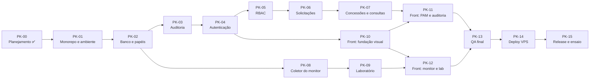

# Roadmap e backlog de packs

> Hoje: **22/10/2026**. Apresentação: **11/11/2026**. São **20 dias**.
> O calendário é uma **hipótese**: depende do tempo disponível para revisar e aprovar cada pack. Ele é revisado ao fim de cada pack.

## 1. Mapa de dependências

## 2. Calendário proposto

| Datas | Packs | Marco |
| --- | --- | --- |
| 22/10 (qua) | PK-00 | Planejamento aprovado |
| 23 a 24/10 | PK-01, PK-02 | `docker compose up` + migrations + testes de banco rodando |
| 25 a 27/10 | PK-03, PK-04 | Login funcionando, com auditoria protegida |
| 28 a 30/10 | PK-05, PK-06, PK-10 | Fluxo pedir → aprovar pela API; shell visual pronto |
| 31/10 a 02/11 | PK-07, PK-11 | **Marco 1:** PAM completo de ponta a ponta na interface |
| 03 a 05/11 | PK-08, PK-09 | Monitor coletando; laboratório rodando |
| 06 a 07/11 | PK-12 | **Marco 2:** dashboard e laboratório animados |
| 08/11 | PK-13 | QA final, E2E e revisão de segurança |
| 09/11 | PK-14 | Deploy na VPS · **congelamento de código** |
| 10/11 | PK-15 | Ensaio completo × 3, release v1.0.0, vídeo de backup |
| **11/11** | — | **Apresentação no InovaTech** |

## 3. Linha de corte do MVP

Se o **Marco 1 atrasar além de 02/11**, cortamos nesta ordem, sem tocar no núcleo acadêmico:

| Prioridade | Itens |
| --- | --- |
| **Must** (não sai) | PK-01 a PK-06, concessões do PK-07, PK-08, PK-09, PK-10, PK-12, ensaio |
| **Should** | Consultas controladas (PK-07b), RLS (PK-06), telas de administração completas (PK-11), deploy na VPS (o plano B é rodar local) |
| **Could** | Cenário de índices no lab, `pg_stat_statements`, exportar a auditoria em CSV, animações extras |
| **Won't** (MVP) | MFA, credenciais efêmeras, particionamento, SSO |

> O laboratório e a auditoria são **Must** porque são o coração da disciplina de persistência. Uma tela bonita a mais nunca vale mais que um deadlock real demonstrado.

## 4. Backlog de packs

Cada pack segue o ciclo **SPEC → implementação → QA → registro**. Um pack só é concluído quando os critérios abaixo são atendidos, com os comandos e resultados anotados no PR.

### PK-00 · Descoberta e planejamento ✅

- **Entregue:** diagnóstico, documentos de `docs/`, identidade visual, validação real do DDL principal num PostgreSQL 16.

### PK-01 · Monorepo e ambiente local ✅

> **Registro de QA (23/10/2026):** `pnpm lint` e `pnpm typecheck` sem erros; `pnpm test` com 8/8 testes passando contra PostgreSQL 16 real; `pnpm build` dos dois apps ok; fluxo navegador → Next → `/api` → Nest → PostgreSQL verificado com o banco no ar (200) e parado (503), com reconexão automática. Teste de mutação: vazar a mensagem do erro no filtro faz o teste correspondente falhar. Decisões do spike em [ADR-018](DECISIONS.md#adr-018--somente-versões-estáveis). `packages/contracts` foi adiado para o PK-04, quando surge o primeiro DTO compartilhado.

- **Objetivo:** qualquer pessoa clona o repositório e roda tudo com poucos comandos.
- **Inclui:** `pnpm-workspace`; `apps/api` (NestJS) e `apps/web` (Next.js) mínimos; `packages/contracts`; TypeScript `strict`; ESLint e Prettier; Vitest; `docker-compose.yml` com PostgreSQL 16 e parâmetros do lab; `.env.example`; `GET /api/health` que consulta o banco; filtro global de erros; `correlation_id`; logger JSON; GitHub Actions (lint, typecheck, test).
- **Spikes (hipóteses a validar):** versões compatíveis entre NestJS, TypeScript e Prisma (fixar versões **estáveis**, sem RC); suporte do Prisma a múltiplos schemas; `SET LOCAL application_name` visível em `pg_stat_activity`.
- **Exclui:** qualquer regra de negócio.
- **Banco:** nenhuma tabela, só a conexão.
- **Testes:** smoke de `/api/health`; teste do filtro de erros.
- **Pronto quando:** `pnpm install && docker compose up -d && pnpm dev` funciona do zero; CI verde.

### PK-02 · Banco base, papéis e harness de testes ✅

> **Registro de QA (23/10/2026):** 17/17 testes contra PostgreSQL 16 real (9 novos de banco: unicidade por `lower(email)`, CHECKs, FK `RESTRICT`, autoatribuição de papel barrada, catálogo de permissões, privilégios negados por papel com `42501`, banco-alvo somente leitura com `25006` e T-MIG-01 sem diferença entre banco e `schema.prisma`). Simulação do CI num PostgreSQL limpo: papéis + migration do zero + suíte verde. Teste de mutação: um `GRANT DELETE` indevido para `dbwatch_app` faz a suíte falhar. O seed de usuários foi para o PK-04 (precisa do hash Argon2id). O banco de testes não é recriado a cada execução: os testes geram dados únicos e as migrations são reaplicadas de forma idempotente.

- **Objetivo:** fundação de persistência com menor privilégio desde o início.
- **Inclui:** `infra/postgres/init` (papéis e bancos); schemas; Prisma schema de `iam` (users, roles, permissions, role_permissions, user_roles); primeira migration; seed; harness `pnpm test:db` contra PostgreSQL real com banco recriado por execução.
- **Banco:** `iam.*`, papéis `dbwatch_migrator`, `dbwatch_app`, `dbwatch_monitor`, `dbwatch_lab`, `dbwatch_target_ro`.
- **Testes:** T-DB-01, T-DB-02, T-DB-12 (grants por papel), T-MIG-01.
- **Pronto quando:** as migrations aplicam do zero e `migrate diff` retorna vazio; testes de banco verdes.

### PK-03 · Auditoria persistente

- **Inclui:** `audit.audit_log`; triggers append-only e de cadeia; `AuditService` (dentro da transação no sucesso, fora dela na falha); `GET /api/audit` paginado por cursor; `GET /api/audit/verify`.
- **Testes:** T-DB-07 a T-DB-11, T-INT-08, T-INT-09.
- **Pronto quando:** a adulteração simulada é detectada num teste automatizado.

### PK-04 · Autenticação

- **Inclui:** Argon2id; `iam.sessions`; login, logout e `GET /api/auth/me`; bloqueio; rate limit; `SessionGuard`; verificação de `Origin`; cabeçalhos de segurança.
- **Testes:** T-AUTH-01 a T-AUTH-08.

### PK-05 · Autorização (RBAC)

- **Inclui:** `PermissionGuard` global (nega por padrão); `@RequirePermission`; CRUD de usuários e atribuição de papéis; proteção do último ADMIN; matriz de autorização gerada a partir das rotas.
- **Testes:** T-SEC-01, T-SEC-02, T-IAM-01 a T-IAM-05.

### PK-06 · Recursos, solicitações e aprovações

- **Inclui:** `pam.resources`, `pam.access_requests`; máquina de estados; CHECKs; aprovação concorrente segura; RLS (*Should*).
- **Testes:** T-PAM-01 a T-PAM-06, T-CONC-01, T-SEC-03, T-SEC-05.

### PK-07 · Concessões e consultas controladas

- **PK-07a (Must):** `pam.access_grants` com EXCLUDE; revogação; job de auditoria das expirações.
- **PK-07b (Should):** `dbwatch_target` com dados fictícios; `pam.query_templates`; executor somente leitura; `pam.query_executions`.
- **Testes:** T-PAM-07 a T-PAM-10, T-DB-05, T-SEC-06.

### PK-08 · Coletor do monitor

- **Inclui:** amostras de `pg_stat_activity`, `pg_locks`, `pg_stat_database` e `pg_stat_user_tables`; `monitor.app_events` via `runInTransaction`; view `event_feed`; endpoints de leitura; SSE; retenção.
- **Testes:** T-MON-01 a T-MON-05.

### PK-09 · Laboratório de concorrência

- **Inclui:** schema `lab`; orquestrador de duas sessões; seis cenários; `lab.runs`; scripts SQL equivalentes em `infra/lab/`.
- **Testes:** T-LAB-01 a T-LAB-06.

### PK-10 · Front: fundação visual

- **Inclui:** tokens de [DESIGN.md](DESIGN.md); fontes locais; modo claro e escuro com troca persistida; layout do console; componentes base (botão, campo, tabela, badge de estado, diálogo, toast); tela de login com a animação do radar; tratamento global de erro e de sessão expirada.
- **Testes:** T-E2E-01 (login), T-A11Y-01 (login e shell).

### PK-11 · Front: PAM e auditoria

- **Inclui:** pedir acesso; meus pedidos; fila de aprovação; meus acessos com contagem regressiva; execução de consultas; explorador da auditoria com verificação de integridade; administração de usuários.
- **Testes:** T-E2E-02 a T-E2E-04.

### PK-12 · Front: monitor e laboratório

- **Inclui:** dashboard (indicadores, séries, sessões); grafo de bloqueio animado; fluxo de eventos ao vivo; laboratório com a linha do tempo A/B.
- **Testes:** T-E2E-05, T-E2E-06.

### PK-13 · QA final

- **Inclui:** suíte completa; navegação exploratória num navegador real com gravação; auditoria de acessibilidade; revisão de segurança do diff completo; teste de carga leve na aprovação concorrente; correções.

### PK-14 · Deploy na VPS *(exige autorização explícita)*

- **Inclui:** compose de produção; Caddy com HTTPS; PostgreSQL sem porta pública; `.env` no servidor; backup com `pg_dump`; checklist de deploy e de rollback.
- **Bloqueado por:** questão Q-1 do [PRD](PRD.md#7-questões-em-aberto).

### PK-15 · Release v1.0.0 e ensaio

- **Inclui:** CHANGELOG; notas de release; README final com capturas de tela; três ensaios do [DEMO.md](DEMO.md); vídeo de backup.

## 5. Status

| Pack | Status | Data |
| --- | --- | --- |
| PK-00 | ✅ Concluído | 22/10/2026 |
| PK-01 | ✅ Concluído | 23/10/2026 |
| PK-02 | ✅ Concluído | 23/10/2026 |
| PK-03 | ⏳ Próximo | — |
| PK-04 a PK-15 | 📋 Planejado | — |
