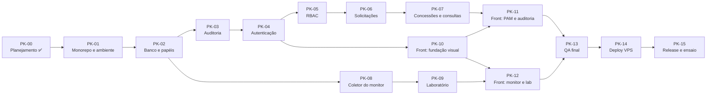

# Roadmap e backlog de packs

> Hoje: **22/10/2026**. Apresentação: **11/11/2026**. São **20 dias**.
> O calendário é uma **hipótese**: depende do tempo disponível para revisar e aprovar cada pack. Ele é revisado ao fim de cada pack.

## 1. Mapa de dependências

## 2. Calendário proposto

> **Revisão de 24/10:** o backend vem primeiro e o front fica para depois, quando todas as regras já estiverem garantidas e testadas na API. O redesenho do front parte de referências visuais escolhidas pelo Gabriel.

| Datas | Packs | Marco |
| --- | --- | --- |
| 22 a 24/10 | PK-00 a PK-04 | Planejamento, ambiente, banco, auditoria e login ✅ |
| 25/10 | PK-05a, PK-05b | Permissões por rota, rotas da auditoria e administração de usuários |
| 25/10 | PK-05c | Sessões ativas e encerrar sessões |
| 25/10 | PK-05d | ACL de login por IP e horário |
| 25/10 | PK-06a | Recursos, pedidos de acesso e fila do aprovador |
| 26 a 31/10 | PK-06b, PK-06c | Aprovar e rejeitar com concorrência segura; 2 níveis para HIGH e RLS |
| 31/10 a 02/11 | PK-07 | **Marco 1:** PAM completo pela API (Swagger) |
| 02 a 04/11 | PK-08 | Monitor coletando, alertas e SSE |
| 04 a 05/11 | PK-09 | Laboratório rodando |
| 05 a 08/11 | PK-10 a PK-12 | **Marco 2:** console com menu lateral, cards e gráficos legíveis |
| 09/11 | PK-13, PK-14 | QA final e deploy na VPS · **congelamento de código** |
| 10/11 | PK-15 | Ensaio completo × 3, release v1.0.0, vídeo de backup |
| **11/11** | — | **Apresentação no InovaTech** |
| Se sobrar tempo | PK-16 | Landing page com motion |

## 3. Linha de corte do MVP

Se o **Marco 1 atrasar além de 02/11**, cortamos nesta ordem, sem tocar no núcleo acadêmico:

| Prioridade | Itens |
| --- | --- |
| **Must** (não sai) | PK-01 a PK-06, concessões do PK-07, PK-08, PK-09, PK-10, PK-12, ensaio |
| **Should** | Consultas controladas (PK-07b), RLS (PK-06), telas de administração completas (PK-11), deploy na VPS (o plano B é rodar local) |
| **Could** | Cenário de índices no lab, `pg_stat_statements`, exportar a auditoria em CSV, animações extras |
| **Won't** (MVP) | MFA, credenciais efêmeras, particionamento, SSO |

> O laboratório e a auditoria são **Must** porque são o coração da disciplina de persistência. Uma tela bonita a mais nunca vale mais que um deadlock real demonstrado.

## 4. Backlog de packs

Cada pack segue o ciclo **SPEC → implementação → QA → registro**. Um pack só é concluído quando os critérios abaixo são atendidos, com os comandos e resultados anotados no PR.

### PK-00 · Descoberta e planejamento ✅

- **Entregue:** diagnóstico, documentos de `docs/`, identidade visual, validação real do DDL principal num PostgreSQL 16.

### PK-01 · Monorepo e ambiente local ✅

> **Registro de QA (23/10/2026):** `pnpm lint` e `pnpm typecheck` sem erros; `pnpm test` com 8/8 testes passando contra PostgreSQL 16 real; `pnpm build` dos dois apps ok; fluxo navegador → Next → `/api` → Nest → PostgreSQL verificado com o banco no ar (200) e parado (503), com reconexão automática. Teste de mutação: vazar a mensagem do erro no filtro faz o teste correspondente falhar. Decisões do spike em [ADR-018](DECISIONS.md#adr-018--somente-versões-estáveis). `packages/contracts` foi adiado para o PK-04, quando surge o primeiro DTO compartilhado.

- **Objetivo:** qualquer pessoa clona o repositório e roda tudo com poucos comandos.
- **Inclui:** `pnpm-workspace`; `apps/api` (NestJS) e `apps/web` (Next.js) mínimos; `packages/contracts`; TypeScript `strict`; ESLint e Prettier; Vitest; `docker-compose.yml` com PostgreSQL 16 e parâmetros do lab; `.env.example`; `GET /api/health` que consulta o banco; filtro global de erros; `correlation_id`; logger JSON; GitHub Actions (lint, typecheck, test).
- **Spikes (hipóteses a validar):** versões compatíveis entre NestJS, TypeScript e Prisma (fixar versões **estáveis**, sem RC); suporte do Prisma a múltiplos schemas; `SET LOCAL application_name` visível em `pg_stat_activity`.
- **Exclui:** qualquer regra de negócio.
- **Banco:** nenhuma tabela, só a conexão.
- **Testes:** smoke de `/api/health`; teste do filtro de erros.
- **Pronto quando:** `pnpm install && docker compose up -d && pnpm dev` funciona do zero; CI verde.

### PK-02 · Banco base, papéis e harness de testes ✅

> **Registro de QA (23/10/2026):** 17/17 testes contra PostgreSQL 16 real (9 novos de banco: unicidade por `lower(email)`, CHECKs, FK `RESTRICT`, autoatribuição de papel barrada, catálogo de permissões, privilégios negados por papel com `42501`, banco-alvo somente leitura com `25006` e T-MIG-01 sem diferença entre banco e `schema.prisma`). Simulação do CI num PostgreSQL limpo: papéis + migration do zero + suíte verde. Teste de mutação: um `GRANT DELETE` indevido para `dbwatch_app` faz a suíte falhar. O seed de usuários foi para o PK-04 (precisa do hash Argon2id). O banco de testes não é recriado a cada execução: os testes geram dados únicos e as migrations são reaplicadas de forma idempotente.

- **Objetivo:** fundação de persistência com menor privilégio desde o início.
- **Inclui:** `infra/postgres/init` (papéis e bancos); schemas; Prisma schema de `iam` (users, roles, permissions, role_permissions, user_roles); primeira migration; seed; harness `pnpm test:db` contra PostgreSQL real com banco recriado por execução.
- **Banco:** `iam.*`, papéis `dbwatch_migrator`, `dbwatch_app`, `dbwatch_monitor`, `dbwatch_lab`, `dbwatch_target_ro`.
- **Testes:** T-DB-01, T-DB-02, T-DB-12 (grants por papel), T-MIG-01.
- **Pronto quando:** as migrations aplicam do zero e `migrate diff` retorna vazio; testes de banco verdes.

### PK-03 · Auditoria persistente ✅

> **Registro de QA (24/10/2026):** 42/42 testes (38 da API, 4 da web): 6 unitários do mapeamento de falhas, 8 de banco (append-only até para o dono da tabela, privilégios por papel, adulteração e remoção de linha detectadas como superusuário em outro fuso, recusa fora de `READ COMMITTED`, 20 inserções concorrentes formando cadeia contínua) e 7 de integração da transação auditada. Testes de mutação: gravar a falha dentro da transação faz 3 testes falharem; um teste quebrado de propósito aparece em vermelho na página `/testes`. O spike do Prisma 7 mostrou que o `DETAIL` do PostgreSQL traz a linha inteira (inclusive hash de senha), por isso a auditoria guarda só SQLSTATE e constraint. **Mudança de escopo:** `GET /api/audit` e `GET /api/audit/verify` foram para o PK-05, porque expor a auditoria antes do guard de permissões violaria o "nega por padrão". Entrou a página `/testes`, que mostra o relatório real da suíte.

- **Inclui:** `audit.audit_log`; triggers append-only e de cadeia; `AuditService` (dentro da transação no sucesso, fora dela na falha); `GET /api/audit` paginado por cursor; `GET /api/audit/verify`.
- **Testes:** T-DB-07 a T-DB-11, T-INT-08, T-INT-09.
- **Pronto quando:** a adulteração simulada é detectada num teste automatizado.

### PK-04 · Autenticação ✅

> **Registro de QA (24/10/2026):** 64/64 testes (60 da API, 4 da web), 22 deles novos: 5 unitários (token, hash, cookie, schema de login e rate limit), 3 de banco em `iam.sessions` (hash de 32 bytes, `DELETE` negado à API, período válido) e 14 de integração cobrindo T-AUTH-01 a T-AUTH-08, T-SEC-04 e T-SEC-07, além do seed e do Swagger. Simulação do CI num PostgreSQL recriado do zero: verde. Testes de mutação: remover o custo do Argon2 para e-mail inexistente, o limite de ociosidade, a checagem de usuário ativo, o ator no contexto da auditoria, o incremento atômico do contador ou o `HttpOnly` do cookie faz um teste falhar em cada caso. Teste manual com a API rodando: login, `/me`, logout e Swagger conferidos com `curl`; nenhuma senha no log.

- **Inclui:** Argon2id; `iam.sessions`; login, logout e `GET /api/auth/me`; bloqueio; rate limit; `SessionGuard`; verificação de `Origin`; cabeçalhos de segurança; Swagger em `/api/docs`; `reason` em cada login negado; `pnpm db:seed` com os usuários de demonstração.
- **Testes:** T-AUTH-01 a T-AUTH-08, T-SEC-04, T-SEC-07.

### PK-05 · Autorização (RBAC)

Dividido em três packs para caber no limite de 400 linhas cada.

#### PK-05a · Permissões por rota e rotas da auditoria ✅

> **Registro de QA (25/10/2026):** 74/74 testes (70 da API, 4 da web), 10 novos, num PostgreSQL de testes recriado do zero: T-SEC-01 (todas as rotas declaram acesso), T-SEC-02 (matriz de 4 rotas × 6 perfis), T-SEC-06 (injeção nos filtros), catálogo de permissões igual ao do banco, rota esquecida negada em execução, negação auditada, papel novo valendo na requisição seguinte, paginação por cursor sem repetir linhas, filtros e verificação da cadeia. Testes de mutação: liberar rota sem decorator, ignorar a permissão, cursor com `<=`, filtro ignorado e schema sem `.strict()` fazem um teste falhar em cada caso. Teste manual com os usuários do seed: a auditora lê e verifica a trilha; a admin recebe 403.

- **Inclui:** guard global que exige `@Public()`, `@Authenticated()` ou `@RequirePermission(...)` em toda rota e nega o resto; permissões carregadas com a sessão a cada requisição; negações auditadas como `authz.denied`; `GET /api/audit` (filtros e paginação por cursor) e `GET /api/audit/verify`.
- **Testes:** T-SEC-01, T-SEC-02, T-SEC-06.

#### PK-05b · Administração de usuários ✅

> **Registro de QA (25/10/2026):** 79/79 testes (75 da API, 4 da web), num PostgreSQL de testes recriado do zero e de novo num banco já usado. Novos: T-IAM-01 a T-IAM-05. O T-IAM-04 abre duas transações reais que removem o papel ADMIN uma da outra: com o trigger, a segunda espera o lock e é barrada (`DW001`). Testes de mutação: **sem o advisory lock, as duas passam e o banco fica sem ADMIN**; desativar sem revogar sessões, não traduzir o `DW001`, não gravar quem deu o papel e aceitar senha curta fazem um teste falhar em cada caso. Teste manual com a admin do seed: criar, dar papel, desativar e tentar remover o próprio papel de única ADMIN (422).

- **Inclui:** criar e desativar usuários (desativar revoga as sessões na mesma transação); atribuir e remover papéis; proteção do último ADMIN com lock; diff antes/depois na auditoria.
- **Testes:** T-IAM-01 a T-IAM-05.

#### PK-05c · Sessões ativas ✅

> **Registro de QA (25/10/2026):** 83/83 testes (79 da API, 4 da web), num PostgreSQL de testes recriado do zero. Novos: listar e encerrar a própria sessão, sessão ociosa fora da lista, sessão de outra pessoa respondendo 404 (sem revelar que existe) e admin derrubando todas as sessões de um usuário com a contagem na auditoria. Testes de mutação: sem o filtro de dono, lista com sessão ociosa, `current` errado e auditoria sem contagem fazem um teste falhar em cada caso. Teste manual: o mesmo usuário em dois navegadores encerra o outro, que passa a receber 401.

- **Inclui:** `GET /api/auth/sessions` e `DELETE /api/auth/sessions/:id` (as próprias), `GET` e `DELETE /api/users/:id/sessions` (admin). A regra de "sessão ativa" é a mesma do login, definida num único lugar.

#### PK-05d · ACL de login ✅

> **Registro de QA (25/10/2026):** 88/88 testes (84 da API, 4 da web), num PostgreSQL de testes recriado do zero e de novo num banco já usado. Novos: decisão por prioridade, faixa, dia da semana e janela em horário de Brasília; CHECKs recusando faixa com bits de host, janela invertida e regra que nega todos sempre; login de IP negado (403 só com a senha certa, auditado); CRUD pela API com o antes e o depois na auditoria; normalização de IPv4 mapeado em IPv6. Testes de mutação: fuso em UTC, prioridade invertida, operador de faixa trocado, login ignorando a ACL, IP sem normalizar e erro sem tradução fazem testes falharem. Teste manual: a admin bloqueia o solicitante na rede local, o login dele recebe 403, e volta a funcionar quando a regra é removida.

- **Inclui:** `iam.login_acl` com índice GiST (`inet_ops`); função `iam.login_acl_decision` no banco; `GET`, `POST` e `DELETE /api/login-acl`; checagem no login depois da senha certa.
- **Decisão:** o Prisma 7 não suporta `cidr`; a coluna é `inet` com uma CHECK `ip_range = network(ip_range)`, que dá a mesma garantia.

### PK-06 · Recursos, solicitações e aprovações

Dividido em três packs para caber no limite de 400 linhas cada.

#### PK-06a · Recursos e pedidos ✅

> **Registro de QA (25/10/2026):** 93/93 testes (89 da API, 4 da web), num PostgreSQL de testes recriado do zero e de novo num banco já usado. Novos: T-PAM-01, T-PAM-02, T-SEC-05, um pendente por pessoa e recurso, fila sem os próprios pedidos e o banco barrando autoaprovação, decisão sem autor e `DELETE`. Testes de mutação: sem o trigger de limites, sem o UNIQUE parcial, sem a CHECK de separação de funções, fila mostrando os próprios pedidos e schema aceitando `status` fazem testes falharem. Teste manual com o seed: o solicitante pede "Clientes", o pedido repetido recebe 409, 90 min num recurso de 60 recebe 422, e o aprovador vê o pedido na fila.

- **Inclui:** schema `pam` com `resources` e `access_requests`; CHECKs (justificativa, duração, separação de funções, decisão com autor); UNIQUE parcial de pendentes; índice parcial da fila; trigger que barra recurso inativo e duração acima do máximo (SQLSTATEs `DW002` e `DW003`); `GET /api/resources`, `POST /api/requests`, `GET /api/requests/mine`, `GET /api/requests/queue`; três recursos fictícios no seed.

#### PK-06b · Aprovar e rejeitar

- **Inclui:** UPDATE condicional; concessão criada na mesma transação; retry automático em `40P01` e `40001`.
- **Testes:** T-PAM-03 a T-PAM-06, T-CONC-01.

#### PK-06c · Aprovação em 2 níveis e RLS

- **Inclui:** dois aprovadores diferentes para recursos HIGH; RLS em `access_requests` (*Should*).
- **Testes:** T-SEC-03.

### PK-07 · Concessões e consultas controladas

- **PK-07a (Must):** `pam.access_grants` com EXCLUDE; revogação; job de auditoria das expirações; aviso antes de expirar; break-glass (*Could*).
- **PK-07b (Should):** `dbwatch_target` com dados fictícios; `pam.query_templates`; executor somente leitura; `pam.query_executions`.
- **Testes:** T-PAM-07 a T-PAM-10, T-DB-05, T-SEC-06.

### PK-08 · Coletor do monitor

- **Inclui:** amostras de `pg_stat_activity`, `pg_locks`, `pg_stat_database` e `pg_stat_user_tables`; `monitor.app_events` via `runInTransaction`; view `event_feed`; endpoints de leitura; SSE; retenção; alertas (lock acima de 5 s, transação parada, deadlock novo).
- **Testes:** T-MON-01 a T-MON-05.

### PK-09 · Laboratório de concorrência

- **Inclui:** schema `lab`; orquestrador de duas sessões; seis cenários; `lab.runs`; scripts SQL equivalentes em `infra/lab/`.
- **Testes:** T-LAB-01 a T-LAB-06.

### PK-10 · Front: fundação visual

- **Inclui:** tokens de [DESIGN.md](DESIGN.md); fontes locais; modo claro e escuro com troca persistida; layout do console; componentes base (botão, campo, tabela, badge de estado, diálogo, toast); tela de login com a animação do radar; tratamento global de erro e de sessão expirada.
- **Testes:** T-E2E-01 (login), T-A11Y-01 (login e shell).

### PK-11 · Front: PAM e auditoria

- **Inclui:** pedir acesso; meus pedidos; fila de aprovação; meus acessos com contagem regressiva; execução de consultas; explorador da auditoria com verificação de integridade; administração de usuários.
- **Testes:** T-E2E-02 a T-E2E-04.

### PK-12 · Front: monitor e laboratório

- **Inclui:** dashboard (indicadores, séries, sessões); grafo de bloqueio animado; fluxo de eventos ao vivo; laboratório com a linha do tempo A/B.
- **Testes:** T-E2E-05, T-E2E-06.

### PK-13 · QA final

- **Inclui:** suíte completa; navegação exploratória num navegador real com gravação; auditoria de acessibilidade; revisão de segurança do diff completo; teste de carga leve na aprovação concorrente; correções.

### PK-14 · Deploy na VPS *(exige autorização explícita)*

- **Inclui:** compose de produção; Caddy com HTTPS; PostgreSQL sem porta pública; `.env` no servidor; backup com `pg_dump`; checklist de deploy e de rollback.
- **Bloqueado por:** questão Q-1 do [PRD](PRD.md#7-questões-em-aberto).

### PK-15 · Release v1.0.0 e ensaio

- **Inclui:** CHANGELOG; notas de release; README final com capturas de tela; três ensaios do [DEMO.md](DEMO.md); vídeo de backup.

### PK-16 · Landing page *(se sobrar tempo)*

- **Inclui:** página pública de apresentação do projeto, com motion.

> **Referência estudada:** o JumpServer (PAM de código aberto, GPL v3) foi lido só como fonte de **ideias**; nenhum código foi copiado. As ideias aproveitadas aparecem nos packs acima. Ver [ADR-022](DECISIONS.md#adr-022--jumpserver-só-como-referência-de-ideias).

## 5. Status

| Pack | Status | Data |
| --- | --- | --- |
| PK-00 | ✅ Concluído | 22/10/2026 |
| PK-01 | ✅ Concluído | 23/10/2026 |
| PK-02 | ✅ Concluído | 23/10/2026 |
| PK-03 | ✅ Concluído | 24/10/2026 |
| PK-04 | ✅ Concluído | 24/10/2026 |
| PK-05a | ✅ Concluído | 25/10/2026 |
| PK-05b | ✅ Concluído | 25/10/2026 |
| PK-05c | ✅ Concluído | 25/10/2026 |
| PK-05d | ✅ Concluído | 25/10/2026 |
| PK-06a | ✅ Concluído | 25/10/2026 |
| PK-06b | ⏳ Próximo | — |
| PK-06c | 📋 Planejado | — |
| PK-07 a PK-16 | 📋 Planejado | — |
