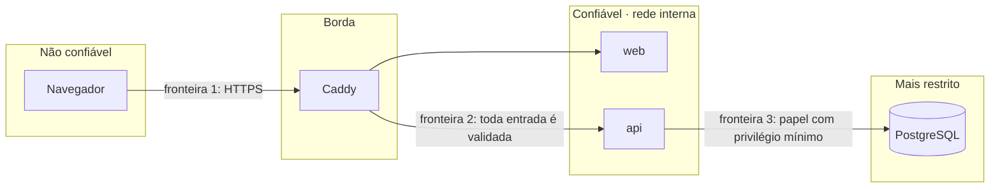

# Segurança

> Status: **proposta para aprovação** (PK-00). Cada controle tem um pack responsável e testes previstos em [TEST_PLAN.md](TEST_PLAN.md).

## 1. Princípios

1. **O backend nunca confia no front-end.** Toda regra é verificada na API. A interface só melhora a usabilidade.
2. **Nega por padrão.** Uma rota sem permissão declarada não responde.
3. **Defesa em profundidade.** As regras críticas existem na API **e** no banco (constraints, triggers, grants, RLS).
4. **Menor privilégio**, tanto nos papéis da aplicação quanto nos papéis do PostgreSQL.
5. **Nada sensível em log:** senhas, tokens, valores de parâmetros de consultas e cookies nunca são registrados.
6. **Falha segura.** Na dúvida (sessão inválida, erro na verificação de permissão), a resposta é negar e registrar.
7. **Honestidade sobre limites.** O que não está implementado ou não é garantido aparece em [Limites conhecidos](#7-limites-conhecidos).

## 2. Ativos e fronteiras de confiança

| Ativo | Por que importa |
| --- | --- |
| Dados do banco-alvo (fictícios, mas tratados como sensíveis) | É o que o PAM protege |
| Concessões de acesso | Quem tem uma concessão ativa lê dados do alvo |
| Trilha de auditoria | Prova do que aconteceu. Se for adulterada, perde o valor |
| Credenciais (senhas, sessões, senhas dos papéis do banco) | Dão acesso a todo o resto |

## 3. Modelo de ameaças (STRIDE)

| Categoria | Ameaça | Controle | Pack | Teste |
| --- | --- | --- | --- | --- |
| **S**poofing | Força bruta ou *credential stuffing* no login | Argon2id; bloqueio progressivo por conta (5 falhas → 15 min) persistido no banco; rate limit por IP; mensagem genérica ("credenciais inválidas") | PK-04 | T-AUTH-03, T-AUTH-04 |
| **S**poofing | Roubo do cookie de sessão | `HttpOnly`, `Secure`, `SameSite=Strict`; só o hash SHA-256 do token fica no banco; expiração por inatividade de 30 min e absoluta de 8 h | PK-04 | T-AUTH-06 |
| **S**poofing | Fixação de sessão | Novo token gerado a cada login. Tokens anteriores ao login não são aceitos | PK-04 | T-AUTH-07 |
| **T**ampering | Alteração da auditoria | `GRANT` mínimo, triggers append-only, cadeia de hash verificável | PK-03 | T-DB-07 a T-DB-11 |
| **T**ampering | *Mass assignment* (enviar `status: "APPROVED"` ao criar um pedido) | Schemas Zod `.strict()`; DTOs de entrada separados das entidades | PK-06 | T-SEC-05 |
| **T**ampering | SQL injection | Prisma e `pg` sempre parametrizados; nenhum SQL concatenado com entrada do usuário; catálogo de consultas fixo | Todos | T-SEC-06 |
| **R**epudiation | "Eu não aprovei isso" | Toda ação relevante é auditada com ator, momento, resultado e `correlation_id`; a auditoria de sucesso é gravada na mesma transação da ação | PK-03 | T-INT-08 |
| **I**nformation disclosure | IDOR: ver o pedido de outra pessoa trocando o ID | Verificação de dono no serviço + RLS no banco | PK-06 | T-SEC-03 |
| **I**nformation disclosure | Erro que expõe stack trace ou SQL | Filtro global devolve só código, mensagem neutra e `correlation_id` | PK-01 | T-SEC-08 |
| **I**nformation disclosure | Queries com literais sensíveis gravadas pelo monitor | O texto das queries não é armazenado | PK-08 | T-MON-04 |
| **I**nformation disclosure | Enumeração de usuários pelo login | Resposta e tempo equivalentes para usuário inexistente (hash de uma senha fictícia) | PK-04 | T-AUTH-05 |
| **D**enial of service | Consulta pesada no banco-alvo | `statement_timeout`, `LIMIT` e transação somente leitura | PK-07 | T-PAM-09 |
| **D**enial of service | Laboratório travando o banco | Papel isolado com timeouts; um experimento por vez (advisory lock) | PK-09 | T-LAB-06 |
| **E**levation of privilege | Usuário comum chamando rota de administrador | Guard global que nega por padrão + matriz de autorização testada para todas as rotas | PK-05 | T-SEC-01, T-SEC-02 |
| **E**levation of privilege | Autoaprovação | Regra no serviço + `CHECK` no banco | PK-06 | T-PAM-03, T-DB-03 |
| **E**levation of privilege | Aplicação comprometida apagando provas | O papel `dbwatch_app` não tem `UPDATE` nem `DELETE` na auditoria nem DDL | PK-02 | T-DB-09 |
| **E**levation of privilege | Administrador se dando acesso ao alvo sem aprovação | Nem o `ADMIN` aprova o próprio pedido; atribuição de papéis é auditada | PK-05/06 | T-PAM-04 |

## 4. Autenticação

| Item | Decisão |
| --- | --- |
| Hash de senha | **Argon2id**, parâmetros do OWASP Password Storage Cheat Sheet (memória ≥ 19 MiB, `t = 2`, `p = 1`). Os parâmetros ficam no próprio hash, o que permite aumentá-los no futuro |
| Política de senha | Mínimo de 12 caracteres, sem regras de composição forçada (seguindo o NIST 800-63B). Bloqueio de senhas iguais ao e-mail |
| Sessão | Token aleatório de 32 bytes (`crypto.randomBytes`), enviado só no cookie; no banco fica `sha256(token)` |
| Cookie | `__Host-dbwatch_session`; `HttpOnly; Secure; SameSite=Strict; Path=/` |
| Expiração | 30 min de inatividade e 8 h absolutas. `last_seen_at` é atualizado no máximo uma vez por minuto, para não gerar escrita a cada requisição |
| Logout | Revoga a sessão no banco (`revoked_at`) e apaga o cookie |
| Encerrar sessões | O administrador pode revogar todas as sessões de um usuário. Desativar um usuário revoga suas sessões na mesma transação |
| Bloqueio | `failed_login_count` e `locked_until` em `iam.users`, atualizados com `UPDATE … RETURNING` atômico. Tentativas são auditadas |

> **Por que sessão no servidor e não JWT?** Num PAM, revogar um acesso precisa ter efeito **imediato**. Um JWT continua válido até expirar. Com a sessão no banco, revogar é um `UPDATE`, e a próxima requisição já é recusada. Ver ADR-005 em [DECISIONS.md](DECISIONS.md).

## 5. Autorização (RBAC)

### Papéis e permissões iniciais

| Permissão | ADMIN | APPROVER | REQUESTER | AUDITOR |
| --- | :-: | :-: | :-: | :-: |
| `request:create` | ✅ | ✅ | ✅ | — |
| `request:read:own` | ✅ | ✅ | ✅ | — |
| `request:review` (ver a fila, aprovar, rejeitar) | — | ✅ | — | — |
| `grant:read:own` | ✅ | ✅ | ✅ | — |
| `grant:revoke` | ✅ | ✅ | — | — |
| `query:execute` (exige uma concessão ativa) | ✅ | ✅ | ✅ | — |
| `user:manage` | ✅ | — | — | — |
| `role:assign` | ✅ | — | — | — |
| `audit:read` | — | — | — | ✅ |
| `audit:verify` | — | — | — | ✅ |
| `monitor:read` | ✅ | ✅ | — | ✅ |
| `lab:run` | ✅ | — | — | — |

Observações:

- **O `ADMIN` não lê a auditoria por padrão.** Quem administra não deveria ser quem fiscaliza (separação de funções). Um usuário pode ter os dois papéis, mas essa atribuição fica registrada.
- Um usuário pode ter vários papéis; as permissões efetivas são a união delas.
- As permissões são carregadas por sessão e reavaliadas a cada requisição, e não guardadas no cliente.

## 6. Segredos e ambientes

- **Somente `.env.example` é versionado**, com valores de exemplo óbvios (`troque-esta-senha`).
- Cada papel do banco tem **senha própria**. Vazar a URL do monitor não dá escrita no domínio.
- Na VPS, o `.env` fica com permissão `600`, fora do diretório servido.
- **Dados reais nunca são usados**: o banco-alvo e o seed são fictícios.
- **Logs** estruturados em JSON, com uma lista de campos proibidos (`password`, `token`, `cookie`, `authorization`, `params`) removidos antes da escrita.
- **Dependências:** `pnpm audit` no CI; versões fixadas no lockfile.
- **Cabeçalhos HTTP:** `Content-Security-Policy` restritiva, `X-Content-Type-Options: nosniff`, `Referrer-Policy: same-origin`, `Strict-Transport-Security` na VPS e `frame-ancestors 'none'`.

## 7. Limites conhecidos

| Limite | Impacto | Possível evolução |
| --- | --- | --- |
| O `DETAIL` dos erros do PostgreSQL traz a linha inteira que falhou (inclusive `password_hash`) | Registrar a mensagem completa vazaria dados na auditoria e nos logs | **Mitigado no PK-03:** a auditoria e os logs guardam só SQLSTATE e nome da constraint; teste unitário garante |
| Um superusuário do PostgreSQL pode desabilitar triggers e alterar a auditoria | A alteração é **detectada** pela cadeia de hash, mas não impedida | Ancorar o último hash fora do banco periodicamente |
| A cadeia de hash não detecta a remoção das **últimas** linhas (truncar o final) | Um atacante com superusuário pode apagar o final da cadeia sem quebrar o que sobra | Âncora externa com o hash e a posição mais recentes |
| Sem MFA no MVP | Uma senha forte é o único fator | TOTP como evolução natural |
| Instância única na VPS | Sem alta disponibilidade | Fora do escopo acadêmico |
| As consultas controladas não substituem um proxy de banco real | O usuário não usa o próprio cliente SQL | Credenciais efêmeras (ver ARCHITECTURE §3.6) |

## 8. Como reportar um problema

Este é um projeto acadêmico. Se você encontrar uma vulnerabilidade, abra uma *issue* sem detalhes exploráveis e peça contato com o mantenedor.
